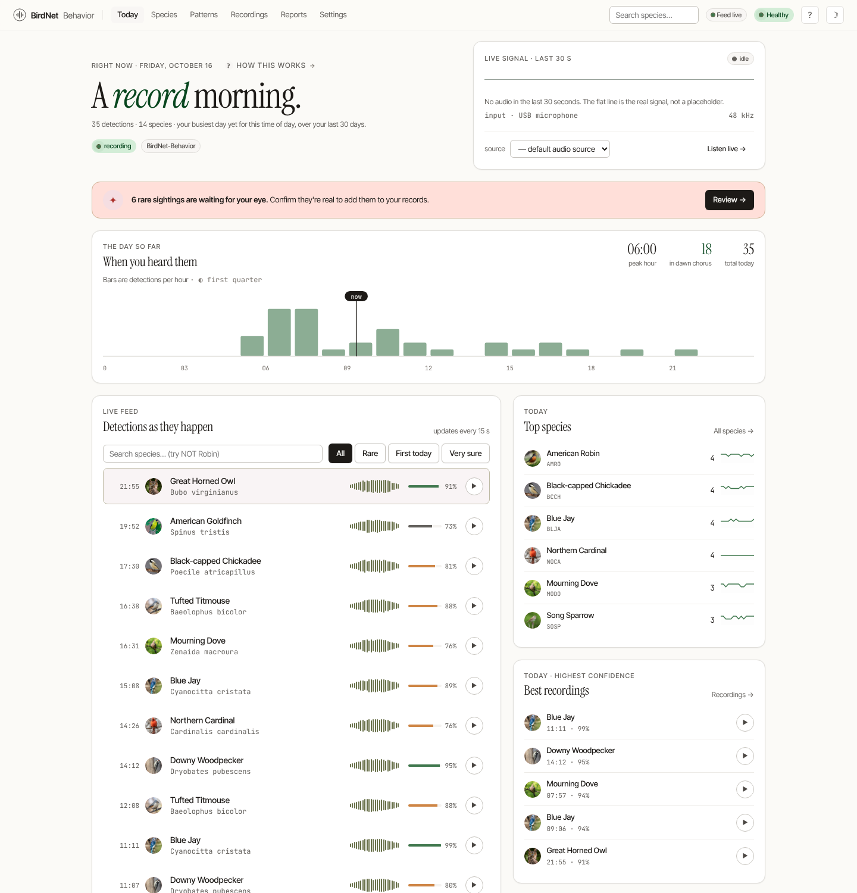
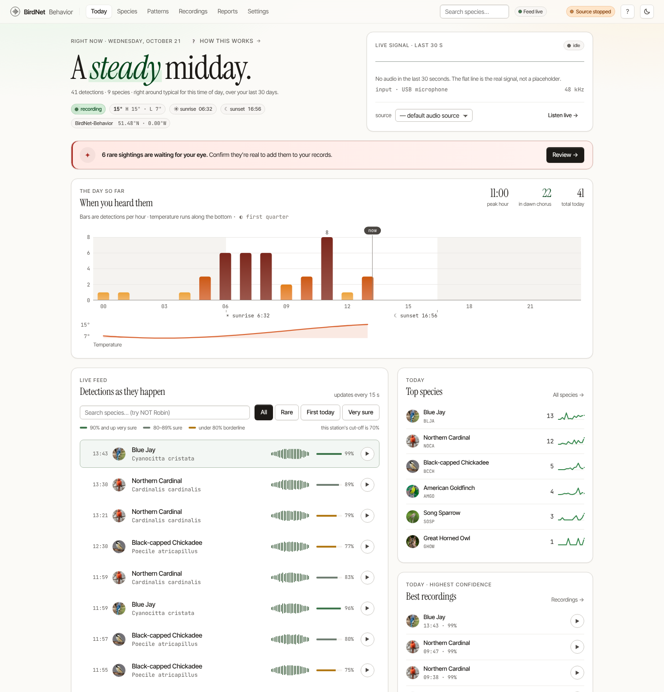
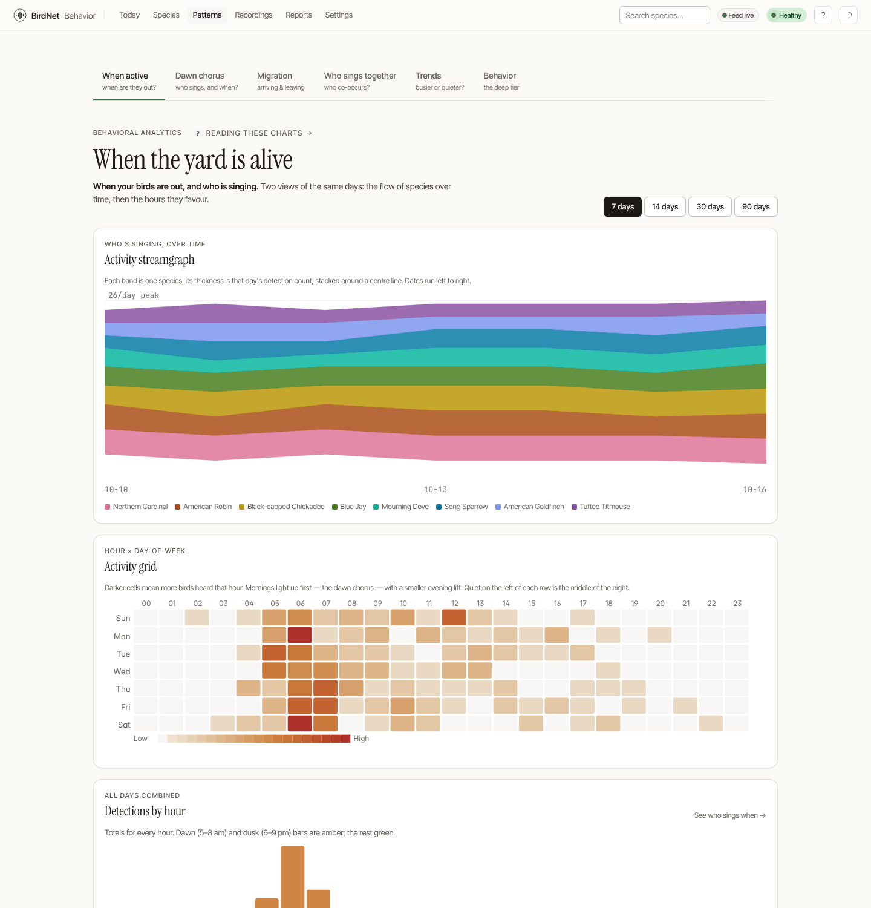
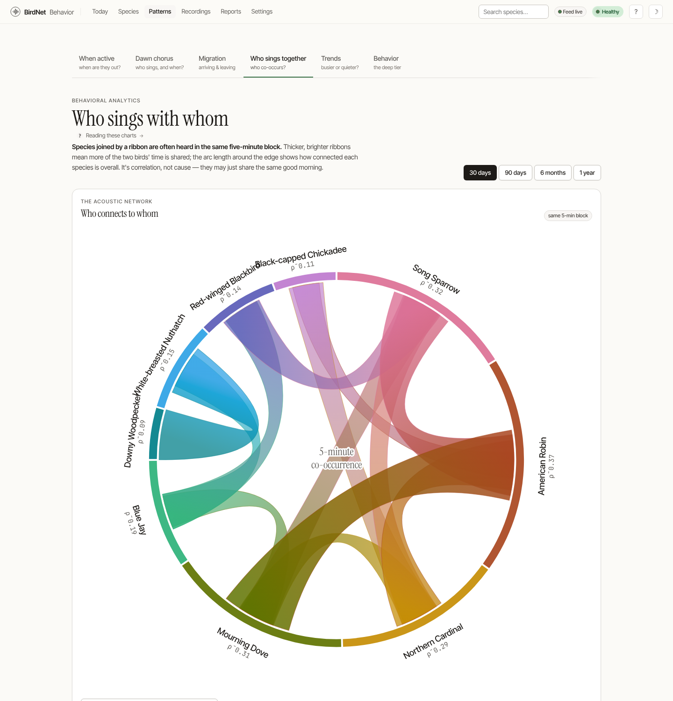
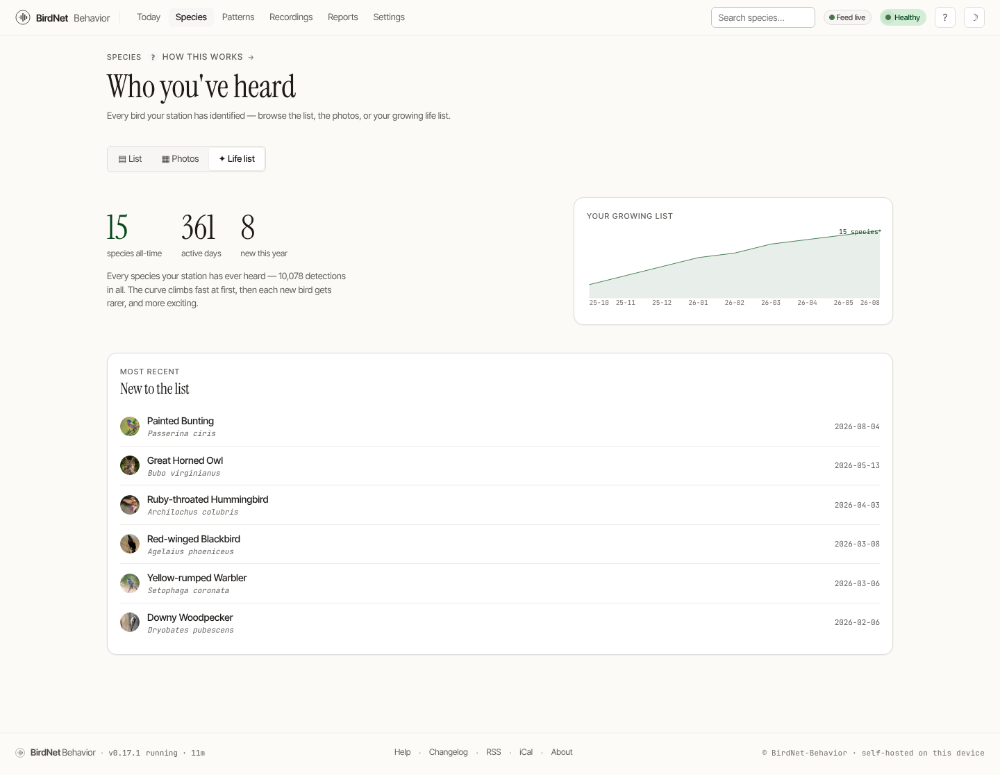
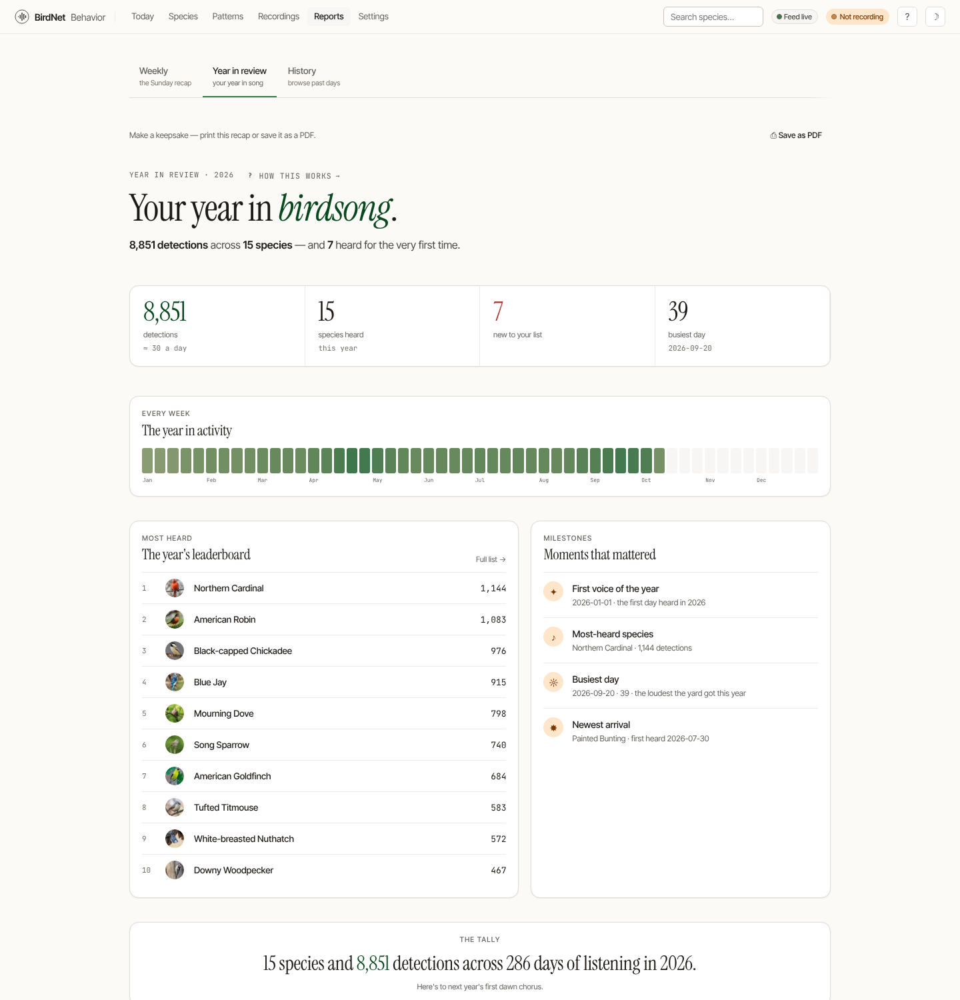
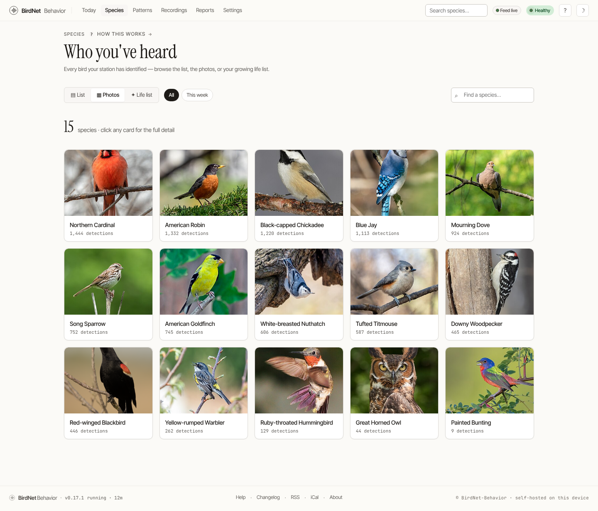
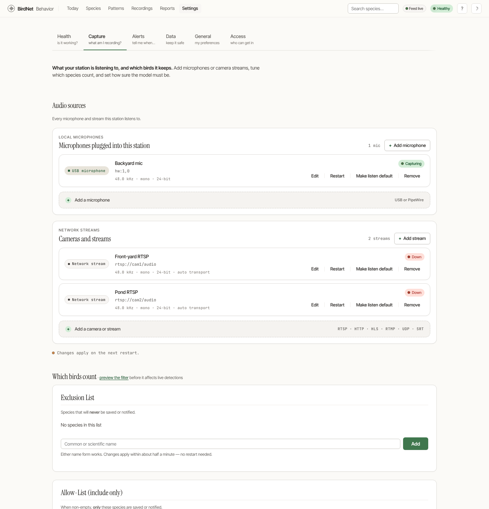
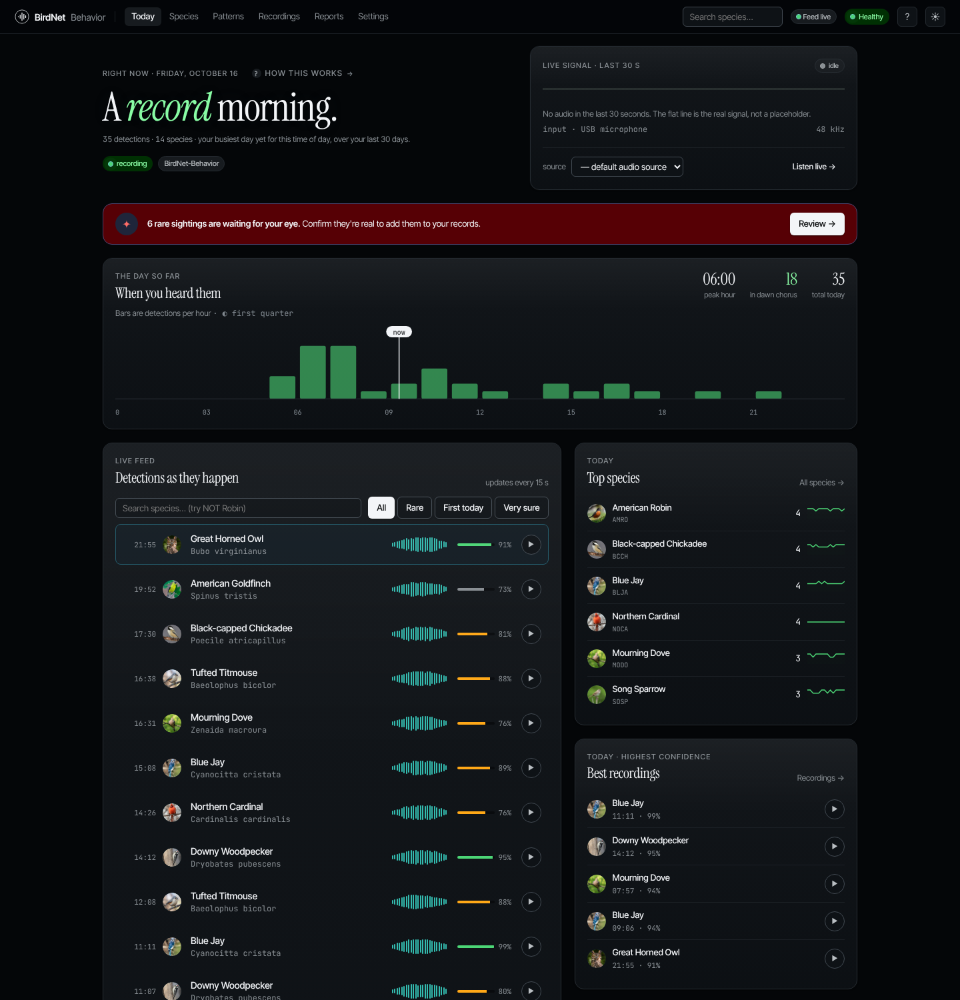
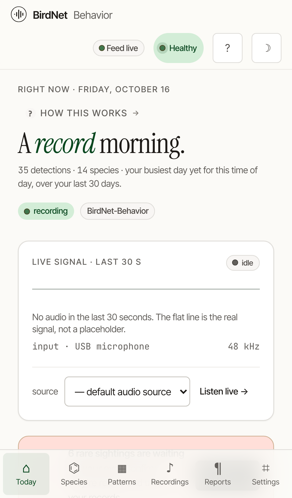

<h1 align="center">BirdNet-Behavior</h1>
<p align="center">Real-time acoustic bird classification with behavioral analytics — written in Rust, runs on a Raspberry Pi.</p>

<p align="center">
  <a href="https://github.com/tomtom215/BirdNet-Behavior/actions/workflows/ci.yml"></a>
  <a href="https://github.com/tomtom215/BirdNet-Behavior/actions/workflows/coverage.yml"></a>
  <a href="https://github.com/tomtom215/BirdNet-Behavior/actions/workflows/supply-chain.yml"></a>
</p>
<p align="center">
  <a href="https://creativecommons.org/licenses/by-nc-sa/4.0/"></a>
  
  
  
  
  
  
</p>

<p align="center">
  <strong>📖 <a href="https://tomtom215.github.io/BirdNet-Behavior/">Read the documentation</a></strong>
  &nbsp;·&nbsp; <a href="docs/book/getting-started/installation.md">Install</a>
  &nbsp;·&nbsp; <a href="docs/book/getting-started/docker.md">Docker</a>
  &nbsp;·&nbsp; <a href="docs/book/guide/today.md">Field Guide</a>
  &nbsp;·&nbsp; <a href="docs/book/guides/troubleshooting.md">Troubleshooting</a>
</p>

> [!IMPORTANT]
> BirdNet-Behavior is licensed **CC BY-NC-SA 4.0** — the same terms as the upstream BirdNET model and BirdNET-Pi.
> **You may not use this project to build a commercial product.** See [LICENSE](LICENSE) for details.

> [!NOTE]
> **This README describes the development tree (`main`), not a release.** The install commands below fetch the **latest release** — `v0.17.1` on 2026-10-20 — and the container image tagged `latest` is that release's. Anything this README describes that is newer than `v0.17.1` is marked *(unreleased)*; the main one is the default classifier: `v0.17.1` installs the BirdNET+ V3.0 preview for everyone and has no `--classifier` flag. Links to the manual are to the files in this tree, so they match the commit you are reading. The manual for the release you installed is at the [site root](https://tomtom215.github.io/BirdNet-Behavior/); the one for this tree is under [`/dev/`](https://tomtom215.github.io/BirdNet-Behavior/dev/); releases from `v0.17.1` on also have a `/vX.Y.Z/` manual ([how the manual is versioned](docs/README.md#how-the-manual-is-versioned)).

<p align="center">
  
</p>

---

## What is BirdNet-Behavior?

A rewrite of [BirdNET-Pi](https://github.com/mcguirepr89/BirdNET-Pi) in Rust, derived from it and licensed accordingly. It listens to a USB microphone or RTSP stream, identifies birds in real time with a BirdNET neural network — BirdNET V2.4, the network BirdNET-Pi runs, by default *(unreleased: `v0.17.1` installs the BirdNET+ V3.0 preview, which remains an option)* — and serves a fast, responsive web dashboard you open in any browser.

It ships as **one self-contained binary** — about 100 MB (the stripped binaries in the `v0.17.1` release archives are 107 488 608 bytes on x86_64 and 99 158 736 on aarch64; the archives you download are 45.2 and 43.0 MB). The ONNX Runtime inference engine and the DuckDB analytics engine are compiled in — there is no Python, no `pip`, no virtualenv, and nothing else to install. The binary links against the host's system C library, so it targets modern 64-bit Linux (**glibc ≥ 2.39** — Raspberry Pi OS Trixie, Debian 13, Ubuntu 24.04); a Docker image carries its own runtime for everything older. Upgrading is replacing one file.

> **It is a rewrite, and it is derived from BirdNET-Pi** (the repository's [LICENSE](LICENSE) says so), which is why it carries the same licence. See [Credits & Attribution](#credits--attribution).

### How it compares to BirdNET-Pi

|  | BirdNET-Pi (Python) | BirdNet-Behavior (Rust) |
|---|---|---|
| Runtime | CPython interpreter + virtualenv | One native binary — no interpreter |
| Install | `pip` into a venv + system packages | one file, or one `curl` installer |
| Upgrade | re-resolve pip dependencies | replace one file |
| Inference | TensorFlow Lite (Python) | ONNX Runtime, linked in-process |
| Detection model | BirdNET V2.4 | BirdNET V2.4 by default for a new install, with BirdNET-Pi's defaults, [measured against BirdNET-Pi](docs/book/guides/parity.md); BirdNET+ V3.0 preview with `--classifier birdnet-v3` *(unreleased; `v0.17.1` installs V3.0 for everyone)* |
| Analytics | — | DuckDB behavioral engine, built in |
| HTTPS | reverse proxy (Caddy/nginx) | built in — `--tls-mode self-signed` or your own certificate |
| Offsite backups | copy them yourself | built in — encrypted on the station, to S3-compatible or SFTP |
| Sound levels | — | ISO 266 third-octave spectrum, IEC 61672 A-weighted |
| Per-source audio filtering | two fixed toggles | a parametric chain, with the response curve drawn as you type |
| Behind a path (`/birdnet`) | own subdomain or port | `BIRDNET_BASE_PATH` |
| Each release ships | — | signed SLSA provenance + CycloneDX SBOM |

Every BirdNET build is dominated by the model itself — its weights cost the same memory whichever runtime loads them. What Rust removes is the overhead *around* the model: no interpreter to warm up, no virtualenv, no GIL serializing the request path. Audio capture and the detection loop run on a dedicated thread; the web server answers requests concurrently on a single Tokio runtime. It runs comfortably on a 2 GB Raspberry Pi.

---

## Screenshots

Every screen leads with a plain-English headline, then layers the dense numbers beneath — designed to serve a casual hobbyist and a PhD ornithologist at once. Light + dark themes, fully responsive.

<table>
  <tr>
    <td width="50%"><a href="docs/book/guide/today.md"></a><br><sub><b>Today</b> — live signal, day strip + unified detection log</sub></td>
    <td width="50%"><a href="docs/book/guide/patterns.md"></a><br><sub><b>Patterns</b> — heatmap, circadian polar, ridgeline, trends</sub></td>
  </tr>
  <tr>
    <td><a href="docs/book/guide/patterns.md"></a><br><sub><b>Co-occurrence</b> — matrix + acoustic-network chord diagram</sub></td>
    <td><a href="docs/book/guide/species.md"></a><br><sub><b>Life List</b> — birding journal with a growth curve</sub></td>
  </tr>
  <tr>
    <td><a href="docs/book/guide/reports.md"></a><br><sub><b>Reports</b> — weekly recap, year in review, history</sub></td>
    <td><a href="docs/book/guide/species.md"></a><br><sub><b>Gallery</b> — the Species → Photos view</sub></td>
  </tr>
  <tr>
    <td><a href="docs/book/admin/audio.md"></a><br><sub><b>Audio setup</b> — USB + RTSP mic management</sub></td>
    <td><a href="docs/book/guide/today.md"></a><br><sub><b>Dark mode</b> — a cool observatory theme</sub></td>
  </tr>
</table>

### On the phone

The same design system, with all six homes on a bottom tab-bar — iPhone 13 captures.

<table>
  <tr>
    <td width="50%"><br><sub><b>Today</b> — bottom tab-bar, live signal, top species</sub></td>
    <td width="50%"><br><sub><b>Detection log</b> — searchable, hourly day strip, swipe-friendly</sub></td>
  </tr>
</table>

➡️ **See every screen in the [Field Guide](docs/book/guide/today.md)** — every PNG above has a matching `docs/book/images/mobile/` capture for the same data and chrome at iPhone 13 width.

---

## Quick start

Both ways below are one command; choose by host. **On a Raspberry Pi (OS Trixie) or modern x86_64 Linux, install the native binary: nothing else needs setting up.** It downloads and sha256-verifies the binary, installs the classifier (see below), auto-detects your USB mic, asks for your location, and starts a hardened systemd service:

```bash
curl --proto '=https' --tlsv1.2 -fsSL https://github.com/tomtom215/BirdNet-Behavior/releases/latest/download/install.sh | sudo bash
```

> Run it exactly as shown — pipe into `sudo bash`, **not** `sudo bash <(curl …)` (the process-substitution form breaks under `sudo`). On a fresh 64-bit Raspberry Pi OS **Trixie** image the prebuilt binary runs as-is (glibc 2.39); the installer refuses early, with guidance, on anything older.

**Prefer Docker?** Use it if you're on **older Pi OS (Bookworm, glibc 2.36)** — the native binary won't run there — or you just want a container; it bundles its own runtime, so the host OS version doesn't matter. Raspberry Pi OS doesn't ship Docker, so install [Docker Engine](https://docs.docker.com/engine/install/) first (`curl -fsSL https://get.docker.com | sudo sh`), then run the one-liner below. It auto-detects your USB mic, asks for your location, writes a minimal `.env`, and starts the container. (The script and the compose files are fetched from `main`, but the image they pull is the `latest` release's, so until the next release a new container runs what `v0.17.1` runs.)

```bash
bash <(curl -fsSL https://raw.githubusercontent.com/tomtom215/BirdNet-Behavior/main/quickstart.sh)
```

**macOS (Apple Silicon)** — the same installer detects macOS and sets up a per-user launchd LaunchAgent instead of systemd (**no `sudo`**):

```bash
curl --proto '=https' --tlsv1.2 -fsSL https://github.com/tomtom215/BirdNet-Behavior/releases/latest/download/install.sh | bash
```

> On macOS it installs the `aarch64-apple-darwin` build that the release workflow publishes for each version (`v0.17.1` has one); if that asset is missing for the version it resolved, it offers to `brew install` the dependencies and prints the one-time source-build steps. A Homebrew formula is planned. macOS is a **preview**: the macOS paths are not yet confirmed on hardware. (See [docs/book/field/macos.md](docs/book/field/macos.md).)

**Which model.** *(Unreleased: `v0.17.1` installs the V3.0 preview, 541 MB, from this project's GitHub release with a Zenodo fallback, and has no choice.)* A new install runs **BirdNET V2.4 and its v2 range filter** (about 85 MB), installed by the binary itself (`birdnet-behavior --install-model birdnet-v24`, then `birdnet-v24-range-v2`) and checked against SHA-256 values compiled into it. Those files come from Hugging Face and `raw.githubusercontent.com`, not from this project's releases, so a default install needs those two hosts as well as GitHub; it is offline-capable afterwards. The BirdNET+ V3.0 preview is a choice, `--classifier birdnet-v3` (or `BIRDNET_CLASSIFIER=birdnet-v3`, also read by the container and by `quickstart.sh`); an existing station keeps the model its configuration names, and a Docker volume that holds the V3.0 model keeps it. [Installation](docs/book/getting-started/installation.md#which-classifier-a-new-install-runs) has the rules and the origins. When it's ready, open **<http://localhost:8502>** — or, from another device on your LAN, `http://<hostname>.local:8502` (or `http://<pi-ip>:8502` by IP; the installer prints both, and the dashboard binds to all interfaces by default). Viewing is open; **anything that changes something** — the `/admin` panel, and deleting, relabelling, reviewing or locking a detection — needs a login. The bare-metal installer auto-generates that admin password (sign in as `admin`) and prints it once in its summary — save it. To restrict the dashboard to the machine itself, set `BIRDNET_LISTEN=127.0.0.1:8502`.

**Uninstall** (`uninstall.sh` ships inside the release tarball and as a standalone release asset). It removes only the software by default — your database, recordings, and settings are kept unless you opt in:

```bash
sudo ./uninstall.sh              # remove the service + binary, KEEP all data
sudo ./uninstall.sh --dry-run    # preview exactly what would change
sudo ./uninstall.sh --purge      # remove everything, including data + model
```

📖 Full instructions: [Installation](docs/book/getting-started/installation.md) · [Docker guide](docs/book/getting-started/docker.md) · [Configuration](docs/book/getting-started/configuration.md)

---

## Supported hardware & OS

| Platform | Status | Notes |
|---|---|---|
| **Raspberry Pi 5 / 4B / 400** (64-bit) | ✅ Recommended | 64-bit Raspberry Pi OS **Trixie** |
| **x86_64 Linux** | ✅ Supported | glibc ≥ 2.39 (Debian 13 / Ubuntu 24.04+) |
| **Pi OS Bookworm** (glibc 2.36) | ⚠️ Docker only | Native binary needs glibc ≥ 2.39 — use Docker (bundles its own runtime) or upgrade to Trixie |
| **macOS, Apple silicon** | ⚠️ Preview | A release binary is built (`aarch64-apple-darwin`); the macOS paths are not yet confirmed on hardware. [macOS guide](docs/book/field/macos.md) |
| **Pi 3 / Zero 2 W on 32-bit OS** (armv7) | ❌ | No prebuilt ONNX Runtime — reflash with 64-bit Pi OS |
| **Pi 3B+ / Zero 2 W on 64-bit OS** | ❌ Not a supported target | [STABILITY.md](STABILITY.md) lists the Pi 4, 5 and 400; no test on these boards is recorded, and they have 1 GB and 512 MB of RAM |

**Runtime requirement: glibc ≥ 2.39** (Pi OS Trixie / Debian 13 / Ubuntu 24.04). The prebuilt binaries are built on Ubuntu 24.04 to match pyke's ONNX Runtime baseline; `install.sh` refuses to install on an older glibc and points you to Docker. Every prebuilt binary and the Docker image ship the DuckDB behavioral-analytics engine **built in and on by default** — the installer and Docker compose set the analytics database path automatically (a manual binary run defaults to `<database>.duckdb` beside the SQLite file, and `--analytics-db` overrides that path; build with `--no-default-features` to omit the engine).

---

## Features

**Everything BirdNET-Pi does** — real-time detection from a USB mic or RTSP stream, with BirdNET V2.4 (or the BirdNET+ V3.0 preview), a SQLite detection database, per-species pages, Apprise notifications (Telegram, Slack, Discord, and dozens more), BirdWeather uploads, email alerts, CSV/JSON/eBird export, web-based admin, database backup/restore, and a password-protected admin panel (a session-cookie login at `/login`; viewing stays open) — **plus** the multi-source capture (USB + PipeWire + many RTSP at once), per-stream supervision, and offline-resilient uploads covered in [Built for the field](#built-for-the-field--and-for-research) below.

**New in BirdNet-Behavior:**

- **A redesigned UI** — two-dozen-plus screens, OKLCH light/dark themes, self-hosted fonts, bespoke SVG visualizations (streamgraph, circadian polar, co-occurrence chord diagram, migration ridgeline, DayStrip), fully responsive down to a phone.
- **Behavioral analytics** (built into every release, on by default; `--no-default-features` to omit) — activity sessions, resident vs. migrant classification, dawn-chorus validation, species co-occurrence, migration phenology.
- **IoT / Home Automation** — pure-Rust MQTT 3.1.1 publishing with Home Assistant auto-discovery.
- **Editorial reports** — a Weekly Report and a celebratory Year in Review.
- **Share & follow** — a per-detection [detail page](docs/book/guide/sharing.md) with spectrogram + audio, signed public **share links** (`/r/<token>`, HMAC-SHA256, 30-day expiry), and **RSS/iCal feeds** for rare and daily detections. Print stylesheet for the reports.
- **Per-device display preferences** — theme, density, motion and contrast, applied before first paint (no flash on reload).
- **HTTPS without a second daemon** — `--tls-mode self-signed` generates a local CA and a certificate it signs (import the CA once; it lasts ten years while the leaf rotates itself a month early), or `--tls-mode manual` serves your own and re-reads it when `certbot` renews, with no restart and no deploy hook.
- **Offsite backups** — each weekly snapshot encrypted **on the station** (argon2id + ChaCha20-Poly1305) and uploaded to any S3-compatible store or SSH host, with retention and a `--decrypt-backup` restore path. The passphrase never leaves; there is no setting to send a backup in the clear.
- **Search the whole log** — `/search` filters every detection you have ever recorded by species, date, hour, confidence, source and review verdict, with bulk confirm/reject/delete for signed-in admins. Every filter is in the URL, so a useful search is a bookmark.
- **Repeat confirmation** — record a species only when enough nearby analysis windows agree, which separates a bird that sings from an artefact that fires once.
- **Sound-level monitoring** — a real ISO 266 third-octave spectrum (band centres from 25 Hz to 20 kHz; 30 bands at 48 kHz, fewer at lower sample rates) with IEC 61672 A-weighting, recording the minimum, maximum and *energy* mean per band. Turns a station into a noise logger alongside its detections.
- **A parametric equaliser per source** — replaces the two fixed high-pass toggles with a filter chain (`highpass:120; notch:50:20`) rendered identically for a local microphone and an RTSP camera, with the response curve drawn live as you type it. Mains hum needs a notch, and no high-pass can give you one.
- **Species tracking** — first of the year, first of the season, and back after a winter away, hemisphere-aware.
- **Dynamic confidence thresholds** — a species the station has already confirmed becomes easier to hear, with a floor at the model's own threshold.
- **More than one classifier** — run Google Perch v2 beside BirdNET, routed per microphone, each held to its own threshold. Every detection records which model produced it and how many models agreed, and agreement is never folded into the confidence, so your thresholds keep meaning what they meant. `--install-model` fetches a classifier against a sha256 compiled into the binary. [How it works](docs/book/admin/classifiers.md).
- **Serve it under a path** — `BIRDNET_BASE_PATH=/birdnet` for the one-hostname-many-services setup, and for Home Assistant ingress.
- **Photographs from Flickr, or your own** — an optional second image provider that falls back to Wikipedia, so choosing it can only add coverage. Point it at your own photostream to show your own pictures of the birds your own station heard.
- **Listen at a pitch you can hear** — age-related hearing loss takes the top of the range first, and much warbler and kinglet song lives above it. The live stream shifts down on request, remembered per listener.
- **Bird names in your language** *(unreleased)* — 35 languages beside English, chosen in Settings. Only what is *shown* is translated: detections stay stored under the classifier's name, so changing language splits nothing and your species lists keep working. A language does not name every species, and Settings shows how many of your classifier's it does ([details](docs/book/admin/species-names.md)).
- **A human-sound filter, on by default** *(unreleased as a default)* — the windows around speech near the microphone are not recorded: BirdNET-Pi's rule, a human class among the model's top 10 classes (`PRIVACY_RANK`; `0` turns it off). A station upgraded from `v0.17.1` that never set it gets the rule too, so some detections near speech will no longer be stored. [Details](docs/book/admin/settings.md#detection).
- **Operational polish** — rare-bird quarantine queue, a built-in `--doctor` diagnostic (also served at `/admin/doctor`), Prometheus metrics, kiosk mode, a live spectrogram, and a first-run onboarding wizard.

➡️ Tour them all in the [Field Guide](docs/book/guide/today.md). New settings for these features — the environment variables `BNB_SHARE_SECRET`, `BNB_BASE_URL`, `BNB_STATION_LAT`/`BNB_STATION_LON` and `BIRDNET_BASE_PATH`, and the config-file keys `IMAGE_PROVIDER`/`FLICKR_API_KEY` (read from `birdnet.conf`, not from the environment) — are documented in [`.env.example`](.env.example) and the [configuration reference](docs/book/reference/configuration-reference.md).

---

## Built for the field — and for research

A station is only useful if it keeps running when nobody is watching, and the data is only useful if you can trust it. Both the casual hobbyist who checks the dashboard over coffee and the researcher whose dataset underpins a conservation case get the same guarantees:

- **Multi-source capture, supervised independently.** Run one or more USB/ALSA mics, a PipeWire source, and any number of RTSP streams *at once*. Each source has its own subprocess, its own recordings, and its own health gauge; a camera that reboots or a mic that's unplugged is restarted with capped exponential backoff (2 s → 60 s, then forever) **without disturbing the others or pausing detection**. A source that stays alive but goes *silent* — a wedged RTSP session, a mic hung after a USB re-enumeration — is detected by watching its segment output and restarted too, the failure mode a liveness check alone can't see.
- **No data lost to a flaky uplink.** BirdWeather uploads that fail during an outage are parked in the local database and replayed **in order** when the network returns — bounded so a months-long outage can't fill the disk. The detection pipeline never blocks on the network: a dead broker or an offline link slows nothing down, and the local database is always ground truth.
- **It tells you when it's unhappy.** A detection **deadman** measures how long since the last detection end-to-end (the one signal that proves the whole audio → inference → database chain is alive — every component can look healthy while a clogged mic foam records silence) and, past a configurable threshold, logs loudly and sends a single notification, with a recovery notice when birds return. Exposed as the `birdnet_detection_silence_seconds` Prometheus gauge, on `/api/v2/health`, and as a plain-English "Last Detection" row on the System page. The same `--doctor` report is served at `/admin/doctor` behind the admin login — with the JSON at `/admin/doctor.json` and the redacted `--support-bundle` archive as a download — so a station can be diagnosed from a browser without a shell.
- **Data sovereignty for sensitive species.** Point uploads at a **self-hosted ingest** (`BIRDWEATHER_URL`) instead of the public community map — for rare or endangered species where a public observation map is a poaching risk — and the offline queue and ordered replay come with it.
- **Survives power loss, a wrong clock, and a dead SD card.** WAL journalling, scheduled integrity checks, rolling backups, and corruption-quarantine-then-recover at boot keep the database intact across yanked power — and `OFFSITE_BACKUP` puts an encrypted copy of each weekly snapshot somewhere that is not the card, which is the only one of those failures the others cannot survive. With no RTC, capture *fails open* until NTP syncs so a bogus boot-time clock never silences the station. systemd watchdog supervision (`WatchdogSec=120`) restarts a hung process, and `Restart=always` with exponential backoff (10 s stretching to 5 minutes, `StartLimitIntervalSec=0`) keeps retrying a crashing one for ever rather than marking the unit failed after a burst — so a cause that clears by itself (a late-mounting data disk, a port still held by the previous process) recovers unattended, and a permanently broken install retries quietly every five minutes instead of staying down until someone walks to it.

📖 The complete playbook — hardware, power, storage, monitoring, recovery — is the [**Field Deployment Runbook**](docs/book/field/deployment.md) in the operator manual.

---

## Engineering

The project is built to be read as well as run:

- **Language** — Rust 2024, **MSRV 1.95**, enforced by a dedicated CI job so a newer-toolchain feature can't slip in unnoticed.
- **Safety** — `unsafe` code is **forbidden** across the entire workspace (`unsafe_code = "forbid"` — not merely denied, so a stray `#[allow]` can't reintroduce it). Public API is documented under `missing_docs`.
- **Lints** — Clippy `pedantic` + `nursery` + `cargo`, and CI fails on any warning (`-D warnings`). `rustfmt` is checked, not just suggested.
- **Errors** — library crates use hand-rolled error types; no `anyhow`/`thiserror` reaching for a `Box<dyn Error>`.
- **Runtime discipline** — the compute and storage crates (`birdnet-core`, `birdnet-db`) are deliberately *synchronous* and own no async runtime. The application layer owns the single Tokio runtime and pushes blocking work — inference, SQLite, DuckDB, file I/O — onto `spawn_blocking`. The detection loop hands finished detections to the async layer over a **bounded** channel, and every network integration is dispatched *off* that path, so a slow consumer or a dead uplink applies backpressure or queues instead of stalling detection or leaking memory.
- **Tests** — 5,000+ test functions across the workspace (`grep -rhE '^\s*#\[(tokio::)?test\]\s*$' --include='*.rs' src crates tests benches | wc -l` prints 5030 at the commit this was written; property-based and parameterised tests run more cases than that): unit, integration, property-based (`proptest`), a soak test asserting bounded memory / file-descriptor / database growth, end-to-end tests that boot the **real compiled binary** as a subprocess (clean startup *and* shutdown, store-and-forward replay against a stub upload server), and `cargo-fuzz` harnesses for the untrusted-input parsers (audio decode, label parsing). Test policy bans fixed-sleep synchronization — readiness is signalled or polled.
- **Supply chain** — every third-party GitHub Actions step is pinned to a full commit SHA (the `CI config` job reads every workflow to keep it so); `dtolnay/rust-toolchain` names its Rust in an explicit `toolchain:` input — `stable`, or the MSRV in the MSRV job, where a step fails the job if the input drifts from `Cargo.toml`'s `rust-version` and another proves the compiler that ran is that version; `cargo-deny` gates advisories, licenses, and sources. Every release publishes cross-compiled binaries (aarch64 + x86_64) carrying a signed **SLSA build-provenance** attestation and a **CycloneDX 1.5 SBOM**; the model is fetched from a single origin, sha256-verified, and the install runs fully offline afterward.
- **Provenance** — `CITATION.cff` for academic citation, `GOVERNANCE.md` for the decision model, and a `CHANGELOG.md` kept in Keep-a-Changelog form.

---

## Architecture

A single binary built from eight Rust workspace crates:

| Crate | Responsibility |
|---|---|
| `birdnet-core` | Audio capture, decode, resample, mel spectrogram, ONNX inference, the detection pipeline, live spectrogram |
| `birdnet-db` | SQLite (OLTP) + DuckDB (OLAP), migrations, resilience |
| `birdnet-web` | axum web server, REST API, WebSocket, HTMX templates, audio player, admin |
| `birdnet-integrations` | BirdWeather, Apprise, MQTT (Home Assistant discovery), Wikipedia images, email, heartbeat, weekly reports, auto-update |
| `birdnet-behavioral` | DuckDB behavioral analytics (sessionization, retention, funnel, sequence matching) |
| `birdnet-timeseries` | Time-series analytics (activity, diversity, trend, peak, gap, sessions) |
| `birdnet-migrate` | BirdNET-Pi migration: schema detection, validation, import |
| `birdnet-scheduler` | Solar calculations, recording-window scheduling |

📖 [Architecture overview](docs/book/reference/architecture.md) · full design docs in [`docs/architecture/`](docs/architecture/).

---

## Migrating from BirdNET-Pi

Safe, non-destructive import — the source database is opened read-only and never modified. Stop BirdNET-Pi, open `/admin/migrate`, point it at your `BirdDB.txt`, review the preview, and import. Duplicate rows are skipped, so re-running is safe.

📖 [Migration guide](docs/book/guides/migration.md)

---

## Building from source

**Prerequisites:** [Rust 1.95+](https://rustup.rs) and `git`. The first build also compiles the bundled DuckDB (a few minutes of C++), so `cmake` and a C++ compiler must be on `PATH`.

```bash
git clone https://github.com/tomtom215/BirdNet-Behavior.git
cd BirdNet-Behavior

cargo build --release                       # optimized build — analytics on by default
cargo build --release --no-default-features # slim build, without the DuckDB analytics engine
cross build --release --target aarch64-unknown-linux-gnu   # cross-compile for a Pi

cargo test --workspace --all-features                    # run tests
cargo clippy --workspace --all-targets --all-features -- -D warnings   # lint (pedantic + nursery)
```

**crates.io.** Nothing has been published there as of 2026-10-20 ([`RELEASING.md`](RELEASING.md) says what is ready and what the maintainer decides first), so `cargo install birdnet-behavior` finds nothing today. Once it is published, the form to use is `cargo install birdnet-behavior --locked`: the inference engine (`ort`) is required as a release candidate, and without `--locked` an install resolves to whichever candidate is newest that day, not the one this project has run. It needs the same toolchain as a source build (`cmake`, a C++ compiler, a few minutes for DuckDB) and network access for the ONNX Runtime download. What it does not give you is what the release archives add: the in-app `/help` manual (a build from a package does not render it; the manual is online and `BNB_HELP_DIR` can point at a rendered copy such as an archive's `help/`) and the two DuckDB extensions embedded in the binary, which a `cargo install` build instead fetches on first use (`icu` and `behavioral`, into `~/.duckdb`, so it needs the network once and a writable home directory; set `BIRDNET_BUNDLED_EXTENSION_FILE` and `BIRDNET_BUNDLED_ICU_FILE` at build time to embed them). Prefer the installer or the container for a station.

---

## Troubleshooting

First step for any problem — run the built-in diagnostic, which prints a one-screen report (CPU, config, audio reachability, model, database, disk, network) with a concrete fix for each issue:

```bash
# Bare metal: the service runs as the account that ran the installer (there is no
# "birdnet" user); this prints that account and runs the doctor as it
sudo -u "$(systemctl show -p User --value birdnet-behavior)" birdnet-behavior --doctor
# Docker
docker compose exec birdnet birdnet-behavior --doctor
```

📖 [Troubleshooting guide](docs/book/guides/troubleshooting.md) (the one guide; [`TROUBLESHOOTING.md`](TROUBLESHOOTING.md) only points to it).

---

## Documentation

The complete, navigable documentation lives in the manual, built with [mdBook](https://rust-lang.github.io/mdBook/) from the Markdown in [`docs/book/`](docs/book/): installation, a screen-by-screen field guide, configuration, administration, migration, an FAQ, and troubleshooting. It is published at **[tomtom215.github.io/BirdNet-Behavior](https://tomtom215.github.io/BirdNet-Behavior/)** — the site root is the manual of the **latest release**, `/vX.Y.Z/` holds the manual of each release from `v0.17.1` on, and `/dev/` is the manual of `main` (it describes unreleased changes). A push to `main` that touches `docs/book/**` rebuilds `/dev/`; the root and the `/vX.Y.Z/` copies change when a release tag is pushed ([`RELEASING.md`](RELEASING.md) has the detail). The same rendered manual ships inside each release archive and is served offline at `/help` by the binary that contains it. Nothing marks an individual page "since 0.x": [`docs/README.md`](docs/README.md) says how to find the manual that matches your version, and what else is in `docs/`.

---

## Credits & Attribution

- **[BirdNET](https://github.com/kahst/BirdNET-Analyzer)** — ML model by the K. Lisa Yang Center for Conservation Bioacoustics, Cornell Lab of Ornithology
- **[BirdNET-Pi](https://github.com/mcguirepr89/BirdNET-Pi)** — original Pi implementation by [Patrick McGuire](https://github.com/mcguirepr89)
- **[BirdNET-Pi fork](https://github.com/Nachtzuster/BirdNET-Pi)** — maintained fork by [Nachtzuster](https://github.com/Nachtzuster)
- **[duckdb-behavioral](https://github.com/tomtom215/duckdb-behavioral)** — behavioral analytics by [tomtom215](https://github.com/tomtom215)

---

## License

Licensed under [CC BY-NC-SA 4.0](https://creativecommons.org/licenses/by-nc-sa/4.0/), matching the upstream BirdNET and BirdNET-Pi projects. See [LICENSE](LICENSE) and [LICENSE-UPSTREAM](LICENSE-UPSTREAM) for full terms.

The binary also contains other people's work — Rust packages, DuckDB, ONNX Runtime, fonts, htmx — under their own licences. [NOTICE](NOTICE) says what and under which terms, [THIRD_PARTY_LICENSES.txt](THIRD_PARTY_LICENSES.txt) reproduces the texts, and both ship in every release archive and container image.

---

## Related Projects

| Repository | Description |
|---|---|
| [duckdb-behavioral](https://github.com/tomtom215/duckdb-behavioral) | ClickHouse-inspired behavioral analytics for DuckDB |
| [quack-rs](https://github.com/tomtom215/quack-rs) | SDK for building DuckDB extensions in Rust |
| [mallardmetrics](https://github.com/tomtom215/mallardmetrics) | Single-binary web analytics (axum + DuckDB) |
| [LyreBirdAudio](https://github.com/tomtom215/LyreBirdAudio) | RTSP audio streaming |
