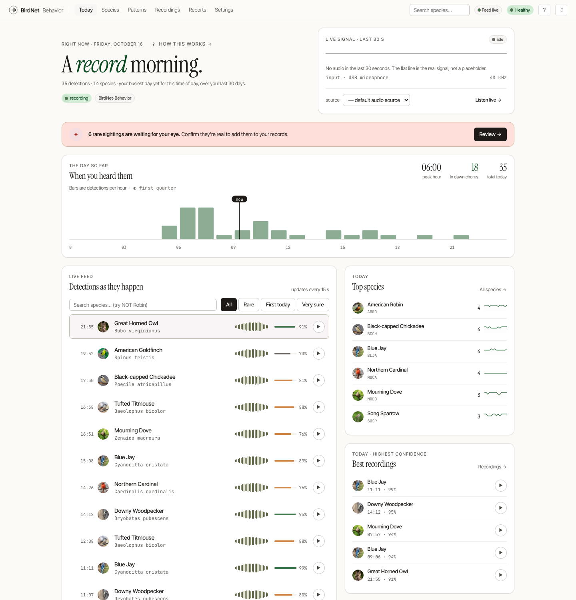

# BirdNet-Behavior

BirdNet-Behavior listens through a microphone, names the birds it hears, and shows them on a web page that any phone or computer on your home network can open.

It runs on a Raspberry Pi 5, 4B or 400, or on a 64-bit Linux PC. It is a rewrite of [BirdNET-Pi](https://github.com/mcguirepr89/BirdNET-Pi) in Rust, derived from it, and it carries the same licence.

> [!IMPORTANT]
> BirdNet-Behavior is licensed **CC BY-NC-SA 4.0**, the same terms as the upstream BirdNET model and BirdNET-Pi.
> **You may not use this project to build a commercial product.** See [LICENSE](LICENSE) for details.



## What you need

- **A Raspberry Pi 5, 4B or 400**, with its power supply and a microSD card. A 64-bit Linux PC also works.
- **A USB microphone**, or a network camera that sends sound. [Hardware](docs/book/getting-started/hardware.md) helps you choose.
- **A network connection** for the Pi (Wi-Fi or cable) and about 1.5 GB of free storage.
- **About 30 minutes**, and a willingness to type one command.

Two things to know before you start:

- **There is no ready-made SD card image.** You install the Raspberry Pi's operating system yourself, then run one command in a terminal. A terminal is a window where you type a command and press Enter.
- **The operating system must be the 64-bit Raspberry Pi OS "Trixie"** (or Debian 13, or Ubuntu 24.04 or newer). On the older "Bookworm" release, use [Docker](docs/book/getting-started/docker.md).

## Install

1. **Put Raspberry Pi OS on the SD card.** Use [Raspberry Pi Imager](https://www.raspberrypi.com/software/) on another computer and choose *Raspberry Pi OS (64-bit)*. In Imager's settings, enter a hostname (the Pi's name on your network, for example `birdnet`), a user name and password, and your Wi-Fi details. If the Pi will have no screen and keyboard, also turn on SSH. SSH lets you type commands on the Pi from another computer.

2. **Start the Pi and open a terminal.** Put the card in the Pi, plug in the microphone, and connect the power. With a screen and keyboard, open the program named *Terminal*. Without them, open a terminal on another computer and type `ssh USER@NAME.local`, where `USER` and `NAME` are the user name and hostname you set in Imager.

3. **Run the installer.** Copy this line into the terminal and press Enter:

   ```bash
   curl --proto '=https' --tlsv1.2 -fsSL https://github.com/tomtom215/BirdNet-Behavior/releases/latest/download/install.sh | sudo bash
   ```

   The installer downloads the program and the bird-identifying model, then asks three questions: whether to use the microphone it found, where the microphone is (latitude and longitude), and a password for changing settings. Answer the location question: without it, the station names birds that do not live near you. It then starts the station. The station starts again by itself whenever the Pi is switched on.

4. **Read the last lines the installer prints.** You will see `Installation complete!`, a line that starts `Web UI:` with an address such as `http://192.168.1.50:8502`, and the admin login (user name `admin`). Write the password down. You need it to change settings.

5. **Open that address** in a web browser on a phone or computer that is on the same network. You see the Today page, and you do not need to sign in to look. A bird appears there within a minute or two of the first call the microphone hears. If you skipped the location question, a short setup wizard opens first and asks for it.

If a step does not go as described, see [Troubleshooting](#troubleshooting). The [manual's first page](docs/book/introduction.md) repeats these steps and says what to do when each one fails. [Installation](docs/book/getting-started/installation.md) has every installer option.

## What you get

- **Today**: the birds heard today, newest first, each with its recording and a picture.
- **Species**: every species the station has heard, and a life list that grows.
- **Patterns**: when each bird is active, the dawn chorus, migration, and which birds are heard together.
- **Recordings**: play any clip, or listen to the microphone live.
- **Reports**: a weekly summary and a year in review.
- **Settings**: microphone, location, alerts, backups and station health, in the browser.

The [field guide](docs/book/guide/today.md) describes every page.

## Supported hardware & OS

| Platform | Status |
|---|---|
| Raspberry Pi 5, 4B, 400 with 64-bit Raspberry Pi OS Trixie | Supported. The Pi 5 is recommended. |
| x86_64 Linux with glibc 2.39 or newer (Debian 13, Ubuntu 24.04 or newer) | Supported |
| Raspberry Pi OS Bookworm (glibc 2.36) | [Docker](docs/book/getting-started/docker.md) only |
| macOS on Apple silicon | Preview. Not yet confirmed on hardware. [macOS guide](docs/book/field/macos.md) |
| Any 32-bit Raspberry Pi OS | Not supported |
| Pi 3B+ and Zero 2 W | Not a supported target ([STABILITY.md](STABILITY.md)) |

The installer checks the operating system first. On one that is too old it stops and tells you to use Docker.

## More in the manual

The manual is published at <https://tomtom215.github.io/BirdNet-Behavior/>. The links below go to the same pages in this repository.

| To do this | Read |
|---|---|
| Run it in a container | [Running with Docker](docs/book/getting-started/docker.md) |
| Move from BirdNET-Pi | [Migrating from BirdNET-Pi](docs/book/guides/migration.md) |
| Choose or add a bird-identifying model | [Classifiers](docs/book/admin/classifiers.md) |
| Change a setting | [Configuration](docs/book/getting-started/configuration.md), [Where to change it](docs/book/reference/where-to-change-it.md) |
| Update, repair or uninstall | [Installation](docs/book/getting-started/installation.md#update-repair-reinstall-uninstall) |
| Back up and restore | [Backups & Recovery](docs/book/admin/backups.md) |
| Reach the station from outside your home, or use HTTPS | [Remote Access & Security](docs/book/admin/remote-access.md) |
| Get alerts | [Notifications](docs/book/admin/notifications.md) |
| Leave a station outdoors for months | [Field deployment](docs/book/field/deployment.md) |
| Look up a word | [Glossary](docs/book/guides/glossary.md), [FAQ](docs/book/guides/faq.md) |

**Migrating from BirdNET-Pi.** The import never changes BirdNET-Pi's files, and it shows you a plan before it writes anything. Stop BirdNET-Pi, then open **Settings → Data** in the browser. Your detection history, settings and recordings each come across as a separate step.

## Troubleshooting

Start with the built-in check. It prints one screen that covers the microphone, the model, the database, the disk and the network, with a suggested fix for each problem. Signed-in admins can read the same report in the browser at `/admin/doctor`.

```bash
# Installed with the installer. The service runs as the account that ran the
# installer, and this command runs the check as that account.
sudo -u "$(systemctl show -p User --value birdnet-behavior)" birdnet-behavior --doctor
# Docker
docker compose exec birdnet birdnet-behavior --doctor
```

Then read the [troubleshooting guide](docs/book/guides/troubleshooting.md). It is the only one; [`TROUBLESHOOTING.md`](TROUBLESHOOTING.md) points to it. [SUPPORT.md](SUPPORT.md) says where to ask for help.

## For researchers

- Each detection is stored with its time, confidence, audio source and the model that produced it. Exports include CSV, JSON, eBird Record Format and Raven selection tables, and there is a [REST API](docs/book/reference/api.md).
- The default model is BirdNET V2.4 with BirdNET-Pi's default thresholds. [Same audio, same detections](docs/book/guides/parity.md) reports what was measured against BirdNET-Pi and where the two differ.
- A built-in DuckDB engine computes activity sessions, resident and migrant classification, dawn-chorus timing, species co-occurrence and migration timing. These are descriptive summaries of one station's detections, and they are not validated against field surveys.
- An optional sound-level log records an ISO 266 third-octave spectrum with IEC 61672 A-weighting.
- Detections come from an automatic classifier and include false positives. The [tuning guide](docs/book/guides/tuning.md) and the review tools help you deal with them.
- To cite the software, use [`CITATION.cff`](CITATION.cff).

## For developers

You need [Rust 1.99 or newer](https://rustup.rs), `git`, `cmake` and a C++ compiler. The first build compiles the bundled DuckDB, which takes several minutes.

```bash
git clone https://github.com/tomtom215/BirdNet-Behavior.git
cd BirdNet-Behavior
cargo build --release
cargo test --workspace --all-features
cargo clippy --workspace --all-targets --all-features -- -D warnings
scripts/preflight.sh    # the checks CI runs; run it before every push
```

- **Layout**: one binary built from eight workspace crates. See the [architecture overview](docs/book/reference/architecture.md), the design notes in [`docs/architecture/`](docs/architecture/) and [CONTRIBUTING.md](CONTRIBUTING.md).
- **Rules**: `unsafe` code is forbidden, public items are documented, Clippy `pedantic` and `nursery` run with `-D warnings`, and library crates use their own error types.
- **Tests** 5,700+ test functions (`#[test]` and `#[tokio::test]` attributes in `src`, `crates` and `tests`), plus property-based tests, fuzz targets and end-to-end tests that start the compiled binary.
- **Releases**: binaries for aarch64 and x86_64 Linux and for Apple silicon, with SHA-256 sums, a signed SLSA build-provenance attestation and a CycloneDX SBOM. [RELEASING.md](RELEASING.md) has the process. Nothing is published on crates.io.
- **Policies**: [STABILITY.md](STABILITY.md), [SECURITY.md](SECURITY.md), [GOVERNANCE.md](GOVERNANCE.md), [CHANGELOG.md](CHANGELOG.md).

## Status and limits

- **This README describes the `main` branch.** The install command fetches the latest release, which can be older. [CHANGELOG.md](CHANGELOG.md) lists under *Unreleased* what `main` has and the release does not. [docs/README.md](docs/README.md#how-the-manual-is-versioned) says how to find the manual for your version.
- There is no SD card image. Installing and updating both need a terminal, and the station does not update itself.
- The address to open is a number with `:8502` at the end. The friendlier `http://NAME.local:8502` works on most devices, but not on all.
- The text of the interface is English only. Bird names are available in 35 other languages.
- It does not do everything BirdNET-Pi does. There is no Reboot or Shutdown button and no switch to skip the sign-in on the home network. [Parity](docs/book/guides/parity.md) and the [feature gap analysis](docs/FEATURE_GAP_ANALYSIS.md) list the differences.
- Anyone on your network can view the pages and listen to the live microphone without signing in. Changing anything needs the admin password.
- macOS is a preview, and the Pi 3B+ and Zero 2 W are not supported targets.

## Credits & Attribution

- **[BirdNET](https://github.com/kahst/BirdNET-Analyzer)**: the machine-learning model, by the K. Lisa Yang Center for Conservation Bioacoustics, Cornell Lab of Ornithology
- **[BirdNET-Pi](https://github.com/mcguirepr89/BirdNET-Pi)**: the original Pi implementation, by [Patrick McGuire](https://github.com/mcguirepr89)
- **[BirdNET-Pi fork](https://github.com/Nachtzuster/BirdNET-Pi)**: the maintained fork, by [Nachtzuster](https://github.com/Nachtzuster)
- **[duckdb-behavioral](https://github.com/tomtom215/duckdb-behavioral)**: behavioral analytics, by [tomtom215](https://github.com/tomtom215)
- **[fugleramme](https://github.com/arnegiacomo/fugleramme)**: the idea behind the kiosk's plate (the birds heard, drawn as natural-history plates), by [Arne Giacomo Munthe-Kaas](https://github.com/arnegiacomo). A new implementation: no code or artwork is shared
- **Public-domain plates**: the nineteenth-century plates the kiosk draws are from the bird books of John Gould, Johann Friedrich Naumann's *Naturgeschichte der Vögel Mitteleuropas* and the von Wrights' *Svenska fåglar*, fetched from [Wikimedia Commons](https://commons.wikimedia.org/) (never bundled) for the birds that have one; the index and its licence rules are in [`tools/plate-index/`](tools/plate-index/)

Related projects by the same author: [duckdb-behavioral](https://github.com/tomtom215/duckdb-behavioral), [quack-rs](https://github.com/tomtom215/quack-rs), [mallardmetrics](https://github.com/tomtom215/mallardmetrics), [LyreBirdAudio](https://github.com/tomtom215/LyreBirdAudio).

## License

Licensed under [CC BY-NC-SA 4.0](https://creativecommons.org/licenses/by-nc-sa/4.0/), matching the upstream BirdNET and BirdNET-Pi projects. BirdNet-Behavior is derived from BirdNET-Pi, and the repository's [LICENSE](LICENSE) says so. See [LICENSE](LICENSE) and [LICENSE-UPSTREAM](LICENSE-UPSTREAM) for full terms.

The binary also contains other people's work (Rust packages, DuckDB, ONNX Runtime, fonts, htmx) under their own licences. [NOTICE](NOTICE) says what and under which terms, [THIRD_PARTY_LICENSES.txt](THIRD_PARTY_LICENSES.txt) reproduces the texts, and both ship in every release archive and container image.
