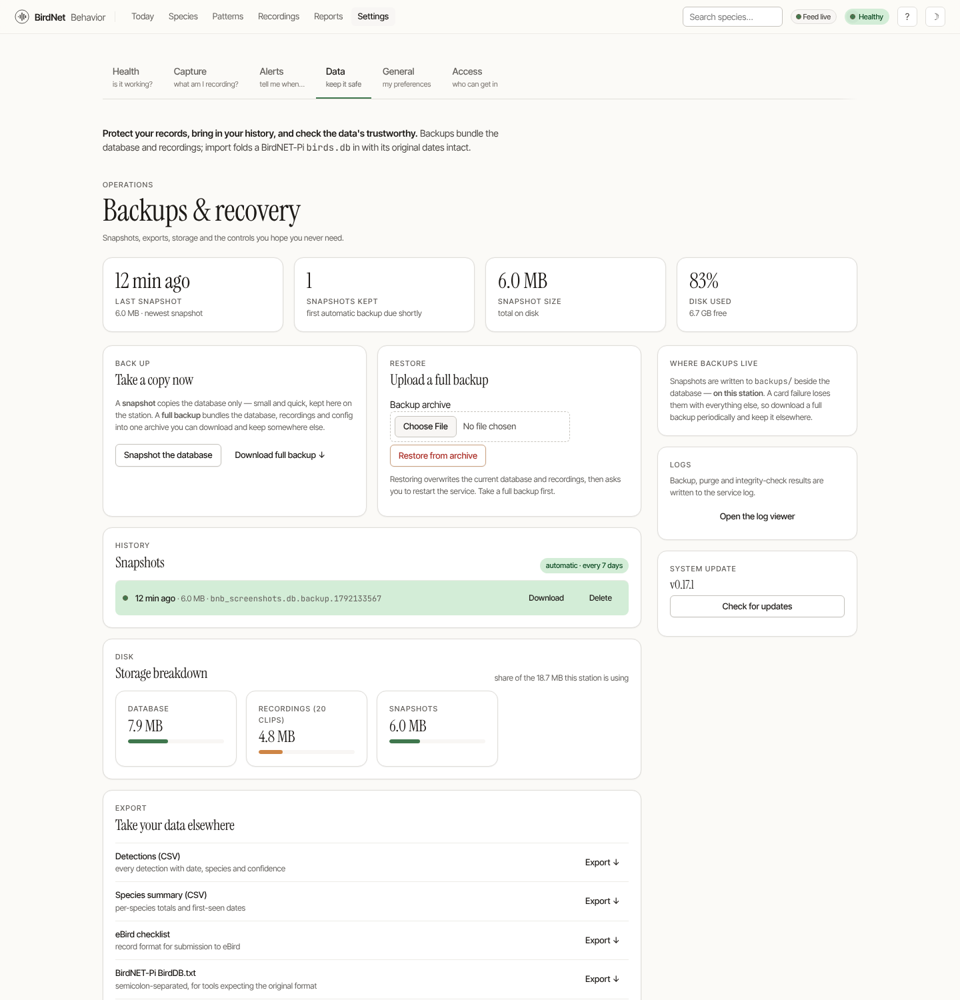

# Backups & Recovery

The **Data** tab (`/station/data`) is where you protect your records: snapshots, exports, storage and the controls you hope you never need.



## Three kinds of backup

**Snapshots** copy the database only. They are small and quick, they run automatically **every 7 days**, and the station keeps the most recent **14**. They live in `backups/` beside `birds.db` — *on the station itself*. That makes them perfect for undoing a bad import or recovering from database corruption, and useless if the SD card dies.

**Full backups** bundle the database, your recordings and the configuration file into one `.tar.gz` you download. This is the one to keep somewhere else. Nothing takes these automatically — download one after any big change, and periodically if your station matters to you. The configuration file is the one the station reads (`--config`: `/etc/birdnet/birdnet.conf` on a bare-metal install), stored in the archive as `birdnet.conf`; it holds your passwords and keys in plain text, as the database beside it holds your accounts, so keep the archive like a password file. [If the SD card dies](./card-failure.md) says what each backup holds and how to rebuild a station from them.

Every full backup also carries a list of the clips:

- `clip-manifest.tsv` — one line per detection that names a clip: the detection's permanent identifier (`detection_uuid`), the clip's name, the SHA-256 and length in bytes recorded when the clip was written, whether the clip is in this archive (`in_archive`), and what the station found (`present`, `missing`, `pruned`). The checksum columns are empty for a clip written before the station recorded checksums: that is unknown, and nothing computes one later from whatever file is there.
- `clips.sha256` — every clip in the archive that has a recorded checksum, in the format `sha256sum -c clips.sha256` checks, run in the folder you unpacked the archive into.
- `backup-manifest.json` — what was included, and the counts.

Audio is most of a full backup. **Download full backup** takes every clip, as it always has. `/admin/system/backup/full?audio=kept` takes only the clips the station keeps back from automatic deletion (locked, reviewed or commented on: the evidence a second reviewer needs), and `?audio=none` takes no audio at all; the two smaller archives are linked beside the button. The clip list names every clip whichever you choose, so what was left out is on record.

**Offsite copies** send each weekly snapshot to an object store or an SSH server, encrypted before it leaves. Off by default; see [Offsite backups](#offsite-backups) below. They are the database only: no audio and no configuration file. The database does carry each clip's recorded SHA-256 and length, so an offsite copy is a checksum manifest of the clips even though it holds none of them. This is what covers the failure the other two do not: the card wearing out, the enclosure flooding, the Pi being stolen.

The automatic schedule runs on **elapsed wall-clock time, not uptime**, so a station that reboots often still gets its backups: an overdue job runs shortly after the next boot rather than restarting its timer.

## Restoring

**Restore from file** takes a full backup archive and puts its database, recordings and configuration file in place of the current ones. The station first checks that the disk can hold the archive's contents with headroom, refuses an archive whose database is not named as this station's, stops recording detections, unpacks the archive beside the database, integrity-checks the copy there and checks every clip `clips.sha256` lists against its checksum (an archive with a damaged or missing clip is refused, and nothing is replaced), and only then swaps the files in. The configuration file goes back where the station reads it, the one there now kept beside it as `birdnet.conf.before-restore`, with its permissions; an archive made before backups carried the configuration restores as before (the database by rename, so the running process is never left reading a half-written file; recordings merged clip by clip, so clips the archive lacks are kept). Under systemd the station restarts itself to load the result; elsewhere it tells you to.

> **Restoring is destructive and cannot be undone.** It replaces what is on the station now, and the station does **not** snapshot the current state first. Download a full backup before you restore. Detections stay paused until the restart that follows.
>
> The archive's contents are not signed or verified — only restore an archive you produced yourself and trust.

Individual snapshots can be downloaded and deleted from the snapshot list, so you can recover a database by hand: stop the service, put the snapshot in place of `birds.db`, and start it again.

## Export

Your detection data is yours, in formats other tools read:

- **Detections (CSV or JSON)** — every detection the station stands behind, with date, species and confidence. Rows a reviewer rejected, and imported rows on a station that excludes imports from its analytics, are left out; the same rule the charts use. `Date` and `Time` are the station's local wall clock with no offset, exactly as BirdNET-Pi wrote them; beside them every row carries `Event_Date` (that wall clock with the offset that was in force, RFC 3339, so the two passes of a repeated autumn hour are told apart) and `Detected_At_UTC` (the instant), both blank on a row that names no point in time. Every row also says which model made it: the CSV ends in `Run_Id,Model_Name,Model_SHA256` and the JSON carries `run_id`, `model_name` and `model_sha256` per row — the model file's name and the SHA-256 of its bytes, so a season that spans a model upgrade can be split by which model heard what. The runs themselves (when each started, the labels checksum, the settings in force) are at `/api/v2/analysis-runs`. The name and checksum are those of the classifier that supplied the row's answer (`Model_Id`), not only the run's first classifier: a run records each classifier it started with. The three columns are empty on a row this station did not analyse (imported history, or rows older than the run table), and the name and checksum are empty on a row whose classifier's file was not recorded, including a row of a run registered before runs recorded each classifier whose rows name more than one, where which file made which row was never written down. Two more columns, `Model_Id` and `Model_Agreement` (`model_id` and `model_agreement` in the JSON), say which classifier supplied the row's answer and how many classifiers cleared their own bar for the species. They are empty on a row written before they were recorded, which is not the same as `1` (one classifier was asked and one answered). Six more follow, after every column above so none of those moves: `Source` (the microphone or stream that heard it), `Review_Verdict` (`confirmed`, or empty for a detection nobody has reviewed), `Chunk_Offset_Secs` (where the analysed chunk began in its recording, in seconds; two chunks of one recording are two detections), `Clip_Pruned_At` (when retention removed the clip's audio, UTC; empty while the audio is kept), `Import_Batch_Id` (the import a row came from; empty for one this station recorded) and `BirdWeather_Soundscape_Id`. The JSON carries the same values as `source`, `review_verdict`, `chunk_offset_secs`, `clip_pruned_at` (Unix seconds), `import_batch_id` and `birdweather_soundscape_id`, each left out of a row that has none. Three more close the CSV: `Detection_Id` (`detection_uuid` in the JSON), the detection's permanent identifier, which a relabel, a database `VACUUM` or a restore does not change, and which the CSV import keeps when the file is read back into a station, so a detection re-imported is recognised as the one it is; and `Clip_SHA256` and `Clip_Bytes` (`clip_sha256`, `clip_bytes`), the checksum and length of the clip as it was written, empty on a row the station recorded no checksum for (one written before it did, or whose clip could not be read back): unknown, not computed later. `GET /api/v2/recordings/verify/<detection_id>` reads the clip on disk now and says whether it is still that clip: `verified`, `altered`, `missing`, `pruned` (retention removed it), `unrecorded` (there is no checksum to compare), `no_clip` or `unreadable`.
- **Classifier scores (CSV or JSON)** — what each classifier said about each detection, one row per detection and classifier: `Date`, `Time`, `Sci_Name` and `File_Name` name the detection exactly as the detections export does (all four are needed: two sources hearing one bird in one second share the first three, and `File_Name` is empty for a detection with no clip), then `Model_Id`, `State` (`heard` it, scored it `below_bar`, has `no_label` for the species, or its window `failed`), the `Score` and the `Bar` it was judged against, and the seconds of the recording that classifier's window covered. A classifier with no class for the species, or whose window failed, has an empty `Score` and `Bar`, never `0`. Scores are each classifier's own and are not comparable across classifiers; nothing here averages them. Same rows as the detections export (rejected detections are left out). Rows exist only for chunks two or more classifiers listened to: a station running one classifier, or a source routed to one, has none, because the detections export already carries that classifier's score as `Confidence`. The file is empty on such a station.
- **Species summary (CSV)** — per-species totals and first-seen dates.
- **eBird checklist** — eBird Record Format, one record per species per hour with `Number` written as `X` (present, not counted) and the detection tally in the comment. Only detections at or above a confidence floor (0.75 by default, `?min_confidence=`) that a reviewer has not rejected are included — add `?verdict=confirmed` to include only detections a reviewer confirmed — and the coordinates are the station's configured location — blank, never `0,0`, if none is set. Protocol, observer count, region and completeness are query parameters (`?protocol=Stationary&observers=1&state=&country=&complete=false`), because they are facts about the submitter rather than the station. Every record's comment says it is an automated acoustic detection, names the model the station ran (its file name and the start of its SHA-256, or that the station did not record one, for imported history), and says how many of that hour's detections a reviewer confirmed. Whether eBird accepts unreviewed recorder detections is a question for eBird's own rules; the default here still includes them.
- **BirdNET-Pi `BirdDB.txt`** — semicolon-separated, the twelve BirdNET-Pi columns and nothing more, for tools expecting the original format. Same rows as the CSV, without the model columns: the format has no room for them and its consumers count fields.
- **Raven selection table** — one tab-separated table over every detection that has a clip, in the format BirdNET-Analyzer writes (`Selection`, `View`, `Channel`, `Begin Time (s)`, `End Time (s)`, `Low Freq (Hz)`, `High Freq (Hz)`, `Common Name`, `Species Code`, `Confidence`, `Begin Path`, `File Offset (s)`), so Raven Pro opens it against the recordings folder as a multi-file table. Each selection is placed where the detection sits inside its clip, from the lead-in the extractor recorded; a row written before that was recorded (schema 47) spans its whole clip, and a row with no clip, or no clip length, is left out rather than given a made-up window. A detection whose clip retention has already removed is left out too, since Raven has no file to open; the response header `X-Omitted-Pruned-Clips` says how many were. The species code is the eBird code from the station's label file, or the scientific name when it has none. Every clip also has its own table (`410 Gone` once the clip's audio has been removed) at `/api/v2/recordings/<clip>/raven.txt` and an Audacity label track (`begin`, `end`, label; **File → Import → Labels**) at `/api/v2/recordings/<clip>/labels.txt`; the detection page links to neither yet, so paste the clip's filename in.

## Storage & retention

The storage breakdown shows where space is going — the database (including its write-ahead log), your recordings, and the snapshots — measured live, not estimated.

Time-based retention is **off by default**, not absent: set **Keep Clip Audio (days)** (`CLIP_RETENTION_DAYS`, `--clip-retention-days`) for a rolling window — `0`, the default, keeps audio for ever. Two disk-based limits apply alongside it:

- once the disk crosses `DISK_PURGE_THRESHOLD` (default 95%), the disk manager deletes a tenth of the clips at each pass, taken from the species with the most clips first, the lowest-confidence clip of that species first and then the oldest, and never taking a species below `PURGE_SPECIES_FLOOR` clips (default 5); with `FULL_DISK=keep` it stops recording instead;
- `MAX_FILES_SPECIES` keeps at most N clips per species, pruned on the daily maintenance tick.

Recordings you have **locked** are never purged by either, and locking takes effect on the next cycle — no restart needed. The audio of every detection someone has confirmed, rejected or commented on is kept the same way by all three (the age limit, the per-species cap and the disk-full purge): that clip is the evidence a second reviewer needs. Set `BIRDNET_RETAIN_REVIEWED_AUDIO=false` (`--retain-reviewed-audio false`) to let them reclaim it like any other. When the disk is over the threshold and every clip left is one the purge keeps (locked, reviewed, or among the `PURGE_SPECIES_FLOOR` clips each species keeps), it deletes nothing and the disk goes on filling: the station logs an error, lists the `purge-nothing-deletable` condition at `/api/v2/health/conditions` and sets `birdnet_purge_nothing_deletable` to 1, until a pass deletes something or usage falls below the threshold. When a clip is pruned its detection row survives: your counts, species lists and analytics are unaffected, only the audio is removed.

**One exception:** a station run with `--watch-dir` (`BIRDNET_WATCH_DIR`) pointed at its own recordings directory. Neither installer sets it up that way (the bare-metal service watches `/tmp/birdnet-stream`; the Docker image watches `/data/recordings` while its clips go to `/data/BirdNet-Behavior/recordings`), but on a station that is, the recordings directory is drained as the raw-audio stream directory is: every WAV, MP3, FLAC or OGG clip older than `STREAM_RETENTION_SECS` (default 600 seconds) is deleted, and the disk-full purge takes the oldest clips with no regard for species. Locked clips, and reviewed ones unless `--retain-reviewed-audio` is off, are kept from both.

To lock a clip, open [Recordings](../guide/recordings.md) and use the 🔒 **Lock** action on a row — or select several and use the bulk **Lock** button above the grid. Locked rows show an unlock action in the same place.

**Detections a stop left unprocessed** are kept in `clip-queue/`, beside the database, and recorded at the next start, under the analysis run and at the thresholds that were in force when they were kept. Each batch keeps only the stretch of audio its clips will be cut from, silent everywhere else, so on a station with the human-sound filter on nothing the filter did not judge reaches the disk. A detection the database will not take is offered again at each start; after three starts that failed, or when its line cannot be read, it is **held**: the start-up log says so at error level every time, and the station never deletes it. A held batch can be inspected and, once dealt with, removed by hand with the service stopped.

## Offsite backups

A snapshot on the same SD card as the database it came from protects you from a corrupt page and a bad import. It does not protect you from the card, and SD cards in a box on a fence post are a *when*, not an *if*.

Set `OFFSITE_BACKUP` and each weekly snapshot is encrypted on the station and uploaded. Nothing else changes: the local snapshots and their 14-file rotation stay exactly as they were, so this only ever adds a copy.

### Encryption is not optional

Your database is a log of what is around your house and when you are there. "Server-side encryption" on a bucket means the provider holds the key; an SFTP host means its administrator does. So the station encrypts before it uploads — argon2id over your passphrase, then ChaCha20-Poly1305 — and there is no setting to turn that off.

```text
OFFSITE_PASSPHRASE=a long passphrase you keep somewhere else
```

**Write it down somewhere that is not this station.** There is no recovery: the passphrase is stored only where you put it (the station's configuration file or environment, which a dead card takes with it), is not derivable from the backup, and is not known to us. A backup you cannot decrypt is not a backup.

At least 12 characters, and the station refuses shorter ones — not as password policy, but because below that the argon2 parameters stop being what protects the file.

Secrets are **config-file or environment keys only**. There is deliberately no `--offsite-passphrase` flag: anything on a command line is visible in `ps` to every user on the machine, is copied into the journal by systemd's `ExecStart=`, and lands in your shell history.

### To an S3-compatible store

Works with AWS S3, Backblaze B2's S3 API, Cloudflare R2, Wasabi, MinIO, Ceph RGW and Garage.

```text
OFFSITE_BACKUP=s3
OFFSITE_S3_ENDPOINT=https://s3.eu-west-2.amazonaws.com
OFFSITE_S3_BUCKET=my-birdnet-backups
OFFSITE_S3_PREFIX=stations/garden          # optional
OFFSITE_S3_REGION=eu-west-2                # default us-east-1
OFFSITE_S3_ACCESS_KEY=AKIA...
OFFSITE_S3_SECRET_KEY=...
OFFSITE_S3_ADDRESSING=auto                 # auto | virtual | path
OFFSITE_PASSPHRASE=...
OFFSITE_KEEP=8                             # 0 keeps everything
```

`OFFSITE_S3_ADDRESSING` decides whether the bucket goes in the hostname (`bucket.endpoint/key`, which AWS requires for buckets made after September 2020) or the path (`endpoint/bucket/key`, which every self-hosted store speaks and some speak only). `auto` picks by endpoint and is right nearly always; set it explicitly if you get a 404 that mentions the bucket.

Give the station its own access key with permission to `PutObject`, `ListBucket` and `DeleteObject` on that prefix, and nothing else. It never reads a backup back — restoring is a thing you do from another machine, deliberately.

### To an SSH server

Any host you can `sftp` into: a NAS, a VPS, a Pi in a different building.

```text
OFFSITE_BACKUP=sftp
OFFSITE_SFTP_HOST=backup.example.net
OFFSITE_SFTP_PORT=22
OFFSITE_SFTP_USER=birdnet
OFFSITE_SFTP_DIR=/srv/backups/garden
OFFSITE_SFTP_IDENTITY=/home/pi/BirdNet-Behavior/ssh/id_ed25519
OFFSITE_SFTP_KNOWN_HOSTS=/home/pi/BirdNet-Behavior/ssh/known_hosts   # defaults beside the key
OFFSITE_SFTP_HOST_KEY_POLICY=yes                            # yes | accept-new
OFFSITE_PASSPHRASE=...
```

Key authentication only — passwords are disabled, because a batch upload cannot answer a prompt and would hang until something killed it. The key lives where you choose; the examples put it in an `ssh` folder inside the station's data directory, which is the one place the service is allowed to read and write (`/home/pi/BirdNet-Behavior` here: the data directory of the account the bare-metal service runs as — substitute yours; in Docker it is `/data`). There is no `birdnet` user on a bare-metal station, so run the commands as the service's account (the `OFFSITE_SFTP_USER` above is the user on the *backup server*). Generate a key for the station and authorise it on the server:

```bash
SVC=$(systemctl show -p User --value birdnet-behavior)       # bare metal: the account the service runs as
DATA=$(getent passwd "$SVC" | cut -d: -f6)/BirdNet-Behavior   # its data directory
sudo -u "$SVC" mkdir -p "$DATA/ssh"
sudo -u "$SVC" ssh-keygen -t ed25519 -f "$DATA/ssh/id_ed25519" -N ''
sudo -u "$SVC" ssh-copy-id -i "$DATA/ssh/id_ed25519.pub" birdnet@backup.example.net
# Docker: docker compose exec birdnet sh -c 'mkdir -p /data/ssh && ssh-keygen -t ed25519 -f /data/ssh/id_ed25519 -N ""'
```

Then record the server's host key, **after checking the fingerprint against the server itself**:

```bash
ssh-keyscan -p 22 backup.example.net | sudo -u "$SVC" tee "$DATA/ssh/known_hosts"
```

`OFFSITE_SFTP_HOST_KEY_POLICY` has no "off". Host key checking is what makes the upload go to *your* server rather than to whoever answers, and there is no setting that disables it. Use `accept-new` for the first connection on a network you control, then set it back to `yes` so a *changed* key is refused.

### How often

`BACKUP_SCHEDULE` is `weekly` (the default) or `daily`. Daily means losing at most a day rather than a week; it also means seven times the offsite upload, which is why weekly stays the default rather than changing an existing station's bandwidth underneath it.

It schedules the **backup** only. The space reclaim — checkpointing the write-ahead log and returning free pages to the filesystem — is a separate job and stays weekly whatever you set here. Asking for a daily backup is not asking to rewrite the database file every day, and on an SD card that is write endurance spent for space nobody needed back.

Both are listed at `GET /api/v2/system/jobs`, with when each last ran and whether it is due.

### Over rsync, when the link is bad

`OFFSITE_BACKUP=rsync` sends the same backup to the same SSH server, with the same `OFFSITE_SFTP_*` settings above — only the program that moves the bytes changes. Switching is one word:

```ini
OFFSITE_BACKUP=rsync
OFFSITE_RSYNC_BWLIMIT=512   # KiB/s; 0 or unset for no limit
```

**Use it if your uplink drops.** rsync keeps what already arrived, so a transfer that dies at 90 % of a 1.3 GB backup continues from there next time. Over SFTP the same backup starts again from zero, and on a link bad enough to matter it may never finish at all. `OFFSITE_RSYNC_BWLIMIT` is the other reason: it stops a backup saturating a shared or metered connection for an hour.

**It is not faster because it is "incremental".** rsync's famous trick is sending only the blocks that changed, and that is worth nothing here. Your backups are encrypted before they leave, under a fresh random salt each time, so consecutive backups share no blocks at all — not even when the database has not changed. Measured on a 1 MiB file: 1496 of 1497 blocks reusable in plaintext, **0 of 1498** once encrypted. rsync sends the whole file every run, exactly as SFTP does. The resume and the speed limit are the reasons to use it.

It needs both `rsync` and `sftp` installed. rsync moves the bytes; `sftp` creates the directory, lists what is there and deletes what retention drops — rsync has no command that removes one named remote file, and its nearest equivalent deletes everything a filter does not mention, which is not a risk worth taking with your only offsite copies.

### Retention

`OFFSITE_KEEP` is how many backups stay at the destination; the oldest go when a new one arrives. `0` keeps everything.

Retention only removes files named like the ones this station writes — `birds.db.backup.<timestamp>.bnb` — directly in its own prefix or directory. Anything else there is left alone, and so is anything in a folder below it, so you can share a bucket without losing the other things in it. Give every station its own prefix: two stations writing to the *same* prefix produce identical names, and each would prune the other's backups as its own.

### Checking it works

```bash
birdnet-behavior --doctor
```

reports the destination, how many backups it will keep, and — for SSH — whether the key exists, whether its permissions are ones OpenSSH will accept, and whether the host is known. It makes no connection: `--doctor` runs on every start, and a diagnostic that dials a remote host fails whenever the uplink is down.

Uploads are logged at `info` on success and `warn` on failure, with the destination named. A failed upload never affects the local backup or the space reclaim that follows it.

### Restoring one

Download the `.bnb` file from your bucket or server, then:

```bash
read -rsp 'Offsite passphrase: ' BIRDNET_OFFSITE_PASSPHRASE; echo
export BIRDNET_OFFSITE_PASSPHRASE
birdnet-behavior --decrypt-backup downloaded.bnb --out restored.db
```

It does not ask for the passphrase: it reads `OFFSITE_PASSPHRASE` from the environment (`BIRDNET_OFFSITE_PASSPHRASE`, as above) or from the configuration file, and refuses to write over a file that already exists. The result is an ordinary SQLite database — put it in place of `birds.db` with the service stopped, as with any snapshot. [If the SD card dies](./card-failure.md#putting-a-station-back-on-a-new-card) has the whole sequence for a new station.

## Danger zone

Two destructive actions live in a clearly marked danger zone, each gated behind an explicit confirmation:

- **Clear all detections** — empties the detections and notification tables; settings are kept.
- **Clear extracted audio** — deletes the saved WAV clips; the detection records stay.

There is no undo. Take a full backup first.
