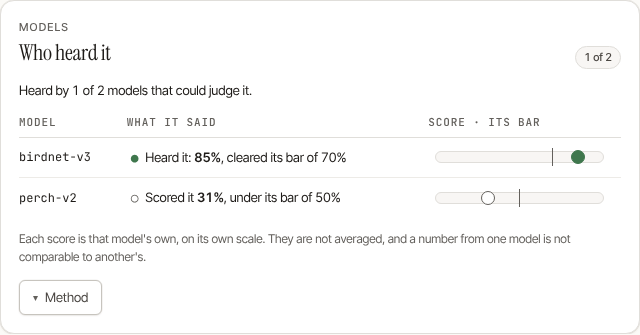

# Running More Than One Classifier

Your station always runs one classifier — BirdNET, the thing that makes it a BirdNET station. This page is about running a **second** one beside it, and what the station does with two opinions about the same three seconds of audio.

You do not need this. One classifier is the supported, tested, default configuration, and most stations should stay there. Read on if you are in the tropics, where Google Perch v2 is materially better than BirdNET, or if you want a second opinion recorded on every detection. The first section is about the one classifier every station has: which one a new station gets, and what changing it involves.

## Choosing and changing the primary classifier

A new install runs **BirdNET V2.4 with its range (occurrence) filter v2**, the network BirdNET-Pi and birdnet-go run; **BirdNET+ V3.0 preview** (a different network, with its own geomodel as the occurrence filter) is an explicit choice. The two are never mixed: the V2.4 range filter is indexed like the V2.4 labels and means nothing to another network, and the geomodel is matched by name through its own label file.

| Where | Choose V3.0 on a new station | What decides an existing station |
|---|---|---|
| Bare metal | `install.sh --classifier birdnet-v3`, or `BIRDNET_CLASSIFIER=birdnet-v3` | the classifier `/etc/birdnet/birdnet.conf` names; a `--classifier` that disagrees is reported as not applied |
| Docker | `BIRDNET_CLASSIFIER=birdnet-v3` in `.env` | the V3.0 model file already on the volume (an explicit `BIRDNET_CLASSIFIER` overrides it) |
| macOS | the same installer flag | the same rule as bare metal |

On bare metal the rule, first match: an existing config keeps the classifier it names (only a config whose `MODEL_PATH` is the V2.4 file the installer manages counts as V2.4; every other existing config is treated as V3.0, because that is what every earlier install fetched); otherwise `--classifier`, then `BIRDNET_CLASSIFIER`; otherwise, if the V3.0 model file is already in the model folder (a station restored from a backup of its data without its config), V3.0; otherwise V2.4. One `Classifier:` line in the install output says which was chosen and why. [Installation](../getting-started/installation.md#which-classifier-a-new-install-runs) and [Running with Docker](../getting-started/docker.md) have the details and say where the files come from.

**Changing a running station is deliberate, never automatic.** No install, update, repair or reinstall does it, because the history would then hold rows two different networks scored. Rows already stored keep their old scores and names, and a species the two label files name differently appears under both names. If you do want to change:

1. Install the other classifier's files (see *Installing one* below).
2. Point the station at them in its configuration, then restart and run `birdnet-behavior --doctor`. Moving to V2.4:

   ```ini
   MODEL_PATH=<model dir>/birdnet-v24.onnx
   LABELS_PATH=<model dir>/birdnet-v24_labels.txt
   METADATA_MODEL_PATH=<model dir>/birdnet-v24-range-v2.onnx
   # no METADATA_LABELS_PATH: the range filter needs none, so remove a geomodel's label file from here
   ```

   with `CONFIDENCE`, `SENSITIVITY` and `PRIVACY_RANK` as [Same audio, same detections](../guides/parity.md) describes. In Docker, set `BIRDNET_CLASSIFIER=birdnet-v24` instead and recreate the container.
3. Moving the other way (V2.4 to V3.0) has no one-line recipe here: the V3.0 files and their pins are named in `installer/lib/10-config.sh`, and `install.sh --classifier birdnet-v3` is only for a new station. In Docker, `BIRDNET_CLASSIFIER=birdnet-v3` is enough.

These steps were read from the installer and the container entrypoint and their tests, not run end to end on a station.

## What a second classifier buys, and what it costs

Every classifier routed to a recording runs on **every chunk of it**. Two classifiers mean two inferences per chunk, which on a Raspberry Pi is the expensive part of the whole pipeline. In exchange:

- **A species only one of the two models knows is now heard.** The results are a union, not an intersection.
- **Each detection records which classifier produced it**, and how many classifiers reported that species in that chunk.
- **Nothing is lost.** A model that reports a species alone still produces a detection.

The cost is real and worth measuring before you commit to it: check the daemon's CPU use for a day with one classifier, then compare.

## Installing one

The station carries a small catalogue of classifiers it knows how to fetch and verify. The default one (BirdNET V2.4 and its local species filter) can be installed from the browser: **Settings → Capture → Bird-identifying model → Install**, or step 2 of the setup wizard. The others below are installed from the command line. To see the catalogue:

```bash
birdnet-behavior --install-model list
```

To install one:

```bash
# Docker: BIRDNET_MODEL_DIR is already /data/model in the container
docker compose exec birdnet birdnet-behavior --install-model perch-v2

# Bare metal: the installer's model folder is <data dir>/models, but --install-model
# writes to /data/model unless BIRDNET_MODEL_DIR (or MODEL_DIR in birdnet.conf) says
# otherwise. Name the folder, and run as the service user, who owns it:
SVC=$(systemctl show -p User --value birdnet-behavior)
sudo -u "$SVC" env BIRDNET_MODEL_DIR="$(getent passwd "$SVC" | cut -d: -f6)/BirdNet-Behavior/models" \
    birdnet-behavior --install-model perch-v2
```

There is no `birdnet` user on a bare-metal station: the installer runs the service as the account that ran `sudo`, and `systemctl show -p User --value birdnet-behavior` prints it.

What it can install:

| id | what | it replaces or joins |
|---|---|---|
| `birdnet-v3` | BirdNET+ V3.0 preview, 32 kHz, 4.5 s windows: an explicit choice for a new station (it was the default up to v0.17.1) | the primary; it cannot run beside V2.4, which wants 48 kHz |
| `birdnet-v24` | BirdNET V2.4, the network BirdNET-Pi and birdnet-go run (48 kHz, 3 s windows), with the label file written by the binary itself (below). The default for a new station | **replaces** the primary: it cannot run beside V3.0, because a recording is resampled once and the two want different rates |
| `birdnet-v24-range-v2` | the V2.4 species-occurrence filter, v2 (BirdNET-Pi's default is v1, which is not hosted as ONNX and so is not in the catalogue) | `METADATA_MODEL_PATH`, with V2.4 only |
| `perch-v2` | Google Perch v2 | runs **beside** the primary |

The installers do this for you on a new station (V2.4 and its range filter). To make an older station report what BirdNET-Pi would, install `birdnet-v24` and `birdnet-v24-range-v2` and follow [Same audio, same detections](../guides/parity.md).

This runs in the foreground and exits — deliberately. It is a several-hundred-megabyte download that takes hours on the uplink a field station has, and you should be able to watch it, interrupt it, and see it fail. There is no button in the web interface for the same reason: a multi-hour download inside a request handler has nowhere to report progress, and a retry would start a second download beside the first.

Three things it does before and while it downloads:

- **Checks free space first**, with a 512 MiB margin on top of the file. Filling the card stops the station recording, which is worse than not having the classifier. A filesystem that will not say how much space it has counts as no space rather than plenty.
- **Verifies as the bytes arrive.** The sha256 of each file is compiled into the binary — not fetched alongside it — so the checksum is a promise this project makes rather than one the download site makes. The digest is computed while streaming, so a 541 MB model never has to fit in a 1 GB board's memory at once.
- **Never leaves a half-file the station would load.** Unverified bytes carry a `.part` name; the file is renamed into place only after its digest matches.

Running it again is cheap: a file already in place whose sha256 matches is **not fetched again** (the command says so, and skips the free-space check for it), while a truncated or substituted file under the right name is fetched afresh. A download that is interrupted starts over; it does not resume.

Files land in the folder named by `BIRDNET_MODEL_DIR`, else `MODEL_DIR` in the config file, else `/data/model`. The same catalogue is readable over the API at `GET /api/v2/models/catalog`.

**Where the files come from.** `birdnet-v3` and the Perch model are fetched from the URLs in the catalogue (their SHA-256 is compiled into the binary); `birdnet-v24` is the model from birdnet-go's published ONNX build on Hugging Face at a pinned revision, and `birdnet-v24-range-v2` the range filter from the `tphakala/birdnet-go` repository at a pinned commit. The V2.4 **labels are not downloaded**: the binary writes `birdnet-v24_labels.txt` itself, verified against a digest, with BirdNET-Pi's English names on V2.4's class order. birdnet-go's own label file, which the model is published with, names 460 of the 6 522 classes differently from BirdNET-Pi (Pica pica is "Eurasian Magpie" in one and "Common Magpie" in the other), and a station that imported a BirdNET-Pi history would otherwise hold one species under two names. A station that already has the older label file keeps it, because the installers skip a file that is present; run `birdnet-behavior --install-model birdnet-v24` yourself to replace it (the labels are always rewritten from the binary, the model that already verifies is not fetched again), then restart. The three files a V2.4 station has are `birdnet-v24.onnx`, `birdnet-v24_labels.txt` and `birdnet-v24-range-v2.onnx`. **Perch's labels are not downloaded either:** Google publishes the model's 14 795 classes as a bare list, and the ONNX conversion ships none, so the binary writes `perch-v2_labels.csv` itself, in the form the station reads and in the model's own order. The two files a Perch install adds are `perch-v2.onnx` and `perch-v2_labels.csv`.

> Labels are positional against a model's output, so a wrong file reports species under other species' names at full confidence — a failure with no symptom at all. That is why the binary carries Perch's list (`crates/birdnet-core/data/labels/perch-v2.csv`, with its provenance in the README beside it) instead of leaving you to find and reshape one: the position of the one class that could be checked was checked against the real model (a magpie recording puts the model's largest output on class 10 397, which is *Pica pica*). If you supply a file of your own for a Perch model it must have exactly 14 795 rows in the model's order, and a `sci_name,com_name` header line; Google's own file has neither the header nor Unix line endings, and the station will not recognise it.

## Configuring it

Up to **three** classifiers total. The primary is always loaded and is whatever `BIRDNET_MODEL` / `BIRDNET_LABELS` already point at.

```ini
# Name the primary, if you want it called something other than `birdnet`
# in routes and on detections.
MODEL_ID=birdnet
MODEL_THRESHOLD=
MODEL_SAMPLE_RATE=

# The second classifier. Each needs its OWN labels file. (<model dir> is
# /data/model in Docker and <data dir>/models on bare metal.)
MODEL_2_PATH=<model dir>/perch-v2.onnx
MODEL_2_LABELS=<model dir>/perch-v2_labels.csv
MODEL_2_ID=perch
MODEL_2_THRESHOLD=0.35
MODEL_2_SAMPLE_RATE=32000

# A third, if you have one.
MODEL_3_PATH=
MODEL_3_LABELS=
MODEL_3_ID=
MODEL_3_THRESHOLD=
MODEL_3_SAMPLE_RATE=
```

Every key also exists as `BIRDNET_MODEL_2_PATH` and so on in the environment; see `.env.example`.

**`MODEL_n_SAMPLE_RATE` is not optional for Perch.** Its tensor declares `[-1, 160000]`, which is 5 s at 32 kHz and equally 3⅓ s at 48 kHz — nothing in the shape distinguishes them, so it has to be told. BirdNET's own shapes are unambiguous, and the station derives those for itself.

**`MODEL_n_THRESHOLD`** (and `MODEL_THRESHOLD` for the primary) holds that classifier's detections to its own confidence bar, whether it is below the station's or above it. Leave it unset to use the station's. A per-species threshold still overrides either.

## What Perch's scores mean

BirdNET V2.4's scores are one independent yes-or-no per species, put through a sigmoid; V3.0's are already probabilities. **Perch's are neither.** Its classifier is trained with a *softmax* over all 14 795 classes (Hamer et al., [Perch 2.0](https://arxiv.org/abs/2508.04665), §2.3, who chose it over the sigmoid used for multi-label classification), so the station reports each class's **share of one window's probability**. Three consequences:

- **The scores of one window sum to 1.** A class holding 96% of a window leaves 4% for the other 14 794.
- **Two species singing at the same moment split the window**, so neither can reach 50%. A bar of 0.7, the station's usual, will pass a clear single-species window and miss overlapping ones; that is arithmetic, not a measurement, and it is why a Perch bar of its own (`MODEL_2_THRESHOLD`; the example above uses 0.35) is the right setting. Nothing in this project has validated a particular value on soundscapes with several species, so treat it as a starting point and look at what it reports.
- **They are not comparable with another classifier's.** A 0.96 from Perch is a share of a window; a 0.96 from V2.4 is a sigmoid of a logit. The detection page puts them side by side because each is the classifier's own, not because they are on one scale.

What this replaced: until this was found, Perch's raw outputs were put through V2.4's sigmoid like any other classifier's. Measured on one 30-second recording of a magpie, with the real model, **between 809 and 1 066 of its 14 795 classes cleared 0.70 in every one of its seven windows** (including windows of passing traffic and engine noise), so every window filled the station's ten-detections cap with confidences of 0.98 to 0.99: 70 detections of 42 "species" from a single bird. With the share, the same recording reports the magpie at about 96% in the four windows where it is clear and 11% in a marginal one (where a crow, *Corvus cornix*, holds 8.5%), and in the two windows of traffic and engine noise the largest share is 3.7% and 7.4%. That is one recording of one species, offered as the size of the effect and not as a validation. If you had raised `MODEL_2_THRESHOLD` to 0.98 or so to tame it, lower it: shares of that size almost never occur.

Sensitivity (`SENSITIVITY`) is a sigmoid setting; it applies to V2.4 only and does nothing to Perch's shares or to V3.0's probabilities. The start-up log says which each classifier uses (`output_scale=` on the `model loaded successfully` line).

Perch's list also holds 200 classes that name a kind of sound and not a species (`Engine`, `Vehicle`, `Animal`, `Wild_animals`), taken from the FSD50K sound dataset. They are not removed: a window with no bird in it can have one of them as its largest share, and at a low bar it will be reported as a detection of that "species". If your bar is low enough to let them in, add the ones you see to the station's species exclusion list: **Species storage** (Admin → Species) lists every species the station has recorded and has an exclude action that adds to that list.

## Routing sources to classifiers

A second classifier runs only where a route sends it: every audio source is judged by the **primary alone** unless `MODEL_ROUTES` names it. That is deliberate — adding a classifier should not quietly double the inference cost of every microphone on a board that was keeping up. To send particular microphones to particular classifiers:

```ini
MODEL_ROUTES=pond:perch,garden:birdnet+perch
```

The source is its `audio_sources` row id — the same label `GET /api/v2/system/capture` lists, and the one each source's recordings carry in their file names, which is how the detection loop knows where a recording came from. To run both classifiers on your only microphone, name that microphone's id: `MODEL_ROUTES=<id>:birdnet+perch`. That needs the microphone to be listed on the **Audio** page, which is what gives it an id; a single microphone set only in `birdnet.conf` records without one, and gets the primary alone. Use `+` for more than one classifier on one source, and commas between sources.

Two rules here exist because a station runs unattended for months:

- **A source you do not name gets the primary classifier**, never nothing. Silence must not be reachable by forgetting to write a line.
- **A route naming a classifier you have not configured stops the station at startup**, where the journal and `--doctor` will show it. Accepting `pond:pecrh` and discovering at runtime that the pond routes to nothing would cost months of recordings from that microphone, and the station would look identical to one having a quiet season.

## What the station does with two opinions

Each classifier is judged against its own threshold, and the results are combined per chunk:

- **Union by species.** Anything any classifier reported above its threshold becomes a detection.
- **The highest confidence wins**, and the detection records **which** classifier gave it (`model_id`).
- **`model_agreement` counts how many distinct classifiers reported that species in that chunk.**

**Agreement is never folded into the confidence.** An averaged or bonused number would have no calibration behind it while sitting in the same column as a real one, quietly changing the meaning of every threshold you have set and every historical comparison you make. The confidence you see is the winning classifier's own output, unchanged.

`model_agreement` is `NULL` on rows written before this feature existed — a third state, and not the same as `1` ("one classifier asked, one answered").

> Both columns are stored on every detection, and read back in three places: a detection's own page, Station Health's **Models** section, and the API and exports (`model_id` and `model_agreement` on every detection row, and the CSV's last two columns).
>
> What each classifier *scored* is stored too, in `detection_model_scores`: one row per detection and classifier, in four states (heard it, scored it below its own bar, has no class for the species, or its window failed). The detection daemon writes it with the detection, in the same database call, but only for a chunk **two or more** classifiers listened to: with one, the detection row already is the whole record (its `Confidence` is that classifier's score, its `Cutoff` the bar), so a station running one classifier, and a source routed to one, store none and are shown no card. Rows exist for species that at least one classifier reported (a detection), and then for *every* classifier that listened, so "Perch scored this 41%, under its bar of 50%" is a number you can read even though Perch did not report the bird. A species no classifier reported has no rows: the scores are not a log of everything every classifier thought. A classifier that failed the chunk is recorded as failed, never answered from its previous window. Each detection's answers are keyed by its date, time, species **and clip**, so two sources that heard one bird in the same second keep their own. They are removed with their detection, and when a detection is relabelled: they were about the old species, and are not shown against the new one (the row keeps its own `model_id`, `model_agreement` and `Confidence`). The detection page shows them as **Who heard it**; `GET /api/v2/detections/models` returns them for one detection and `GET /api/v2/detections/export/model-scores` for a date range. Nothing averages them.
>
> 
>
> **Two bars.** An answer is judged against *its classifier's* bar. The station then applies its own cutoff to the detection (a per-species setting, a dynamic threshold), kept on the row as `Cutoff`. They usually agree. When an answer met its own classifier's bar but not the station's, the card says so, so "heard it" is never read as "the station accepted it".
>
> Limits. A classifier reports at most its ten highest species per window, so in a very busy window it can have *heard* a species (its score at or above its bar, in the scores) without having been counted in `model_agreement`; the scores are the more exact of the two. And species are matched by scientific name as each classifier's labels write it: a name one model spells differently is a different species to the merge and to these rows alike. How much that matters can be counted from the label files the catalogue installs: 10,916 of V3.0's 11,560 scientific names (94.4%) also appear, spelled the same, in Perch's list, and 6,325 of V2.4's 6,522 (97.0%) in V3.0's. The other 644 of V3.0's names are not in Perch's list, and 469 of those are in a genus Perch does list, so some may be one species under two taxonomies' names (that was not checked name by name). For those species the card says "has no class for this species" about the classifier that knows it only by the other name, which is accurate about the label file and may not be about the bird. The detection page names a detection by its date, time and common name and shows the first match, as the review and comment features do; where two sources share all three it shows one of them, with that detection's own answers.

## When a classifier fails a window

A window **fails** when its classifier returns an error or answers with NaN or infinite scores, which are never recorded. Ten failures in a row, with no answer since, make the classifier **Failing**: Station Health's Models card says so, `/station` shows a banner, and `birdnet_model_failing` is `1`. One answer ends it. A classifier that fails a window does not silence the others, and on a detection another classifier reported it is shown as *Did not answer: its window failed*. It is never shown as a score of 0%.

Two things follow that are easy to miss, both seen on the real models:

- **A failing classifier can cost the others their detections.** A human-voice score that is not finite is read as speech, because a damaged output must not switch the privacy filter off, and the filter then suppresses that chunk and the ones beside it whichever classifier heard the bird. On a recording where BirdNET+ V3.0 returned NaN for two windows, the pair of Perch classifiers that answered cleanly still lost three of the file's four detections; with `PRIVACY_RANK=0` (the filter off) all four were stored, the two failed windows recorded as failed beside Perch's answers. This is deliberate, and it is why *Failing* is shown rather than left to the logs.
- **Digital silence is not a failure.** BirdNET+ V3.0 preview 3 answers a window of exactly constant samples with NaN in all 11 560 outputs. So does a window with a single one-bit flip in zeros, and so does white noise below an RMS of about 6e-7; ten flipped bits are answered normally. Perch answers all of these. A muted, unplugged or null microphone delivers exact zeros, and a station that counted that as a failed window would have shown *"the classifier is failing every window"* after ten windows (about 45 seconds of audio) and said its model was damaged. The station now skips a window in which every sample is identical, tells neither classifier about it, and says so in the log (at most once every ten minutes: *part of this recording is digital silence*). Quiet but varying audio is still classified, so a very quiet noise floor can still fail on V3.0, and is then reported as failing, which is true of the model.

> Measured with V3.0 preview 3 (`BirdNET+_V3.0-preview3_Global_11K_FP32.onnx`) under onnxruntime 1.29.0 and, for the daemon behaviour, the station itself; the NaN threshold is a property of that file and may differ in a later release.

## Windows: what "the same chunk" means

Classifiers do not agree on how much audio a judgement covers. BirdNET+ V3.0 wants 4.5 s; Perch v2 wants 5.0 s.

The station cuts each chunk to the **longest** window any loaded classifier wants, and advances by the **shortest**. Each classifier reads its own window from the start of the shared chunk.

The reason it is not simply "cut and step by the longest" is a gap you would never see. Cut at 5.0 s and step 5.0 s, and BirdNET hears the first 4.5 s of every chunk and never the last half-second — audio no classifier is ever given, recurring on every chunk for as long as the station runs, producing no error and no missing-data indicator. The detections that would have been there simply are not there.

Stepping by the shortest window removes it. The shortest-window classifier gets exactly the chunks it would have had running alone, and longer-window classifiers get overlapping chunks instead of gaps.

What this costs, so you can decide: a classifier whose window is longer than the shortest runs `longest ÷ shortest` more inferences — 5.0 ÷ 4.5 ≈ **1.11**, about 11 % more for Perch beside BirdNET. The daemon logs it at startup as `extra_inference_ratio` alongside both window lengths, so you do not have to work it out:

```text
classifiers want different windows: chunking to the longest and stepping by the
shortest ... longest_window_secs=5.0 shortest_window_secs=4.5
extra_inference_ratio=1.1111112
```

One consequence worth knowing when you read detection times: a detection carries the **chunk's** span, not its own classifier's. A shorter-window classifier's detection can therefore show an end time up to half a second later than the audio it actually read. The recorded span always contains that audio, so a clip cut from it contains the detection. With one classifier the two are identical.

## What the station refuses, and why

**A different sample rate.** Every classifier must want audio at the same rate. A recording is decoded and resampled once; resampling it twice would double the most expensive step in the pipeline on the boards this runs on, and there is no rate that is correct for both. The station says so at startup and names both rates rather than starting and feeding one of them audio prepared for the other. Differing *window lengths* are fine — that is what the chunking above is for.

**More classifiers than the machine can hold.** All classifiers together may use at most **half** the machine's effective memory ceiling — the cgroup limit if there is one, otherwise physical memory — counting each model's file size plus a 256 MiB working-set allowance. On a 1 GB board that budget is 512 MiB, which one BirdNET model already fills, so a second is skipped and the arithmetic goes in the journal. A machine that will not report its memory gets one classifier, because "unknown" must not be read as "plenty".

**Nothing at all.** A station with no classifier is not a degraded station; it is a station that has stopped being what it is for. Startup refuses it.

## Not yet supported

**Bat classification.** `BattyBirdNET` is not a peer classifier — it is a chained second stage that consumes BirdNET **v2.4** embeddings and needs 256 kHz audio fed through *without* resampling. That needs a capture path, a deliberate no-resample route, BirdNET v2.4's 1024-wide *embedding* output (the `birdnet-v24` classifier here emits species scores, not embeddings), and the ultrasonic validation filter, none of which ship yet.

## See also

- [Settings & Detection](./settings.md) — thresholds, sensitivity and the rest of the detection knobs
- [Tuning Detection Accuracy](../guides/tuning.md) — what to change before reaching for a second model
- [Audio & Microphones](./audio.md) — the sources `MODEL_ROUTES` names
