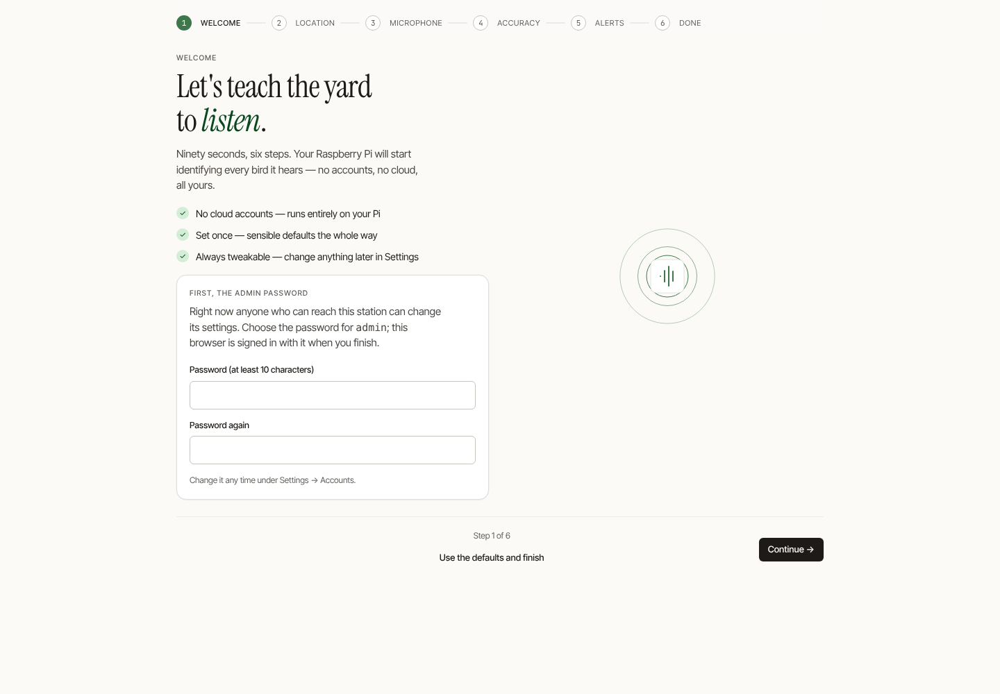
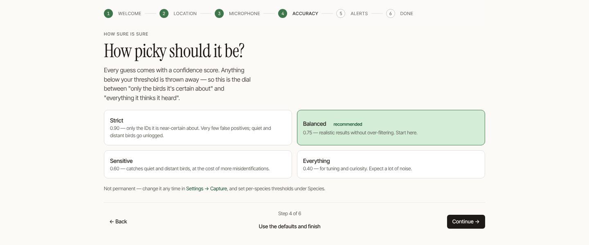

# First Steps

After starting (via the installer or Docker), open the web dashboard:

```text
http://<your-ip>:8502
```

> Not sure of your Pi's IP? Run `hostname -I` on the Pi, or check your router's device list.

The dashboard binds to all interfaces by default, so it's reachable from any device on your LAN — no extra step. Viewing needs no login; the **Admin** panel, the Settings management tabs and every action that changes something do. The bare-metal installer prints an auto-generated admin password once in its post-install summary (username `admin`) — log in with that when you open `/admin`. Lost it? See [Remote Access & Security](../admin/remote-access.md#built-in-admin-sign-in) to read or reset `CADDY_PWD`. To restrict the dashboard to the Pi itself, set `BIRDNET_LISTEN=127.0.0.1:8502`.

If you set your latitude/longitude and an audio source, detections start appearing within a minute or two of the first bird call — no further configuration required.

## A two-minute tour

The UI has six homes — the tabs along the top (and the phone bottom bar):

1. **Today** (`/`) — the home and right-now view: live signal, the day strip, and the full searchable detection log. See [Today](../guide/today.md).
2. **Species** (`/species`) — browse every species you've recorded as a list, a photo grid or your growing life list. See [Species & the Life List](../guide/species.md).
3. **Patterns** (`/patterns`) — the analytics: when birds are active, the dawn chorus, migration, who sings together, trends. See [Patterns](../guide/patterns.md).
4. **Recordings** (`/recordings`) — play back captured clips and listen to live audio.
5. **Reports** (`/reports`) — the weekly recap, year in review and history calendar. See [Reports](../guide/reports.md).
6. **Settings** (`/station`) — health at a glance, plus all configuration and admin. Start with **General** (`/station/settings`) for optional fine-tuning: confidence threshold, per-species overrides, email, quarantine rules.

## First-run wizard

You do not need a terminal, a config file or a command-line flag to get a new station detecting. Open **`/onboarding`** (a fresh station is sent there automatically the first time you open the dashboard) and answer a seven-step wizard — about two minutes:

1. **Welcome** — on a station with no admin password (a Docker run without `CADDY_PWD`, say) this step asks you to choose one, and the browser that finishes setup is signed in with it. If the installer generated a password for you, you are asked to sign in first and then land on the wizard.
2. **Model** — the bird-identifying model is a download of about 54 MB that the program does not ship. This step says whether it is installed; if not, one button downloads and checks it, with a progress bar. A download that fails says why and can be retried.
3. **Location** — latitude and longitude (with a lookup from a place name), the station's name, and the language bird names are shown in. The location it saves must be a real coordinate pair (both values, within ±90 / ±180) and a time zone this host knows, or it is left unset and the server log says why.
4. **Microphone** — the sound cards the system lists that can record are offered by name, with a **Test** button that records two seconds and shows how loud it was. A network camera's address (RTSP) or a device name can be typed instead. What you choose becomes the same audio source **Settings → Capture** shows.
5. **Accuracy** — plain-language presets for the minimum confidence a detection needs before it is recorded. The default is **0.70**, BirdNET-Pi's own default (it was 0.75 up to v0.17.1), so that a station nobody has customised stores the rows BirdNET-Pi stores for the same audio. Change it later under **Settings → Capture → Detection Settings**, where per-species thresholds also live.
6. **Alerts** — plain-language presets for when to be notified.
7. **Done** — saves everything and shows what is true now: whether the model is installed, which microphone was chosen, and the **one button that restarts the station** so it starts listening. A station that is not run by a service manager restarts itself in place; no terminal is needed.





Everything the wizard shows is read from the station itself — if a read fails the page says so instead of drawing a wizard from defaults that would overwrite your real settings. If nothing is configured as a microphone, the final page says so plainly, because a station with no source detects nothing.

### After the wizard

Every setting can be changed later from **Settings** in the browser. Each setting carries a badge saying whether it **applies immediately** or **after a restart**; when something is waiting for a restart, a banner at the top of Settings says which settings and offers the restart button. The complete list of where each setting lives — and the few that are deliberately file-only, with the reason — is in [Where to change it](../reference/where-to-change-it.md).

## Health check

At any time you can run the built-in diagnostic, which prints a one-screen report covering CPU, configuration, audio reachability, the model file, database integrity, disk, and network — each problem with a concrete suggested fix:

```bash
# Bare metal: the service runs as the account that ran the installer (there is
# no "birdnet" user); this prints that account and runs the doctor as it
sudo -u "$(systemctl show -p User --value birdnet-behavior)" birdnet-behavior --doctor

# Docker
docker compose exec birdnet birdnet-behavior --doctor
```

See [Troubleshooting](../guides/troubleshooting.md) if anything looks off.
