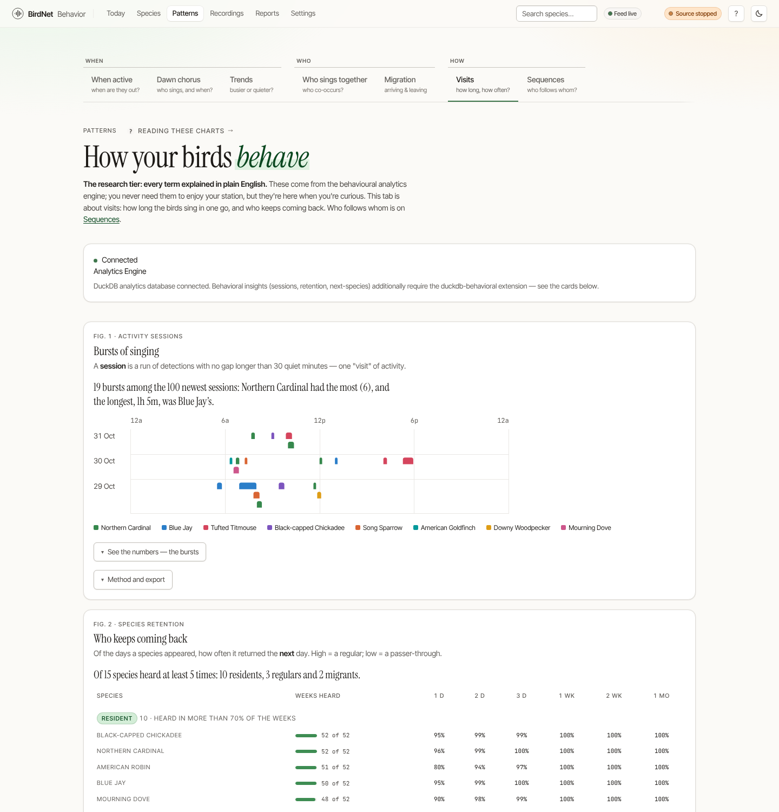
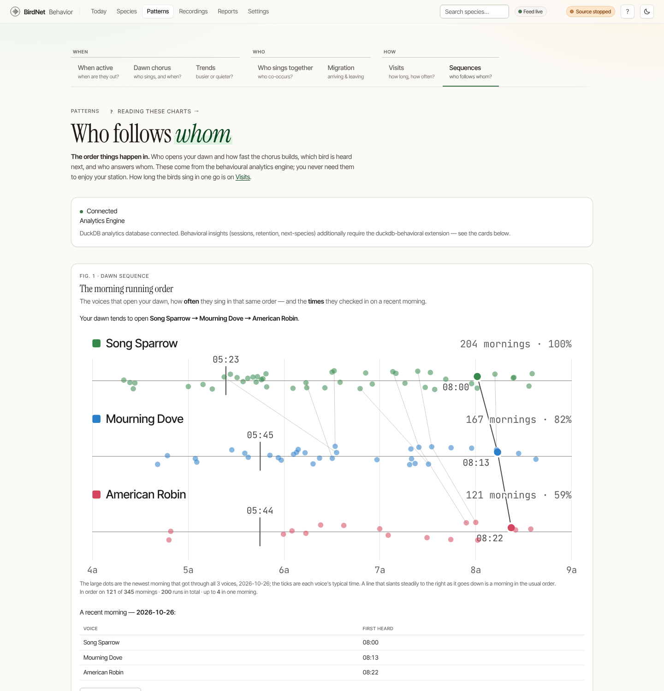

# Behavioral Analytics

BirdNet-Behavior turns a stream of detections into behavior. The analytics screens answer *when* the yard is alive and *who* sings with whom.

## Activity heatmap — "When the yard is alive"

The **When active** and **Dawn chorus** tabs of [Patterns](./patterns.md) (`/patterns`) stack several bespoke visualizations:

- **Activity streamgraph** — species composition over time, drawn from a centered baseline. Each band is a species and its thickness is that day's count; the eight busiest are drawn one by one and every other species is one more band, so the whole is the day's real total. Point at a day (or use the arrow keys) for every species' count; point at a band, or at a name in the key, to bring that species forward and put the rest in the background. The curves between days are smooth but never rise above a peak or below a trough the counts did not have. A day the station was not listening is hatched, so it is not read as a silent day.
- **Activity grid** — an hour × day-of-week mosaic of rounded cells on the sequential sand-to-brick ramp (one hue family, steps by the square root of the count so one detection and ten are told apart). The colour is the average per day in that slot, so a 90-day window's thirteen Mondays are compared with its twelve Tuesdays fairly. The totals for each weekday are beside the grid and the totals for each hour are under it; the busiest cell is ringed and named. Three states are kept apart: a count is a colour, a quiet hour is an empty cell, and a weekday the station was off for is hatched; an hour of today that has not happened yet is an outline that says "Not yet".
- **Circadian rhythm** — a polar plot where each species occupies its own concentric ring that swells where it's active across the 24-hour clock, with a sky strip (night, first light, day), three-hour ticks, the sun and a solid "now" hand; see [The Dawn Chorus](./dawn-chorus.md).
- **Detections by hour** — the day's totals as columns on an axis from zero, with the night shaded behind them (from your station's sunrise and sunset) and dawn and dusk in colour. It is a bar chart rather than a clock because the question is *how much more*: length on a common baseline is read more accurately than an arc, and the dawn chorus tab already has the clock for *who sings when*. Only the busiest hour is labelled; point at any hour for its count, its share of the day and, on Today, its three busiest species.
- **Seasonal phenology** — a migration ridgeline, one gradient-filled ridge per species, with spring and fall season bands behind; see [Migration & Phenology](./phenology.md).

### Pointing at a chart

Every chart here answers to a pointer, a finger and a keyboard alike. Point at it (or touch it, or Tab to it and use the arrow keys) and a small card reads out what is under you: the day and every species' count, the hour and its share of the day, the cell and its count. **Left and Right** step along the chart, **Up and Down** step by row (the grid), by week (the calendar) or from species to species (the streamgraph), **Escape** lets go, and each step is read aloud to a screen reader. The same figures are always in the table under the chart, behind "Show as a table". Nothing moves when you do this, and with reduced motion on (in your system, or under Settings → General → Display → Motion) the charts simply appear instead of growing into place. The reasoning behind how these charts are drawn, and what they refuse to do, is in `docs/design/charts.md`.

## Co-occurrence — "Who sings with whom"

The **Who sings together** tab of [Patterns](./patterns.md) (`/patterns?tab=together`) shows which species are detected together — heard in the same five-minute block of the same day. A pair's strength is its overlap: the blocks they share, as a share of the blocks in which either was heard. A pair needs at least three shared blocks to be drawn.

- **The acoustic network** — the data drawn as a **chord diagram**: each species an arc, each pair that is heard together a ribbon whose width and colour are how much of their time they share. The species stand in the order that crosses the fewest ribbons, so groups that sing together sit together. It shows the 12 strongest links (choose 24 or All). **Point at a name** and only its ribbons stay in the foreground; point at a ribbon and only it and its two species do. The ring needs a wide screen: on a phone you get the **ladder** instead, a staircase matrix with each name at the foot of its own step (read across a row to its name, up a column to the other).
- **Co-occurrence matrix** and **strongest pairs** — the same numbers as a table behind "See the numbers".
- **Top co-occurring species** and a **companion lookup** let you ask "what's usually nearby when I hear X?"

> The richest DuckDB-powered views — activity sessions, species retention, next-species prediction, year-on-year trends — are **on by default**: every release has the analytics engine built in, and the installer and Docker compose enable it automatically. If you've turned it off on a low-RAM board, these panels explain what they'd show and how to switch it back on. See [Configuration](../getting-started/configuration.md).

## How — Visits and Sequences, the research tier

The **How** group of [Patterns](./patterns.md) draws what the analytics engine computes, on two tabs: **Visits** (`/patterns?tab=behavior`) for how long and how often the birds are heard, and **Sequences** (`/patterns?tab=sequences`) for the order things happen in. Every figure on them has the same four layers, in the same order: one sentence of what it found, the picture, a closer look (the numbers behind a "See the numbers" button), and **Method and export**.

### Visits

- **Bursts of singing** — a lane per day with the hours along it and a bar for each burst, from the moment it began to the moment it ended; bursts of different species that overlap are stacked, never drawn over each other. The legend brings one species forward.
- **Who keeps coming back** — species grouped as resident, regular, migrant and rarity (how much of the station's time they were present), with the weeks each was heard and how often it was heard again a day, two, three, a week, a fortnight and a month later, each a cell that also prints its number.

### Sequences

- **The morning running order** — a lane per voice of your dawn, the clock from 04:00 to 09:00 along it, a dot for every morning's first-heard time, thin lines joining the newest mornings from lane to lane, a tick at each voice's typical time and the newest complete morning drawn large. A line that slants steadily to the right as it goes down is a morning in the usual order.
- **How fast the chorus comes together** — how long, once the dawn starts, before it is a chorus? Each column is a *time allowed*, from the first voice to the last (1 minute up to 5 hours); each row is how many of your usual dawn voices (up to six, in the order they typically open) have joined, in that order, within it. A disc's **area** is the share of your mornings, over the last 90 days, that had that many voices together in that time, and its colour is the voice that completes the row. The **bold line** is the typical morning (the most voices that at least half your mornings had, at each time allowed) and the **shaded band** is the middle half of mornings (from the most that three in four had to the most that one in four had); the figures at the right are the share that ever got that far. A chorus that assembles fast is discs that grow early and to the left; a station whose voices straggle in has its big discs far to the right. The sentence above says it in words (for instance "on half of your 76 mornings 2 voices were together, in order, within 45 min"), and says so when fewer than seven mornings, or fewer than three regular dawn voices, leave too little to read. On a phone the figure is redrawn at its own size, with row numbers and fewer column labels, so no label is cut short.
- **Neighbouring species** — who is heard just before and just after the latest species, as a flow with that species in the middle (ranked bars on a phone); a ribbon's width is the share of the sessions that had a bird on that side (a session the bird opens has no bird before it, and one it closes has none after).
- **Who answers whom** — after one bird is heard, which others are heard within a minute? A grid: read across a row, where the bird on the left was heard first, and the disc under each column says how often that bird was heard within a minute after it. It is not the same both ways (a Blackbird may follow a Robin often and a Robin a Blackbird rarely), and the sentence above the grid names the most one-sided pair. Two birds heard at the same instant are not counted as replies, and neither is a bird repeating itself; a pair seen fewer than three times is a small ring and never a finding. It looks back 30 days at the eight birds heard most.

> **Why the chorus is built on `window_funnel` and not on `window_funnel_events`.** The step *times* of `window_funnel_events` are the latest occurrence of each voice before the next one (a Robin at 05:00 and 05:03, a Blackbird at 05:02 and 05:04, a Wren at 05:30 give 05:03, 05:04, 05:30, while the first occurrences are 05:00, 05:02, 05:30), so a gap between two of its steps depends on that choice and not on the birds. `window_funnel` asked at a ladder of windows has no such choice: how many voices fit within *this* long, at any point in the morning, with the boundary inclusive. The function and its REST route are still there (`/api/v2/analytics/funnel-events`).

### Method and export

Under every figure on these two tabs, a closed **Method and export** button opens a short panel: which of the extension's functions computed the numbers (and the extension's version, read from the running engine), exactly what was asked of it (the voices and their order, the times, the hours of the morning, the days), a sentence on what a number in the figure counts, and how to take the numbers away:

- **The numbers as JSON** links to the REST route that returns the same figure (`/api/v2/analytics/assembly` for the chorus, `/api/v2/analytics/answers` for who answers whom, and the existing `sessions`, `retention`, `sequence-count`, `sequence-match-events`, `funnel`, `next-species` and `previous-species`), with the question already in the address, so it returns these numbers and not the route's defaults. A link is left out where it could not be made true (a bird whose name has a comma in it cannot be said in a comma-separated list).
- **Download the table as CSV** saves the table beside the figure. The file is built in your browser and sent nowhere; it opens in a spreadsheet without surprises (UTF-8 with a byte order mark, so accented names survive, and a cell that a spreadsheet would run as a formula is written with a leading apostrophe, unless it is plainly a number). The button appears once the page's script has run.
