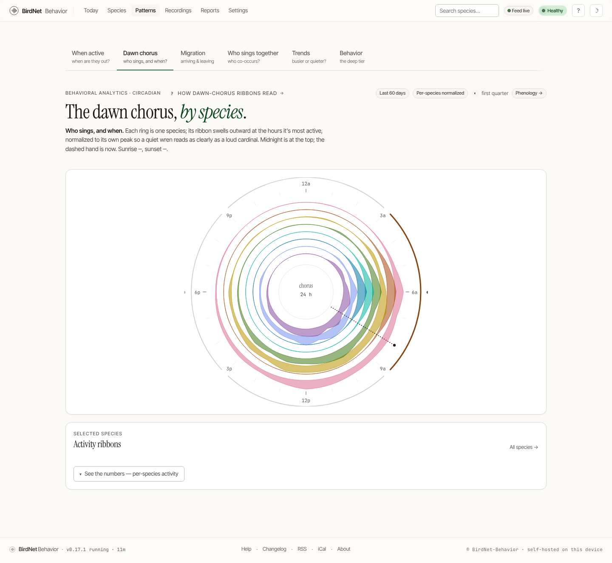

# The Dawn Chorus

The **Dawn chorus** tab of [Patterns](./patterns.md) (`/patterns?tab=dawn`) shows the daily *rhythm* of your yard: which species sing when, wrapped around a 24-hour clock and anchored to the real sunrise and sunset for your location.

## What you're looking at

- **The rings** plot detection activity around a 24-hour dial (midnight at the top, noon at the bottom). Each species is a coloured ring that swells outward at the hours it was heard, scaled to its own busiest hour so a quiet wren reads as clearly as a loud cardinal. Point at a ring (or tab to it and use the arrow keys: left and right move by the hour, up and down from ring to ring) and it comes forward and says the hour, the count, that hour's share of the bird's day and its busiest hour. A swell sits on the middle of its hour: a bird heard through 06:00-06:59 peaks at 06:30.
- **The sky strip** round the rim is drawn from the station's coordinates: night, first light (civil dawn), daylight and last light, with the sun where the colour changes. The times are in the key beside the chart. Birds start singing in first light, so it is drawn beside sunrise.
- **The middle** says the time now (the line from the centre is the same hand) and the window the rings are drawn from (60 days); the four arcs round it are the moon's phase.
- **The key** beside the chart names every ring with its busiest hour; hover or focus a name to bring its ring forward, click to hold it.
- **Each bird's day** lays the same species flat: one row each, a column per hour, the dawn window shaded and the sun's day a line. The numbers are in a table under it.

## Setting your location

The sunrise/sunset markers use the station's configured coordinates — the
`latitude` / `longitude` settings you enter in the onboarding wizard or under
**Location & Recording Schedule** on the settings form. With no coordinates the
ribbons still draw, but the sun markers and the night wedge are omitted rather
than guessed (see below). `BNB_STATION_LAT` / `BNB_STATION_LON` are read only by
the weather integration and have no effect here.

## A note on time zones

Everything on this clock is in the station's **local** time: the ribbons are bucketed from the local hour in each recording's filename, and the sunrise/sunset markers are computed for your configured coordinates and then shifted into the same local frame. Set your station's timezone with `timedatectl set-timezone` (which is what `--doctor` checks) and set your coordinates on the Settings page — the two together are what makes the sun markers land where the sun actually was.

This page previously told you to run the station on UTC. That was advice for a defect, not a design: the markers were computed in UTC and drawn over local-time ribbons, so on any non-UTC station they were offset by the UTC difference, and they contradicted `--doctor`, which has always told operators to set their local timezone. The markers were additionally computed for a hard-coded (40.0 N, 74.0 W) unless two undocumented environment variables were set, on a day-of-year that drifted about a day a year. All three are fixed; run the station on its real timezone.

**No coordinates set?** The ribbons still draw — they need no location — but the sun markers and the night wedge are omitted rather than guessed. A sun drawn where your station is not would answer "does this species sing before sunrise?" wrongly while looking authoritative.

> Like the [migration](./phenology.md) view, this is built entirely from your own detections — no external data.
