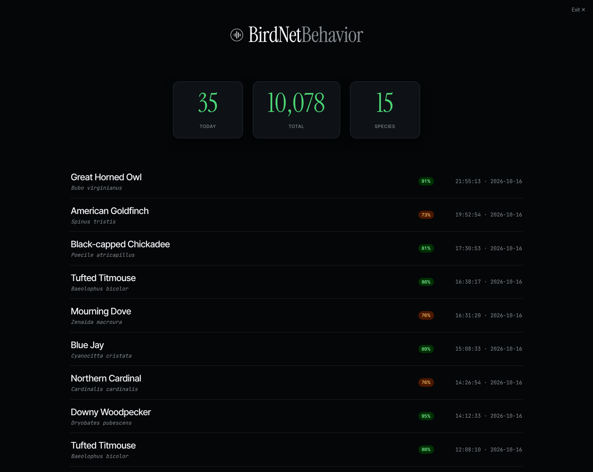

# Kiosk Mode

**Kiosk mode** (`/kiosk`) is a full-screen display for a wall-mounted screen — a Raspberry Pi touchscreen by the window, a spare monitor in the hallway, a TV in the visitor center. It has three faces, switched by the faint links at the top left (or `?mode=` in the address):

| Face | Address | What it shows |
|---|---|---|
| **Plate** (the default) | `/kiosk` | Today's birds as a page from a field guide: one oval per species, larger the more it was heard, the Latin name beneath, a numbered key at the foot. |
| **Latest** | `/kiosk?mode=latest` | The bird heard most recently, large. |
| **Numbers** | `/kiosk?mode=numbers` | The original display: today's count, the all-time total, species, and a list of the latest detections. |

The plate is drawn for a wide screen: its smallest captions are set at 8.5 px or more only in a window about 1180 px wide or wider. In a narrower window (a phone, or a 7-inch Pi display at 800 × 480) `/kiosk` opens on **Numbers** instead, and `/kiosk?mode=plate` asks for the plate there anyway.

To leave kiosk mode, click the dimmed **Exit** link in the top-right corner, or press **Esc** — either returns you to the full dashboard. Both links stay faint so they never compete with the display, and brighten when someone is at the screen.

## The plate

*An example morning at a European station. The pictures are public-domain plates from the books named in the foot, fetched from Wikimedia Commons; the Great Tit has none in the index, and its cartouche stays empty because this capture draws no photographs.*

The plate is numbered by the day of the year (Plate CCCI is 28 October), titled by the time of day ("Heard this morning"), and redrawn only when the birds change — a quiet hour does not repaint the wall. Sizes follow the square root of the count, with a floor so a bird heard once is still drawn: it is a hierarchy to look at from across the room, and the exact counts are in the key. Species beyond what the sheet can hold are listed in the key and marked with a dot.

In the small hours, before anything has been heard today, the plate shows yesterday's and says so.

**Pictures.** Each oval starts as a hatched cartouche carrying the Latin name, and fills as its picture arrives. There are three kinds of picture, tried in this order.

1. **A plate, where there is one.** For a minority of species the station knows a nineteenth-century plate from John Gould's bird books ([*The Birds of Europe*](https://commons.wikimedia.org/wiki/Category:The_Birds_of_Europe_(Gould)), and those of Asia, Great Britain, Australia, New Guinea and the Himalaya), Johann Friedrich Naumann's *Naturgeschichte der Vögel Mitteleuropas* or the von Wrights' *Svenska fåglar*, all in the public domain. The plate is fetched from Wikimedia Commons the first time that bird is heard and kept in a `plates/` folder inside the picture cache, so a station with no network after that still draws it. Its page is cut away, so the birds fill the figure, and its paper is levelled to the sheet's: by day it is multiplied into the sheet, so only the ink and colour of the plate remain; by night it is a lit print on the dark ground. Which species have a plate is decided by an index built into the program (built by `tools/plate-index/`; its `report.md` has the counts and the licence rules, and it is Europe-heavy, so on a North American station few birds have one). The plates are credited on the kiosk's foot and on **Picture credits** (`/system/credits`).
2. **Your own art**, if you supplied some (below), which is drawn as it is.
3. **The station's photograph**, the one on [Species & the Life List](species.md), when there is no plate. Your browser *engraves* it: line-hatched by tone, tinted from the photograph's own colours, and given a deckled edge. The whole photograph is shown, never cropped. Nothing is sent anywhere to do this. By night the lines fall where the photograph is bright rather than dark, so a dark bird stays a dark bird on dark paper. Art you supply yourself comes before both: if your [`CUSTOM_IMAGE_DIR`](../reference/configuration-reference.md) holds `turdus_merula.jpg` (the scientific name, lower case, with underscores), that file is drawn exactly as it is, with its own transparency, and never engraved or levelled. Put the credit for such art on the first line of a `CREDITS.txt` beside it and the plate prints it in its foot.

The foot is written from what was drawn: the books the plates came from, whether any photograph was engraved, and the address of the credits page, which an engraved photograph needs because an engraving is an adaptation of it.

**Day and night.** The plate has its own pair of palettes rather than following the dashboard theme: paper and ink by day, lamplight after dusk. Which one is chosen from the station's sunrise and sunset (half an hour either side), or from 06:00 and 20:00 without coordinates. `?night=1` or `?night=0` forces one.

**Small boards.** The paper's grain is a filter pass; add `?paper=0` to leave it out on a very small board. The sheet follows the screen's shape, portrait and ultra-wide included, and drifts a few pixels over ten minutes (off for anyone who has asked their system for reduced motion) to spare an OLED panel. A busy day draws the most-heard birds as figures and lists the rest in the key.

## Tips for a dedicated display

- Point a full-screen browser at `http://<your-pi>:8502/kiosk`.
- On Raspberry Pi OS, Chromium's `--kiosk` flag plus the URL is all you need in an autostart entry.
- For an always-on display, make sure a system CJK font (e.g. `fonts-noto-cjk`) is installed if you expect non-Latin species names — the dashboard ships all its Latin fonts self-hosted and never calls out to a font CDN.

## Where the idea comes from

The plate is a new implementation of an idea from [fugleramme](https://github.com/arnegiacomo/fugleramme) by Arne Giacomo Munthe-Kaas: a picture frame that shows the birds heard as nineteenth-century plates on paper, redrawn only when the birds change. BirdNet-Behavior shares no code and no artwork with it: its code is MIT-licensed and its artwork CC BY-SA 4.0, and this project's licence (CC BY-NC-SA 4.0) cannot carry the latter. That is why the plate engraves the station's photographs, or draws art you supply, instead of bundling any.
