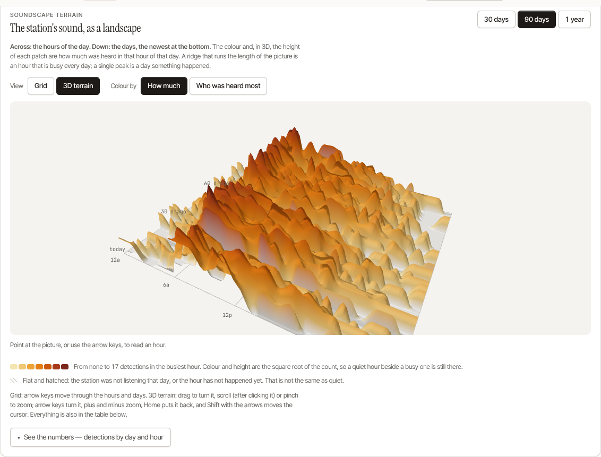

# Patterns

**Patterns** (`/patterns`) is the analytics home — "when & where?". It gathers
the station's deeper readings behind one tab strip, each tab leading with a
single picture and a plain-English read, with the dense numbers tucked behind a
"see the numbers" disclosure. A hobbyist never meets six analytical surfaces at
once; a researcher still reaches every one in a click.

The tab bar groups the tabs under three labels, so you choose a kind of question before a page:

| Group | Tab | Question it answers | Covered in |
|---|---|---|---|
| **When** | **When active** | when are they out? | the [soundscape terrain](#the-soundscape-terrain), the hour × day-of-week heatmap + by-hour totals |
| | **Dawn chorus** | who sings, and when? | [The Dawn Chorus](./dawn-chorus.md) |
| | **Trends** | busier or quieter? | detections a day against their 7-day average and the 30 days before, and species richness, each with the busiest and quietest day named |
| **Who** | **Who sings together** | who co-occurs? | the co-occurrence chord diagram (a ladder matrix on a phone) |
| | **Migration** | arriving & leaving | [Migration & Phenology](./phenology.md) |
| **How** | **Visits** | how long, how often? | [Behavioral Analytics](./analytics.md#visits): bursts of singing, who keeps coming back |
| | **Sequences** | who follows whom? | [Behavioral Analytics](./analytics.md#sequences): the morning running order, how fast the chorus comes together, neighbouring species, who answers whom |

> The grouping changes how the bar looks and nothing about an address: every tab keeps the `?tab=` it had (`when`, `dawn`, `trends`, `together`, `migration`, `behavior`), and the Sequences tab is the new `?tab=sequences`. On a phone the bar scrolls sideways and opens on the tab you are on.
>
> The old standalone addresses still work and redirect into the right tab:
> `/heatmap` → `When active`, `/analytics/dawn-chorus` → `Dawn chorus`,
> `/migration` → `Migration`, `/correlation` → `Who sings together`,
> `/timeseries` → `Trends`, `/analytics` → `Visits`.

Every chart is rendered server-side as inline SVG — no JavaScript charting
runtime — so the page stays light on a Raspberry Pi and works offline. The
three deepest readings have their own pages, linked above.

## The soundscape terrain

The **When active** tab leads with the station's last 30, 90 or 365 days as a
landscape: the hours of the day across, the days down (the newest at the bottom),
and the colour of each patch how much was heard in that hour of that day. It opens
as a flat grid of those numbers. **3D terrain** raises the same numbers into a
height-field you can turn: drag (or one finger) to orbit, scroll after clicking it
or pinch to zoom, the arrow keys to turn, plus and minus to zoom, Home to put it
back, Shift with the arrows to move a reading cursor. **Colour by** switches from
how much to which species was heard most in each hour.

Height and colour are the square root of the count, so a quiet hour beside a busy
one is still there. A day the station was not listening, and an hour that has not
happened yet, are flat and hatched: that is not the same as quiet. The 3D view
loads its one library (a part of three.js, about 134 kB compressed) only when you
choose it; a browser without WebGL keeps the grid and says so. Every reading is
written under the picture and the numbers are in a table behind "See the numbers".
Design notes and the checks behind it: `docs/design/charts-relational.md`.

