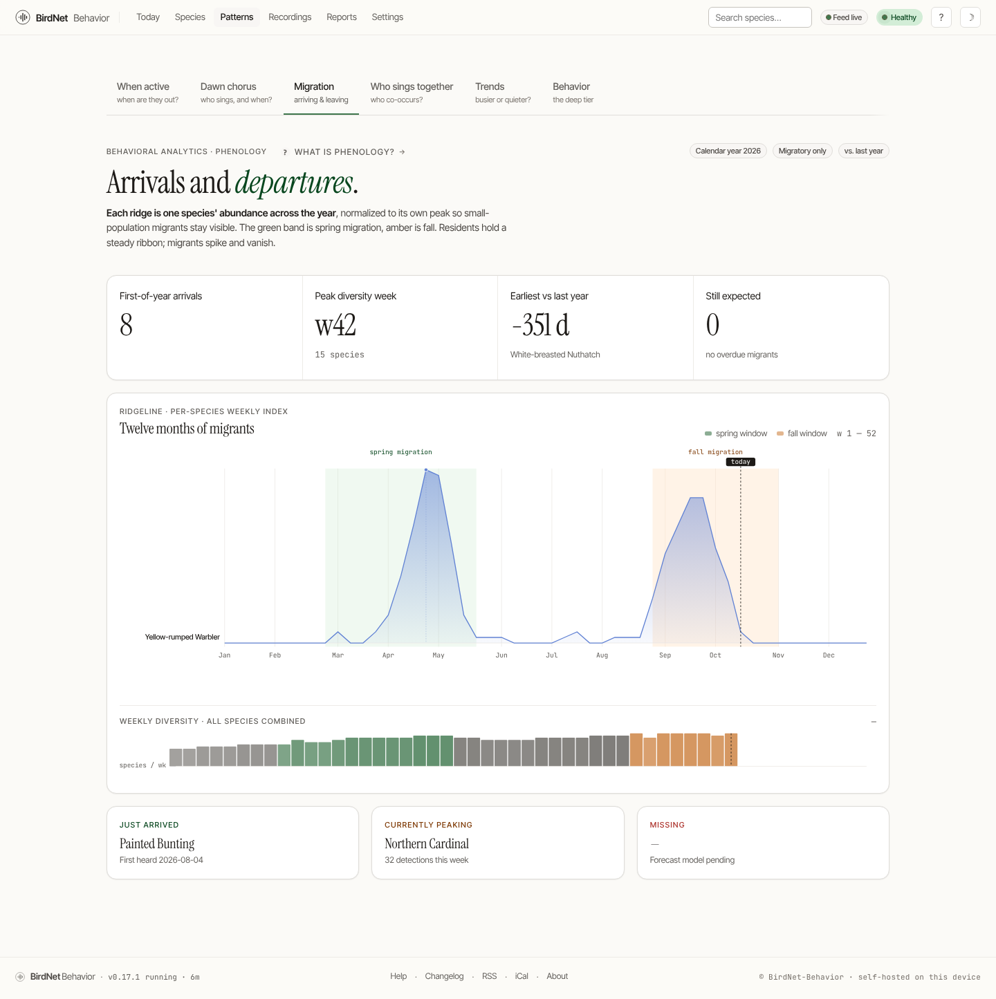

# Migration & Phenology

The **Migration** tab of [Patterns](./patterns.md) (`/patterns?tab=migration`) turns a year of detections into a picture of *when* each species moves through your yard. It's the seasonal companion to [Today](./today.md)'s right-now view: instead of "what's singing this minute?", it answers "who has arrived, who's peaking, and who's overdue?"

## What you're looking at

- **Four KPI tiles** across the top:
  - **First-of-year arrivals** — species whose first-ever detection at the station falls in the current year.
  - **Peak diversity week** — the calendar week with the most distinct species so far.
  - **Earliest vs last year** — of the birds that *arrived* in both this year and last (first heard from the end of January on), the one that came furthest ahead of its arrival last year, in days (a negative number means earlier). It needs a last year that was recorded from its start: a station that began part-way through it says "last year was only partly recorded" rather than comparing a first date that is only where recording began.
  - **Still expected** — species that arrived within the next six weeks of the prior year and haven't been logged yet this year. It says "needs a year of records" where there is no last year to expect from.
- **The ridgeline** ("joyplot") is the heart of the page: one ridge per seasonal species, stacked and ordered by peak week, a ridge being the species' detections each week as a share of its own busiest week. A ridge's colour is the season it peaks in (green for the spring migration window, amber for the fall one, grey for neither; the windows swap south of the equator). Point at a week to read every species heard in it with its real count and how many different species were heard; the weeks that have not happened yet are hatched, not drawn as zero.
- **The species-per-week lane** under the ridges is distinct species heard each week, on the same weeks.
- **Editorial cards** call out what *just arrived*, what's *currently peaking*, and what is **missing**: the birds that arrived in these weeks last year and have not been heard yet.

## How a species qualifies as "migratory"

The ridgeline uses a deliberately cheap heuristic on the current year's data: a species earns a ridge when its busiest week is at least three times its median active week (a sharp seasonal pulse), holds at least five detections, and it has been heard across at least four weeks. When more than twelve qualify, the twelve most sharply seasonal are drawn. Year-round residents — which detect at a steady level — are filtered out so the plot stays about movement, not abundance. Early in the year the page is naturally sparse; it fills in as the season progresses.

> This is a station-local view built entirely from your own `detections` table — no external range maps. It reflects what *your* microphone hears, which is exactly the point.

## Not the same as "Migrating from BirdNET-Pi"

This page is about bird migration through your yard. If you're looking to **import data from an existing BirdNET-Pi install**, that's a different feature — see [Migrating from BirdNET-Pi](../guides/migration.md) and the import panel under Settings → Data (`/station/data#import`; the old `/admin/migrate` redirects there).
