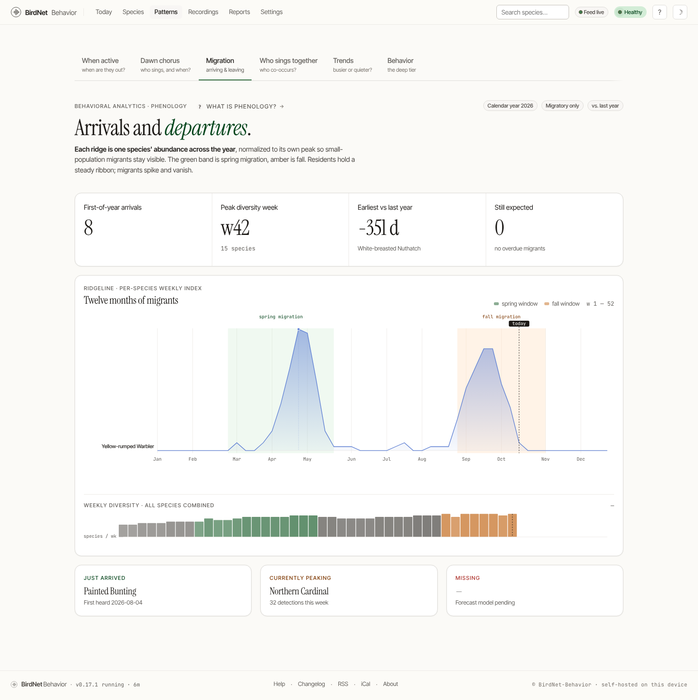

# Migration & Phenology

The **Migration** tab of [Patterns](./patterns.md) (`/patterns?tab=migration`) turns a year of detections into a picture of *when* each species moves through your yard. It's the seasonal companion to [Today](./today.md)'s right-now view: instead of "what's singing this minute?", it answers "who has arrived, who's peaking, and who's overdue?"

## What you're looking at

- **Four KPI tiles** across the top:
  - **First-of-year arrivals** — species whose first-ever detection at the station falls in the current year.
  - **Peak diversity week** — the week of the chart with the most distinct species so far, named as a time of year, with its week number under it: "late Sep", week 39. A week is named by its middle day: the 1st to the 10th of a month is early, the 11th to the 20th mid, from the 21st late. The weeks are the chart's: seven days from 1 January, the last one running to 31 December, so there is no week 53.
  - **Earliest vs last year** — of the birds that *arrived* in both this year and last, the one that came furthest ahead of its arrival last year, in days (a negative number means earlier). An arrival is not the first detection, which one false positive can move by months: it is the same onset the phenology data uses, the 5th percentile of the days the bird was heard that year (of 120 days heard, the 6th), so a stray detection in January does not move a May arrival. With twenty or fewer days heard it is the first day. Last year is read only up to today's date, so both years are measured over the same stretch of the season, and an arrival is an onset from the end of January on (a bird heard all winter is not arriving). It needs a last year that was recorded from its start: a station that began part-way through it says "last year was only partly recorded" rather than comparing a first date that is only where recording began.
  - **Still expected** — species that arrived within the next six weeks of the prior year and haven't been logged yet this year. It says "needs a year of records" where there is no last year to expect from.
- **The ridgeline** ("joyplot") is the heart of the page: one ridge per seasonal species, stacked and ordered by peak week, a ridge being the species' detections each week as a share of its own busiest week. A ridge's colour is the migration window it peaks in, spring, fall or neither, and the key under the chart names each (the windows swap south of the equator). Point at a week to read every species heard in it with its real count and how many different species were heard; the weeks that have not happened yet are hatched, not drawn as zero.
- **The species-per-week lane** under the ridges is distinct species heard each week, on the same weeks.
- **Editorial cards** call out what *just arrived*, what's *currently peaking*, and what is **missing**: the birds that arrived in these weeks last year and have not been heard yet.

## How a species qualifies as "migratory"

The ridgeline uses a deliberately cheap heuristic on the current year's data, measured per hour the station listened rather than in raw counts: a species earns a ridge when its busiest week is at least three times its median active week (a sharp seasonal pulse), holds at least five detections, and it has been heard across at least four weeks. Each week's rate is its detections on the days the station listened (a day with at least half the station's typical day of audio, the rule every page uses) divided by how much it listened, so a station that listened six hours a day most of the year and all day for six weeks does not see its resident wren "peak" in those six weeks. A week with fewer than three listened days is unknown and does not count either way; today is not counted until it is over. Days from before the station kept its listening record (imported history) count as ordinary listened days. The ridges themselves are still drawn from the raw weekly counts, which the readout and the table give. When more than twelve qualify, the twelve most sharply seasonal are drawn. Year-round residents — which detect at a steady level — are filtered out so the plot stays about movement, not abundance. Early in the year the page is naturally sparse; it fills in as the season progresses.

> This is a station-local view built entirely from your own `detections` table — no external range maps. It reflects what *your* microphone hears, which is exactly the point.

## Not the same as "Migrating from BirdNET-Pi"

This page is about bird migration through your yard. If you're looking to **import data from an existing BirdNET-Pi install**, that's a different feature — see [Migrating from BirdNET-Pi](../guides/migration.md) and the import panel under Settings → Data (`/station/data#import`; the old `/admin/migrate` redirects there).
