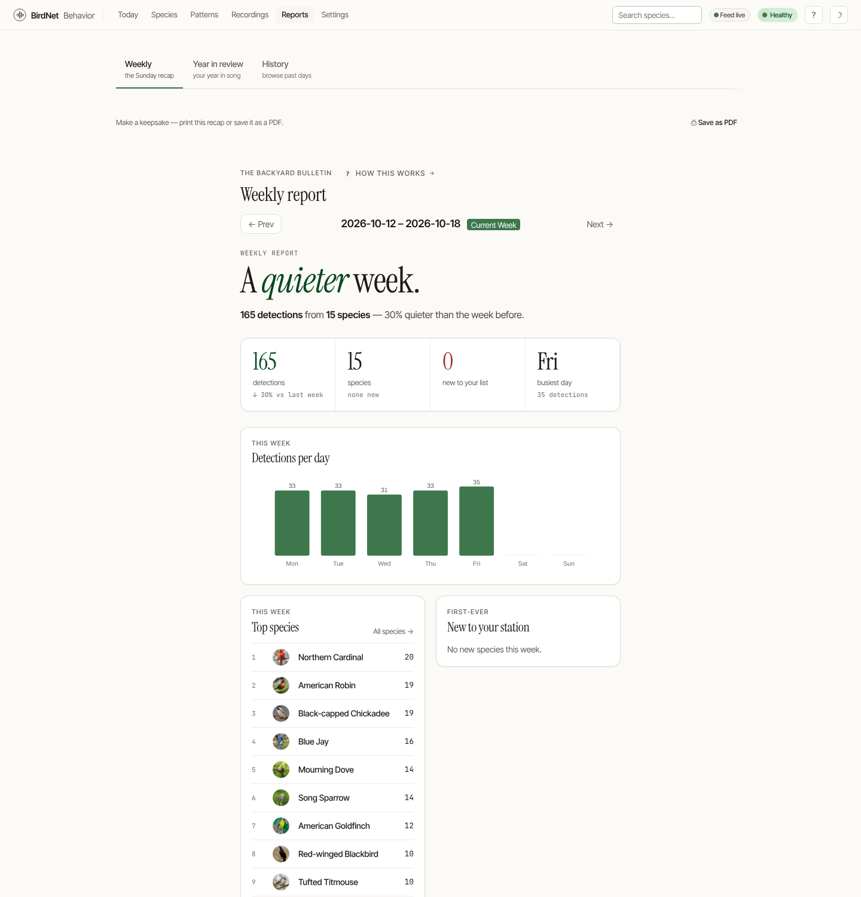
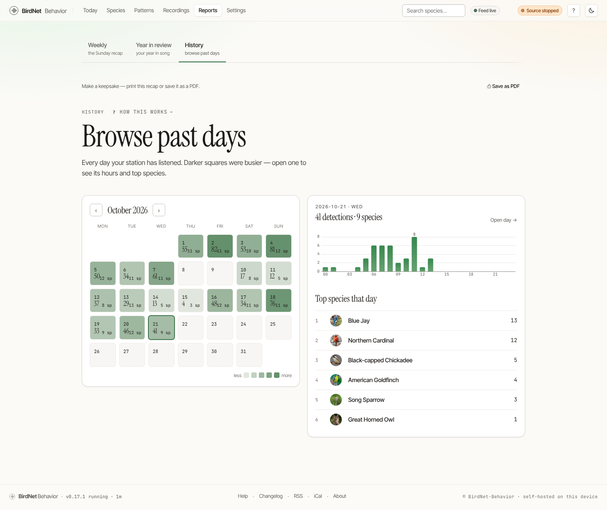

# Reports

BirdNet-Behavior turns your data into editorial recaps you'd actually want to read. **Reports** (`/reports`) gathers the look-back in one place, behind three tabs.

## Weekly

The **Weekly** tab (`/reports`) is a Sunday-paper recap of the week — total detections, species count, new arrivals, a daily-activity chart and the week's leaderboard. Navigate between weeks with the prev/next controls.

## Year in Review

The **Year in Review** tab (`/reports?tab=year`) is a celebratory recap of the
calendar year so far — 1 January to today. Every figure on it covers that
period and nothing earlier; on New Year's Day it starts again from nothing.

- a display headline and four big-number tiles (detections, species heard,
  species new to your list — first heard on this station this year — and the
  busiest day),
- a **calendar of the year** — a cell for every day since 1 January, a column a week, coloured by how many detections that day (the busiest day is ringed and named; a day the station was not listening is hatched, so it is not mistaken for a quiet one) — that shows its rhythm at a glance,
- the year's species leaderboard with banding-code avatars,
- **who led, and when it changed** — a rank-over-time chart of the year's eight most-heard birds, one line each, with a month scrubber and a leaderboard beside it for the month you choose. The lines are *ranks* (1st at the top), which hide how far ahead a bird was, so the bars show the true counts from zero, on one scale for the whole year. A month with none is a gap in the line, never a drop to last place, and a month that has not happened is marked "not yet". Press **Play** to step through the months; Play is not offered when your device asks for reduced motion,
- a milestones strip (first voice of the year, most-heard species, busiest day, newest arrival),
- and a closing tally.

## History calendar

The **History** tab (`/reports?tab=history`) is a calendar browser. Each day tile is intensity-coded by detection count; select a day to see its hourly activity and top species.

