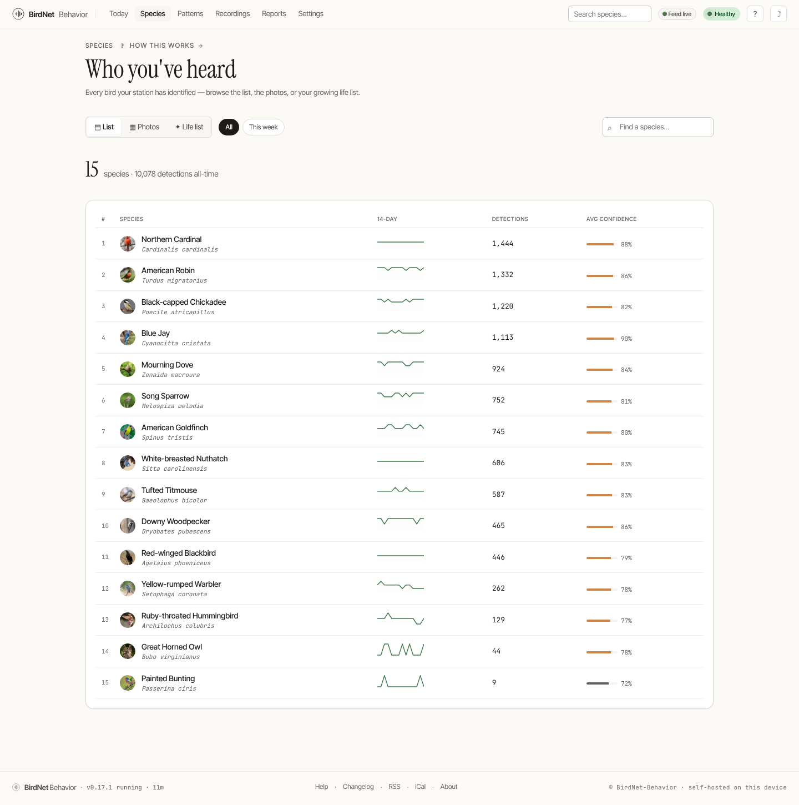
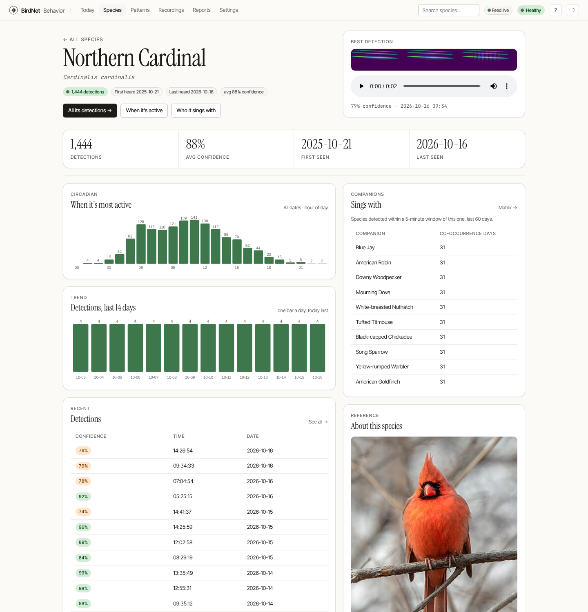

# Species & the Life List

What the Species home shows — the list of every bird the station has recorded, how to browse it by taxonomy, the per-species page and the life list — and how to read each; for anyone, hobbyist or researcher, who wants to browse or review what the station has heard.

## Species list

The **Species** page (`/species`) is the browsable index of every bird you've recorded — searchable and sortable by most-heard, A→Z, or newest.

Each row carries the species avatar, common and scientific name, all-time count, a 14-day sparkline, average confidence, and first/last-heard dates.

## Browsing by taxonomy

When the station has its classifier label file, the List and Photos views carry a row of **order** chips — *Piciformes*, *Strigiformes*, *Anseriformes* — with the number of your species in each. Clicking one narrows the page to that order; clicking **All orders** widens it again. The chips are built from the species *you* have recorded, not from the classifier's 11 560, so a garden with forty birds gets a handful of orders rather than seventy-five, and every chip leads somewhere.

The chips and the search box compose: search inside an order, or pick an order while a search is active, and neither drops the other. The view switcher keeps the order too, so List → Photos stays on the same birds.

Three ranks are browsable — **class**, **order** and **genus** — and each is a link on the species detail page, so *"the other Dryobates I've heard"* is one click from a woodpecker. Genus has no chip row: 2 907 genera is not a control.

**There is no family.** The shipped label file states a class and an order and nothing between them (its header is `idx;id;sci_name;com_name;class;order`), so a family would have to be inferred from the genus, and a guess sitting beside two stated facts is worse than an absent rank. A station whose label file has no taxonomy columns at all — the V2.4 text format has none — simply gets no chips, and its pages are exactly as they were.

## Species detail

Click any species for its detail page (`/species/detail?name=…`): a full-bleed Wikipedia photo, the scientific name and description, its class · order · genus (each a link back to the list filtered to that rank), an hourly activity profile, a multi-week activity grid, companion species (the birds it's most often heard alongside), and a strip of recent recordings.

## Why isn't a bird heard here?

A bird you can hear and the station never logs is, sometimes, a bird the station's **range filter** drops. The station asks a range model which species occur around where it is in each week of the year and holds back any it scores below the *Species Frequency Threshold* (default 3 %); see [the settings](../admin/settings.md#detection). Until now nothing said which birds that was.

The link **Why isn't a bird heard here?** at the top of the Species page (`/species/occurrence`) is the answer. Type a bird's name, in English, in the scientific form or in the station's own language, and it says in a sentence whether the station admits that bird this week, with the numbers: *"Held back: the range model gives it 0.4 % here in week 22; this station admits species at 3 % and above."* A bird the model scores well but that your own include or exclude list keeps out is said to be held back by *your lists*, not by the model, and a bird under the threshold that you put on the Always allowed list is said to be allowed by it. The week defaults to the current one; the selector goes through the model's 48-week year, four weeks to a month, so you can ask what the station would admit in May. Below the answer is the list of the birds the station does admit that week, a hundred at a time.

When a species page is for a bird the filter would hold back this week, a line under its headline says so and links to the answer for that bird.

If there is nothing to show, the page says why instead of showing an empty list, which would read as "nothing occurs here": the station has no location, no range model is loaded (so the filter is off and every bird the classifier knows is a candidate, wherever the station is), or the model would not run. The same answer is available to scripts as [`GET /api/v2/species/occurrence`](../reference/api.md#why-isnt-a-bird-heard-here). The numbers are the filter's own: the species the page marks admitted are exactly those the detection daemon lets through for that place and week, and a test holds that against the real V2.4 range filter.

The station's location is shown to one decimal place (about 11 km): enough to say which region's birds the question is about.

## Life list

The **Life List** (`/species?view=lifelist` — the old `/life-list` still redirects in) is your birding journal — every species, once. It leads with three tallies (species, total detections, active days) and a smooth **accumulation curve** showing the list growing over the year, then a per-month "new species" chart and the full ranked table with average-confidence pills.

> Confidence pills and bars use one colour rule everywhere in the app: green at 90 % and up, amber for a detection within ten points of the station's own cut-off (*borderline*), neutral in between. Because the edge follows your cut-off, a station that keeps 80 % and up has two tiers only: everything under 90 % reads as borderline. A key above each list says which applies, and none of the colours is the alert red.
