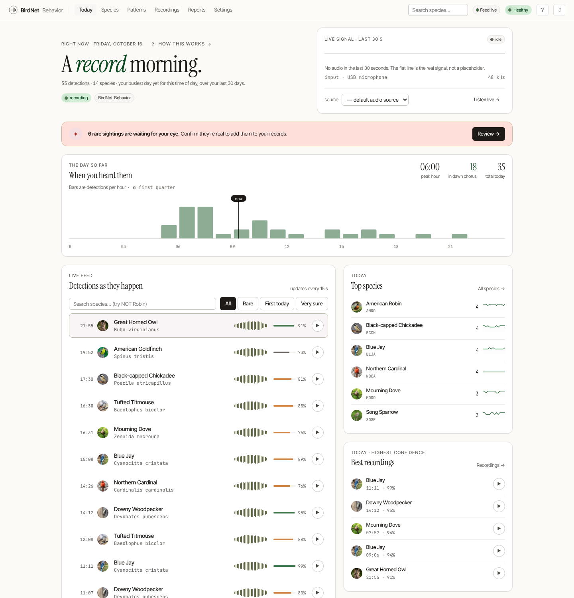

# BirdNet-Behavior

BirdNet-Behavior listens through a microphone, names the birds it hears, and shows them on a web page that any phone or computer on your home network can open. It runs on a Raspberry Pi 5, 4B or 400, or on a 64-bit Linux PC.

This page takes you from "I have a Pi and a microphone" to "I am looking at birds". Allow about 30 minutes. Everything else in this manual is optional reading for later.



## What you need

- A Raspberry Pi 5, 4B or 400, with its power supply and a microSD card.
- A USB microphone. [Hardware & Audio Sources](./getting-started/hardware.md) helps you choose one.
- Wi-Fi or a network cable for the Pi.
- A second computer, to prepare the SD card.

Two things to know first:

- **There is no ready-made SD card image.** You install the Pi's operating system yourself and then type one command.
- **You type that command in a terminal.** A terminal is a window where you type a line of text and press Enter. Steps 2 and 3 use one. Nothing after them does.

Not starting from a Raspberry Pi and an empty card? See [Other ways to install](#other-ways-to-install).

## Step 1: Put Raspberry Pi OS on the SD card

**Do this.** On your second computer, install [Raspberry Pi Imager](https://www.raspberrypi.com/software/). Choose your Pi model, then *Raspberry Pi OS (64-bit)*, then your SD card. When Imager offers to change settings, enter:

- a hostname, for example `birdnet`. The hostname is the Pi's name on your network.
- a user name and a password. Write both down.
- your Wi-Fi name and password, and your time zone.
- if the Pi will have no screen and keyboard: turn on **SSH**. SSH lets you type commands on the Pi from your other computer.

**You will see** Imager write the card and say that it is finished.

**If not:** check that you chose the 64-bit version. Its release name is "Trixie". The older release named "Bookworm" cannot run the installer in step 3.

## Step 2: Start the Pi and open a terminal

**Do this.** Put the card in the Pi, plug in the microphone, and connect the power. Wait two minutes. Then open a terminal in one of two ways:

- **With a screen and keyboard on the Pi:** open the program named *Terminal*.
- **Without them:** on your other computer, open *Terminal* (macOS, Linux) or *PowerShell* (Windows). Type the line below, with your own user name in place of `USER` and your own hostname in place of `birdnet`. Press Enter. Type the password when asked. Nothing shows on the screen while you type it.

```text
ssh USER@birdnet.local
```

**You will see** a line that ends in `$`. The Pi is waiting for a command.

**If not:** if the name is not found, look up the Pi's address in your router's list of connected devices. Use it in place of `birdnet.local`, for example `ssh USER@192.168.1.50`.

## Step 3: Run the installer

**Do this.** Copy this line, paste it into the terminal, and press Enter.

```bash
curl --proto '=https' --tlsv1.2 -fsSL https://github.com/tomtom215/BirdNet-Behavior/releases/latest/download/install.sh | sudo bash
```

The installer downloads the program and the bird-identifying model. It then asks three questions:

1. **Whether to use the microphone it found.** Answer `y`.
2. **Where the microphone is**, as latitude and longitude. To find these two numbers, right-click your position on <https://openstreetmap.org>. You can paste both at once, for example `49.4521, 8.6724`. Do not skip this question: without a location, the station names birds that do not live near you.
3. **A password for changing settings.** Type one, or press Enter to have one made for you.

**You will see**, after a few minutes, `Installation complete!` and below it:

- a line that starts `Web UI:` with an address such as `http://192.168.1.50:8502`
- `Admin panel login`, with the user name `admin` and the password

Write the address and the password down. A password that the installer made is shown only this once.

**If not:** the installer stops with a message that says what is wrong and what to do. If it says the operating system is too old, go back to step 1 and choose the 64-bit version. If it says `No microphone found`, press Enter to continue and choose the microphone in the browser later, under **Settings → Capture**. For anything else, see [Troubleshooting](./guides/troubleshooting.md).

## Step 4: Open the station in a browser

**Do this.** On a phone or computer that is on the same network as the Pi, open a web browser. Type the address from step 3, including `:8502` at the end.

**You will see** the **Today** page. It has no birds yet. You do not need to sign in to look. You sign in as `admin`, with the password from step 3, only when you change a setting.

**If not:**

- The page does not load: check that the phone is on the same Wi-Fi as the Pi, and that the address starts with `http://` and not `https://`.
- A setup wizard opens in place of the Today page: you skipped the location question. Sign in as `admin` and answer the wizard. [First Steps](./getting-started/first-steps.md#first-run-wizard) describes each of its steps.

## Step 5: Wait for a bird

**Do this.** Put the microphone at an open window or outside, away from wind. Keep the Today page open.

**You will see** the first bird within a minute or two of the first call that the microphone hears. Each entry has a name, a time and a recording that you can play.

**If not:** birds are quiet at midday and at night. Wait for an early morning before you suspect a fault. If nothing has appeared after a morning, open **Settings**. It shows the station's health and the time of the last detection. Then read [Troubleshooting](./guides/troubleshooting.md).

The station now runs by itself, and it starts again whenever the Pi is switched on. Save the address as a bookmark.

## Other ways to install

| Your situation | Read |
|---|---|
| A Linux PC, or a Pi that already runs the 64-bit "Trixie" system | Start at step 3. [Installation](./getting-started/installation.md) has every option. |
| A Pi on the older "Bookworm" system, or you prefer containers | [Running with Docker](./getting-started/docker.md) |
| You already run BirdNET-Pi | [Migrating from BirdNET-Pi](./guides/migration.md) |
| A network camera in place of a microphone | [Hardware & Audio Sources](./getting-started/hardware.md#rtsp-cameras-no-microphone-hardware) |
| A Mac (preview) | [macOS](./field/macos.md) |

## What to read next

| To do this | Read |
|---|---|
| Learn what each page shows | [Today](./guide/today.md), then the rest of the field guide |
| Change a setting | [Where to change it](./reference/where-to-change-it.md) |
| Get an alert for a new bird | [Notifications](./admin/notifications.md) |
| Find a lost password | [Remote Access & Security](./admin/remote-access.md#built-in-admin-sign-in) |
| Update the station | [Installation](./getting-started/installation.md#update-repair-reinstall-uninstall). Updating needs the terminal again. |
| Keep a copy of your data | [Backups & Recovery](./admin/backups.md) |
| Look up a word | [Glossary](./guides/glossary.md), [FAQ](./guides/faq.md) |
| Fix a problem | [Troubleshooting](./guides/troubleshooting.md) |

## Where it comes from

BirdNet-Behavior is a rewrite of [BirdNET-Pi](https://github.com/mcguirepr89/BirdNET-Pi) in Rust, derived from it and licensed accordingly. The licence is CC BY-NC-SA 4.0, which does not allow commercial use. The bird-identifying model is BirdNET, from the K. Lisa Yang Center for Conservation Bioacoustics at the Cornell Lab of Ornithology. [Credits & License](./about.md) has the full attribution.

It is one program, with nothing else to install beside it. Compared with BirdNET-Pi it adds pages about bird behaviour: activity through the day, the dawn chorus, migration, and birds heard together. It does not do everything BirdNET-Pi does. [Same audio, same detections](./guides/parity.md) says what was measured and what differs.
