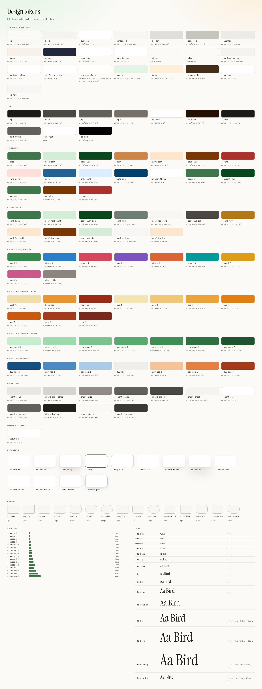
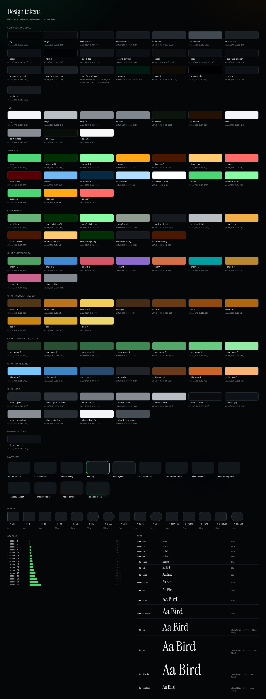

# Design tokens

The web UI's entire visual language — colour, type, spacing, elevation, corner
radii, motion — is expressed as a small set of **CSS custom properties**
("design tokens") defined once at the top of
[`crates/birdnet-web/static/css/app.css`](https://github.com/tomtom215/BirdNet-Behavior/blob/main/crates/birdnet-web/static/css/app.css).
Components read tokens; a colour or a pixel pad written into a rule is a defect
unless this page says why it is allowed (see [What stays literal](#what-stays-literal)).
This page is the reference for what each token means and what value it carries
in each theme.

Two principles govern them:

- **Colours are [OKLCH](https://oklch.com/).** OKLCH is perceptually uniform, so
  a hue stays the same "colour" as its lightness changes, and light/dark themes
  can be derived by moving lightness rather than re-picking hex values. The
  format is `oklch(L C H)` — lightness %, chroma, hue degrees — with an optional
  `/ alpha`. Every colour in the stylesheet, the categorical chart palette included,
  is written that way, so a colour-blind-safety check runs on the exact values that
  ship (see [Chart colours](#chart-colours)).
- **The token set grows by decision, not by accident.** New UI is built by composing
  existing tokens into new *classes*. Adding a token is a deliberate, reviewed design
  decision (see [Adding or changing a token](#adding-or-changing-a-token)), and the
  gates below refuse a raw colour, shadow, radius, duration, curve, layer or on-ladder
  gap where a token exists.

## At a glance

The stylesheet's light block declares
<!--count-light-->241<!--/count--> tokens, and the dark block overrides
<!--count-dark-->90<!--/count--> of them. Those two numbers are checked against
`app.css` by the test below, so they cannot go stale; every other number on this
page that describes the present is read from the stylesheet the same way.

| What | Enforced by |
|---|---|
| Every token declared here, with the value it has in each theme | `tests/design_tokens_doc_matches_the_stylesheet.rs` |
| Every `var(--x)` names a token that exists | `tests/css_variables_are_defined.rs` |
| Every token that flips between themes is forced to a light value on paper | `tests/print_forces_every_theme_flipped_token.rs` |
| No raw colour literal outside the token blocks, and no raw weight, hairline or bar radius where a token exists | `tests/design_tokens_are_the_only_literals.rs` |
| Every colour token has a value in both themes, or is named as theme-invariant | `tests/design_tokens_are_the_only_literals.rs` |
| The contrast ratios the tokens claim, measured in a browser in both themes | `tools/visual-qa/tokens.mjs` |
| A token refactor changes no element's computed style | `tools/visual-qa/style-snapshot.mjs` |
| No raw shadow, radius, duration, curve, layer or on-ladder gap outside a token definition | `tests/design_tokens_are_the_only_literals.rs` (rule 5) |
| The sequential, diverging and data-ink tokens, graded in both themes | `tools/visual-qa/chart-ramps.mjs` |
| The page washes, the translucent nav, surface order and the focus ring, graded | `tools/visual-qa/surface-layers.mjs` |
| The generated tables, every hand-written row's values and both counts equal `app.css` | `tools/visual-qa/token-doc.mjs --check` |

### Every token, drawn

Both pictures are rendered from the stylesheet the station serves, so they are the
tokens and not a drawing of them. `tools/visual-qa/token-swatches.mjs` regenerates
them; a token added to `app.css` appears without the script changing.





## Themes

Tokens are defined for two themes, selected by the `data-theme` attribute on the
`:root` element (set early by `static/theme-guard.js` to avoid a flash):

| Theme | Selector | Notes |
|---|---|---|
| Light | `:root`, `:root[data-theme="light"]` | The default. |
| Dark  | `:root[data-theme="dark"]` | Overrides the colour + shadow tokens only; structural tokens (radii, type, motion, layers, spacing) are shared. |

Because components only ever read tokens, switching `data-theme` reskins the
whole UI with no per-component dark-mode CSS. A token that differs between the
two blocks must also be listed in `static/css/print.css`, which forces the light
values on paper (`print_forces_every_theme_flipped_token.rs` enforces it).

## Colour — surfaces & lines

The greys that build the page: backgrounds, card surfaces, and dividers.

| Token | Light | Dark | Use |
|---|---|---|---|
| `--bg` | `oklch(98.5% 0.004 80)` | `oklch(12% 0.008 250)` | Page background. |
| `--bg-2` | `oklch(96.5% 0.005 80)` | `oklch(15% 0.008 250)` | Secondary background / inset wells. |
| `--surface` | `oklch(100% 0 0)` | `oklch(18% 0.010 250)` | Card / panel surface. |
| `--surface-2` | `oklch(97.5% 0.004 80)` | `oklch(22% 0.010 250)` | Nested surface, hover fill. |
| `--border` | `oklch(90% 0.006 80)` | `oklch(28% 0.014 250)` | Default border. |
| `--border-2` | `oklch(82% 0.008 80)` | `oklch(40% 0.018 250)` | Stronger border (inputs, buttons). |
| `--hairline` | `oklch(94% 0.005 80)` | `oklch(24% 0.012 250)` | Faint divider between list rows. |

## Colour — text

A four-step text hierarchy, brightest (most important) to faintest.

| Token | Light | Dark | Use |
|---|---|---|---|
| `--fg` | `oklch(22% 0.008 70)` | `oklch(97% 0.004 240)` | Primary text. |
| `--fg-2` | `oklch(40% 0.008 70)` | `oklch(80% 0.008 240)` | Secondary text. |
| `--fg-3` | `oklch(49% 0.008 70)` | `oklch(64% 0.010 240)` | Muted / metadata. |
| `--fg-4` | `oklch(55% 0.012 70)` | `oklch(62% 0.014 240)` | Faint / disabled. |

## Colour — semantic hues

Four hue families carry meaning across the app, and the legacy names `--success`,
`--warning`, `--danger` (below) say which: **success** is moss, **warning** is
dawn, **danger** is rare, and **information** is its own cool blue so that "for
your information" never reads as either "all is well" or "look at this". Each has
a base, a `-soft` tint (for fills/badges) and an `-ink` (for text/icons on a soft
fill; `--rare` is dark enough to be its own ink).

| Token | Light | Dark | Meaning |
|---|---|---|---|
| `--moss` | `oklch(52% 0.09 150)` | `oklch(78% 0.18 150)` | Primary / healthy / success — the "green" of a thriving yard. |
| `--moss-soft` | `oklch(92% 0.04 150)` | `oklch(26% 0.10 150)` | Soft green fill (a positive pill, the "live" tint, a very-sure confidence pill). |
| `--moss-ink` | `oklch(35% 0.09 150)` | `oklch(90% 0.16 150)` | Green text/ink on a soft fill. |
| `--dawn` | `oklch(68% 0.12 60)` | `oklch(82% 0.18 65)` | Morning / dawn chorus / warning — amber. A fill, never text. |
| `--dawn-soft` | `oklch(94% 0.05 65)` | `oklch(28% 0.10 60)` | Soft amber fill (a warning pill, a borderline-confidence pill). |
| `--dawn-ink` | `oklch(42% 0.12 55)` | `oklch(92% 0.16 60)` | Amber text/ink. |
| `--rare` | `oklch(50% 0.16 28)` | `oklch(74% 0.20 25)` | Rare bird / alert / danger — red. |
| `--rare-soft` | `oklch(94% 0.05 28)` | `oklch(28% 0.12 25)` | Soft red fill (rare-bird and alert badges). Never a confidence. |
| `--info` | `oklch(48% 0.10 245)` | `oklch(76% 0.11 245)` | Information — a cool blue. A fill or an icon; the text on it is `--info-ink`. |
| `--info-soft` | `oklch(94% 0.03 245)` | `oklch(27% 0.06 245)` | Soft blue fill (an informational pill or callout). |
| `--info-ink` | `oklch(36% 0.10 245)` | `oklch(88% 0.07 245)` | Blue text/ink on a soft fill. |

## Colour — confidence tiers

How sure the identifier was, painted the same way on every surface that shows it
(the Today feed, species, recordings, the review and quarantine queues, the share
page). **One rule picks the tier** — `crates/birdnet-web/src/routes/pages/confidence.rs`
— and these tokens only say what each tier looks like.

| Tier | Whole percent | Reads as |
|---|---|---|
| high | 90 and up | very sure |
| mid | from the borderline edge to 89 | sure |
| low | below the borderline edge | borderline |

The *borderline edge* follows the station's own confidence cut-off: the cut-off
plus ten points, never above 90. At a 70 % cut-off, 80–89 is mid and 70–79 is low;
a strict station (85 % or more) has no mid tier. The scale never uses `--rare`:
a detection the station accepted at 72 % is not a fault.

| Token | Light | Dark | Use |
|---|---|---|---|
| `--conf-high` | `var(--moss)` | `oklch(70% 0.12 150)` | Bar fill for a very sure detection. |
| `--conf-high-soft` | `var(--moss-soft)` | Pill background, high. |
| `--conf-high-ink` | `var(--moss-ink)` | Pill text, high. |
| `--conf-mid` | `oklch(58% 0.025 150)` | `oklch(68% 0.025 150)` | Bar fill for a sure detection. |
| `--conf-mid-soft` | `var(--surface-2)` | Pill background, mid. |
| `--conf-mid-ink` | `var(--fg-2)` | Pill text, mid. |
| `--conf-low` | `oklch(62% 0.125 74)` | `oklch(80% 0.14 75)` | Bar fill for a borderline detection. |
| `--conf-low-soft` | `var(--dawn-soft)` | Pill background, low. |
| `--conf-low-ink` | `var(--dawn-ink)` | Pill text, low. |

## Colour — special surfaces

| Token | Light | Dark | Use |
|---|---|---|---|
| `--paper` | `oklch(96% 0.012 75)` | `oklch(18% 0.010 250)` | Warm "paper" surface for editorial recaps (Reports). |
| `--night` | `oklch(28% 0.04 270)` | `oklch(8% 0.020 250)` | Deep night surface (e.g. live spectrogram backdrop). |
| `--card-top` | `var(--surface)` | `oklch(20% 0.010 250)` | The top of a dark card's gradient. Light cards are flat, so light only names it. |
| `--card-bottom` | `var(--surface)` | `oklch(17% 0.010 250)` | The bottom of a dark card's gradient. |
| `--sheen` | `transparent` | `oklch(100% 0 0 / .04)` | A faint light along a dark card's upper edge. |
| `--glow` | `transparent` | `oklch(60% 0.04 240 / .10)` | The soft halo behind display type on a dark page. |

## Colour — text on a filled surface

| Token | Light | Dark | Use |
|---|---|---|---|
| `--on-moss` | `oklch(100% 0 0)` | `oklch(18% 0.02 150)` | Text on a `--moss` fill (primary buttons). |
| `--on-fill` | `#fff` | `oklch(15% 0.02 150)` | Text on any saturated fill (badges, hovered amber buttons). |
| `--sp-ink` | `oklch(10% 0 0)` | `oklch(98% 0 0)` | What a species colour is mixed toward for its own text, so the hue stays and the contrast holds. |
| `--accent-rgb` | `60, 120, 80` | `120, 200, 150` | The accent as an `r, g, b` triple, for `rgba()` tints. |

Two inks are fixed because the fill they sit on does not change between themes:

| Token | Value | Use |
|---|---|---|
| `--on-dawn` | `oklch(20% 0.04 60)` | Ink on a `--dawn` fill (the amber button): amber is a bright fill in both themes, so its ink is dark in both. |
| `--switch-thumb` | `oklch(100% 0 0)` | A toggle's thumb, white on its track in both themes. |

## Elevation — shadows

Three elevations (and the rest of the family under [More scales](#more-scales)).
Each layers a tight contact shadow, a long soft one and a hairline `0 0 0 0.5px`
ring so a card reads as lifted on both themes. The shadows are mixed from
`--shadow-tint` (a warm brown on paper, a cool near-black on night), never from
pure black, so a lifted card throws a shadow the colour of the page it sits on. The
dark theme deepens them and switches the ring to a faint light edge, and the large
one carries a one-pixel light along its top edge.

| Token | Light | Dark | Use |
|---|---|---|---|
| `--shadow-sm` | `0 1px 2px color-mix(in oklab, var(--shadow-tint) 7%, transparent), 0 0 0 0.5px color-mix(in oklab, var(--shadow-tint) 8%, transparent)` | `0 1px 2px color-mix(in oklab, var(--shadow-tint) 55%, transparent), 0 0 0 0.5px oklch(100% 0 0 / .06)` | Subtle lift (cards, chips, inputs). |
| `--shadow-md` | `0 2px 4px color-mix(in oklab, var(--shadow-tint) 5%, transparent), 0 8px 20px -4px color-mix(in oklab, var(--shadow-tint) 11%, transparent), 0 0 0 0.5px color-mix(in oklab, var(--shadow-tint) 8%, transparent)` | `0 2px 6px color-mix(in oklab, var(--shadow-tint) 35%, transparent), 0 10px 28px -4px color-mix(in oklab, var(--shadow-tint) 70%, transparent), 0 0 0 0.5px oklch(100% 0 0 / .08)` | Popovers, hovered cards. |
| `--shadow-lg` | `0 4px 8px color-mix(in oklab, var(--shadow-tint) 5%, transparent), 0 20px 44px -8px color-mix(in oklab, var(--shadow-tint) 19%, transparent), 0 0 0 0.5px color-mix(in oklab, var(--shadow-tint) 9%, transparent)` | `0 4px 10px color-mix(in oklab, var(--shadow-tint) 35%, transparent), 0 24px 56px -8px color-mix(in oklab, var(--shadow-tint) 80%, transparent), 0 0 0 0.5px oklch(100% 0 0 / .09), inset 0 1px 0 oklch(100% 0 0 / .05)` | Modals, the floating now-playing bar. |

## Focus & scrim

| Token | Value | Use |
|---|---|---|
| `--ring` | `0 0 0 2px var(--surface), 0 0 0 4px var(--moss)` | The keyboard focus ring for a field: a `--surface` gap, then `--moss`. One token so a high-contrast theme changes it once. |
| `--ring-soft` | `0 0 0 3px color-mix(in oklab, var(--moss) 22%, transparent)` | The softer halo a pointer-focused field keeps. |
| `--scrim` | `oklch(0% 0 0 / .32)` | The dimming layer behind a dialog, a drawer or a sheet. Five rules had three different opacities (22, 32 and 38 %) before this existed. |

## Radii

| Token | Value | Use |
|---|---|---|
| `--r-2xs` | `3px` | The ends of a bar, a tile's chip, a small mark. |
| `--r-xs` | `4px` | Checkboxes, tiny chips. |
| `--r-sm` | `6px` | Buttons, inputs. |
| `--r-md` | `10px` | Cards, rows. |
| `--r-lg` | `14px` | Large cards, the head player. |
| `--r-xl` | `20px` | Hero panels. |
| `--r-pill` | `999px` | A fully rounded pill (chips, badges, round buttons). |

## Borders

| Token | Value | Use |
|---|---|---|
| `--bw` | `0.5px` | The hairline: every card edge, row divider and control edge. High contrast (the Display preference, or the OS asking for more) changes this one value to `--bw-strong`, and every line in the product thickens at once. |
| `--bw-strong` | `1px` | A line that must read as a line: what `--bw` becomes under high contrast. |

## Spacing & density

Padding is derived from a single `--density` multiplier, so the operator's
density preference (**Settings → General → Display**) rescales the whole UI by changing one
value rather than re-spacing every component.

| Token | Value | Use |
|---|---|---|
| `--density` | `1` | Density multiplier (compact / comfy / regular set this). |
| `--pad-1` | `calc(8px * var(--density))` | Tight padding / small gaps. |
| `--pad-2` | `calc(12px * var(--density))` | Default control padding. |
| `--pad-3` | `calc(18px * var(--density))` | Card padding; the gap between blocks on a page. |
| `--pad-4` | `calc(28px * var(--density))` | Section padding. |

`--pad-*` is the rhythm *between* blocks and *inside* cards, and it moves with
density. The small gaps *within* a component — an icon beside its label, the
cells of a calendar, the gap under an eyebrow — are optical adjustments to that
component's own size and must not move with density, so they have their own,
fixed ladder. `--space-N` is N pixels. It is the set of values the stylesheet
used most, not a modular scale. The odd in-between gaps (3, 5, 7, 9, 11, 13 px)
are still written as literals where a component's own optical balance depends
on them; a new rule should use the nearer rung.

| Token | Value | Use |
|---|---|---|
| `--space-2` | `2px` | The gap between a number and the bar under it. |
| `--space-4` | `4px` | Tight pairs: a label and its value. |
| `--space-6` | `6px` | An icon and its label; chips in a row. |
| `--space-8` | `8px` | Rows of controls; a heading and its first line. |
| `--space-10` | `10px` | The default gap inside a list row or a card header. |
| `--space-12` | `12px` | Between a card's header and its body. |
| `--space-14` | `14px` | Between small cards in a grid. |
| `--space-16` | `16px` | Between groups inside a card. |
| `--space-18` | `18px` | Between a detail page's blocks: a card, then its actions or the next card. |
| `--space-20` | `20px` | Between a page's blocks on a phone. |
| `--space-24` | `24px` | Between a page's blocks on a desktop. |
| `--space-32` | `32px` | Between a page's major parts: an identity strip and what follows it. |

## Typography — families

Self-hosted font stacks (no external font CDNs) with broad CJK / Devanagari
fallbacks so localized common names render.

| Token | Value | Use |
|---|---|---|
| `--font-display` | `"Instrument Serif", "Source Serif 4", Georgia, "Noto Serif CJK SC", "Noto Serif CJK JP", serif` | Editorial headlines, card titles and statistic numerals. |
| `--font-ui` | `"Inter Tight", "Noto Sans", "Noto Sans CJK SC", "Noto Sans CJK JP", "Noto Sans CJK KR", "Noto Sans Devanagari", -apple-system, BlinkMacSystemFont, "Segoe UI", system-ui, sans-serif` | Body and UI text. |
| `--font-mono` | `"JetBrains Mono", "IBM Plex Mono", ui-monospace, SFMono-Regular, monospace` | Times, codes, numeric tables. |

## Typography — sizes

The stylesheet used to carry dozens of `font-size` values, half-pixel steps
included. They are a scale now. The first six steps are UI text; the rest are the
serif display steps. Sizes at or below 16 px were snapped to the nearest step
(never by more than 0.8 px); larger one-off sizes (an icon glyph, a gauge
numeral, a 404 code) stay literal and are listed under
[What stays literal](#what-stays-literal).

| Token | Value | Use |
|---|---|---|
| `--fs-2xs` | `10px` | Axis ticks, banding codes, the smallest mono tags. |
| `--fs-xs` | `11px` | Eyebrows, table heads, captions, chips. |
| `--fs-sm` | `12px` | Hints, meta lines, secondary controls. |
| `--fs-md` | `13px` | Buttons, form controls, table cells. |
| `--fs-base` | `14px` | Body text (set on `<body>`). |
| `--fs-lg` | `16px` | Lede paragraphs and sub-headings. 16 px also keeps iOS from zooming a focused field. |
| `--fs-lead` | `20px` | A headline sentence under a title; a small numeral. |
| `--fs-title` | `22px` | A card or section title, in the serif. |
| `--fs-h3` | `24px` | A sub-section title, or a numeral between a title and a statistic. |
| `--fs-stat` | `32px` | A statistic's numeral, in the serif. |
| `--fs-stat-lg` | `44px` | The large numeral of a four-up stat tile. |
| `--fs-h1` | `clamp(34px, 3.2vw + 22px, 56px)` | A page title. Fluid, so a phone gets a title that fits rather than one that wraps four times. |
| `--fs-hero` | `clamp(38px, 4.2vw + 22px, 72px)` | An editorial headline: Today, the species name, the weekly and yearly recaps. |

## Typography — weights and tracking

The stylesheet writes `font-weight` and `letter-spacing` as these, never as a
number. Inter Tight ships 400, 500 and 600; 700 is the browser's synthetic bold
and is asked for in a handful of places only.

| Token | Value | Use |
|---|---|---|
| `--fw-regular` | `400` | Body text; the serif display faces have one weight. |
| `--fw-medium` | `500` | UI labels, buttons, table heads, names. |
| `--fw-semibold` | `600` | Emphasis inside a sentence; a selected tab. |
| `--fw-bold` | `700` | Rare: a count in a badge. |
| `--track-tight` | `-0.01em` | UI headings. |
| `--track-display` | `-0.02em` | The serif at display sizes, where its default spacing opens up. |
| `--track-caps-sm` | `0.08em` | Small-caps table heads and tile labels. |
| `--track-caps` | `0.10em` | Eyebrows. |

## Motion

Three durations and two curves. `prefers-reduced-motion` (and the operator's
Motion setting) flatten every transition and animation at once, so none of these
needs its own opt-out.

| Token | Value | Use |
|---|---|---|
| `--dur-fast` | `.12s` | Hover and press feedback (background, border, colour). |
| `--dur-base` | `.2s` | Disclosures, popovers, dialogs and drawers appearing. |
| `--dur-slow` | `.32s` | Something moving a distance: a progress bar, the floating dock, a row rising in. |
| `--ease-out` | `cubic-bezier(.2, .7, .2, 1)` | Things arriving. |
| `--ease-in-out` | `cubic-bezier(.4, 0, .2, 1)` | Things that loop or travel and settle (the skeleton shimmer). |

## Layers

Only the stacking layers that must agree across components are tokens. A
`z-index` of 0 or 1 inside a component's own stacking context is local and stays
a literal.

| Token | Value | Use |
|---|---|---|
| `--z-raised` | `5` | A sticky bar inside a page (the Today search row). |
| `--z-sticky` | `50` | The top navigation and the floating recordings dock. |
| `--z-tabbar` | `55` | The phone's bottom tab bar (above the dock, below toasts). |
| `--z-toast` | `60` | The toast region. |
| `--z-skip` | `100` | The skip-to-content link, above everything when focused. |

## Chart colours

A chart does not borrow UI colours. The brand greens, ambers and reds mean
*accepted*, *attention* and *alert* elsewhere on the page, and the dark theme's
`--moss` is a 78 % lime chosen to read as text on near-black, which on a bar or a
band glows beside the grey text it labels. Charts have their own set, defined
once for each theme and graded by arithmetic, not by eye
(`tests/the_chart_palette_can_be_told_apart.rs`, and `tools/visual-qa/tokens.mjs`
on the colours a real page paints).

**Categorical** (`--chart-1` … `--chart-8`): which species, which source. Assign
them in this order and never cycle: a ninth series is `--chart-other`, a neutral,
and means "everything else". The order is part of the palette, not a preference.
It is the best of the 20 orderings (of the 5 040 that keep green first) that clear
the gates in both themes: it opens with the brand colour and keeps every
neighbouring pair apart for a reader who cannot tell red from green
(OKLab ΔE of at least 8 under the Machado protan and deutan simulations; the
worst pair measures 12.2) and for a reader who can (at least 15; the worst is
17.4). The dark column is the same eight hues stepped to
the dark band (OKLCH lightness 0.48–0.67), not an automatic flip, so no mark
needs a `filter` to show.

Amber (`--chart-7`) is 2.35:1 against a white card. Darkened to 3:1 it is brown, so
it stays amber and every chart that draws it names the band in a legend, in the
band's tooltip and in a table; that exemption is listed by slot in the test, with
the reason.

| Token | Light | Dark | Use |
|---|---|---|---|
| `--chart-1` | `oklch(56% 0.12 150)` | `oklch(64% 0.12 150)` | Series 1, and the colour of any chart with one series: moss. |
| `--chart-2` | `oklch(58% 0.14 250)` | `oklch(62% 0.13 250)` | Series 2: blue. |
| `--chart-3` | `oklch(60% 0.18 15)` | `oklch(62% 0.16 15)` | Series 3: rose. |
| `--chart-4` | `oklch(54% 0.16 298)` | `oklch(60% 0.15 298)` | Series 4: violet. |
| `--chart-5` | `oklch(64% 0.16 42)` | `oklch(65% 0.14 42)` | Series 5: orange. |
| `--chart-6` | `oklch(62% 0.105 196)` | `oklch(64% 0.109 196)` | Series 6: teal. |
| `--chart-7` | `oklch(74% 0.15 78)` | `oklch(66% 0.12 78)` | Series 7: amber (see above). |
| `--chart-8` | `oklch(62% 0.16 355)` | `oklch(64% 0.14 355)` | Series 8: magenta. |
| `--chart-other` | `oklch(62% 0.012 80)` | `oklch(62% 0.014 250)` | "Everything else": a neutral, never a ninth hue. |

**Sequential** (`--heat-lo`, `--heat-mid`, `--heat-hi`): how much. One hue family
(sand, orange, brick in light; brown, amber, gold in dark) with lightness that
only goes one way, so a cell is darker the more it holds on paper and brighter the
more it holds on night, and the ramp means the same thing in both. The lowest step
is held at least 8 ΔE from an empty cell (`--surface-2`), or a cell with one
detection reads as none, and the highest step is held 3:1 against the card.

| Token | Light | Dark | Use |
|---|---|---|---|
| `--heat-lo` | `oklch(90% 0.07 90)` | `oklch(36% 0.06 70)` | The least a cell can hold and still be drawn. |
| `--heat-mid` | `oklch(74% 0.15 65)` | `oklch(62% 0.13 65)` | Halfway. |
| `--heat-hi` | `oklch(46% 0.15 32)` | `oklch(86% 0.14 92)` | The most. |

Every chart reads these and nothing else: `tests/the_chart_palette_can_be_told_apart.rs`
scans the chart renderers for a mark painted in `--moss`, `--dawn`, `--rare`, `--info` or
`--accent-rgb`, or in a colour literal. The exceptions are named in the test, with a
reason: the sun and moon glyphs on the day strip and the polar clock are the sun and the
moon. A heat cell interpolates `--heat-lo` → `--heat-mid` → `--heat-hi` in OKLab and is
drawn at full strength with no `fill-opacity`, so what is painted is what was graded. The
one place that keeps its own ramp is the History calendar, which prints a day number on
each cell and so uses a lighter, capped tint of `--moss` that keeps that number at 4.5:1.

## Chart ramps and data ink

The categorical set above says *which*. These say *how much*, *which side*, and
what a chart draws that is not data. A chart renderer reads these and nothing else
(no `--moss`, no literal), so one change here retunes every chart.

### Which ramp for which question

| The data says | Use | Why |
|---|---|---|
| Identity: which species, which source | `--chart-1` … `--chart-8`, then `--chart-other` | Fixed order, never cycled. |
| Magnitude: how many, how loud | `--seq-1` … `--seq-7` | One hue family, lightness moves one way. |
| Magnitude on a cell that prints its own number | `--seq-moss-1` … `--seq-moss-7` | Pale enough that the number keeps 4.5:1. |
| Polarity: above or below a baseline | `--div-neg-3` … `--div-pos-3` | Two hues and a neutral middle. |
| State: good, watch, bad | `--moss`, `--dawn`, `--rare`, always with a word or an icon | Reserved meaning; never a series. |

Interpolate between two steps in OKLab (`color-mix(in oklab, var(--seq-5) 40%, var(--seq-4))`),
never in sRGB or OKLCH, which bend through grey or swing the hue. A ramp is
graded by arithmetic, not by eye: `tools/visual-qa/chart-ramps.mjs` reads the
shipped values and fails on a step that is not monotone in lightness, a step
that is not 7 to 13 dE from its neighbour, a lowest step within 8 dE of an empty
cell, a highest step under 3:1 on its card, the two diverging poles within 15 dE
of each other under either colour-blind simulation, or a data-ink colour under its
stated contrast.

### How a renderer reads them

An SVG mark takes its colour from a class (the stylesheet, not a presentation
attribute, so the theme can change it) or from a custom property set on the element
through `data-style`. Never a literal, never `--moss`.

```css
.my-grid   { stroke: var(--chart-grid); stroke-width: 1; }
.my-axis   { stroke: var(--chart-axis); stroke-width: 1; }
.my-label  { fill: var(--chart-label); font-size: var(--fs-2xs); }
.my-line   { stroke: var(--chart-1); stroke-width: var(--chart-stroke); fill: none; }
.my-bar    { fill: var(--chart-2); stroke: var(--chart-gap); stroke-width: var(--chart-gap-w); }
.my-dim    { opacity: var(--chart-dim); }          /* the marks that are not hovered */
/* A cell a quarter of the way from step 4 to step 5, as OKLab: */
.my-cell   { fill: color-mix(in oklab, var(--seq-5) 25%, var(--seq-4)); }
/* One value either side of a baseline: */
.my-up     { fill: var(--div-pos-2); }
.my-down   { fill: var(--div-neg-2); }
```

A tooltip is `background: var(--chart-tip-bg); color: var(--chart-tip-fg);
border: var(--bw-strong) solid var(--chart-tip-border)`, with `--shadow-md` under it.
Text on a chart is never drawn in a series colour: the mark carries the identity, the
label stays in `--chart-label` or `--chart-annot`.

### Sequential (the sun ramp)

Light runs pale to brick, dark runs ember to gold: in both, the more a cell holds,
the more it stands out from the card.

<!--tokens:begin seq-sun-->
| Token | Light | Dark | Use |
|---|---|---|---|
| `--seq-1` | `oklch(92% 0.07 95)` | `oklch(32% 0.05 60)` | The least a cell can hold and still be drawn (held 8 dE from an empty cell). |
| `--seq-2` | `oklch(85% 0.11 85)` | `oklch(40% 0.085 55)` | Sequential sun ramp, step 2. |
| `--seq-3` | `oklch(77% 0.145 72)` | `oklch(49% 0.115 55)` | Step 3. |
| `--seq-4` | `oklch(69% 0.16 58)` | `oklch(58% 0.13 62)` | The middle of the ramp. |
| `--seq-5` | `oklch(60% 0.165 46)` | `oklch(67% 0.14 72)` | Step 5. |
| `--seq-6` | `oklch(50% 0.15 36)` | `oklch(77% 0.145 85)` | Step 6. |
| `--seq-7` | `oklch(40% 0.12 30)` | `oklch(88% 0.13 98)` | The most. 9.8:1 on a light card, 13:1 on a dark one. |
<!--tokens:end-->

### Sequential (the moss ramp)

<!--tokens:begin seq-moss-->
| Token | Light | Dark | Use |
|---|---|---|---|
| `--seq-moss-1` | `oklch(91% 0.055 150)` | `oklch(31% 0.04 150)` | Moss ramp, the least. |
| `--seq-moss-2` | `oklch(83.5% 0.085 152)` | `oklch(39% 0.065 152)` | Step 2. |
| `--seq-moss-3` | `oklch(75.5% 0.105 152)` | `oklch(48% 0.09 152)` | Step 3. |
| `--seq-moss-4` | `oklch(67% 0.118 151)` | `oklch(57% 0.11 151)` | Step 4. |
| `--seq-moss-5` | `oklch(58% 0.118 150)` | `oklch(66% 0.125 150)` | Step 5. |
| `--seq-moss-6` | `oklch(49% 0.102 150)` | `oklch(76% 0.14 150)` | Step 6. |
| `--seq-moss-7` | `oklch(40% 0.085 150)` | `oklch(87% 0.13 150)` | The most. |
<!--tokens:end-->

### Diverging

<!--tokens:begin diverging-->
| Token | Light | Dark | Use |
|---|---|---|---|
| `--div-neg-3` | `oklch(42% 0.105 250)` | `oklch(80% 0.11 240)` | Far below the baseline (strong blue). |
| `--div-neg-2` | `oklch(62% 0.11 248)` | `oklch(60% 0.12 248)` | Below. |
| `--div-neg-1` | `oklch(83% 0.055 245)` | `oklch(40% 0.07 250)` | Slightly below. |
| `--div-mid` | `oklch(95% 0.004 80)` | `oklch(26% 0.008 250)` | The baseline: a neutral grey, never a hue. |
| `--div-pos-1` | `oklch(85% 0.08 62)` | `oklch(40% 0.08 52)` | Slightly above. |
| `--div-pos-2` | `oklch(70% 0.15 50)` | `oklch(62% 0.15 48)` | Above. |
| `--div-pos-3` | `oklch(50% 0.15 36)` | `oklch(82% 0.115 62)` | Far above the baseline (strong brick). |
<!--tokens:end-->

### Data ink and mark anatomy

<!--tokens:begin chart-ink-->
| Token | Light | Dark | Use |
|---|---|---|---|
| `--chart-grid` | `oklch(93% 0.005 80)` | `oklch(26% 0.012 250)` | A gridline: 1.2:1 against the card on purpose, a guide and not information. |
| `--chart-grid-strong` | `oklch(87% 0.006 80)` | `oklch(32% 0.014 250)` | The gridline that marks a boundary (midnight, the zero line of a diverging chart). |
| `--chart-axis` | `oklch(64% 0.010 70)` | `oklch(58% 0.014 250)` | An axis line and its ticks: 3:1 against the card. |
| `--chart-tip-bg` | `oklch(24% 0.010 70)` | `oklch(30% 0.014 250)` | A chart tooltip: a dark card on the light theme, a lifted one on dark. |
| `--chart-tip-fg` | `oklch(98% 0.004 80)` | `oklch(97% 0.004 240)` | Tooltip text, 13:1 or better on the tooltip. |
| `--chart-tip-border` | `oklch(34% 0.010 70)` | `oklch(42% 0.016 250)` | Tooltip edge, so it never merges with the card behind it. |
<!--tokens:end-->

The rest of the ink is the same in both themes, or reads a token that already flips:

<!--tokens:begin chart-ink-shared-->
| Token | Value | Use |
|---|---|---|
| `--chart-label` | `var(--fg-3)` | An axis label or a mark label: text, 4.5:1. |
| `--chart-annot` | `var(--fg-2)` | An annotation drawn on the plot ("peak", "now"): text, stronger than a label. |
| `--chart-track` | `var(--bg-2)` | The empty part of a bar: the track a fill sits on. |
| `--chart-gap` | `var(--surface)` | The colour of the gap between touching fills: the card, so a stack reads as separate marks. |
| `--chart-crosshair` | `var(--fg-3)` | The hover crosshair line. |
| `--chart-stroke` | `2px` | A line mark's width. |
| `--chart-gap-w` | `2px` | The width of the gap between touching fills. |
| `--chart-bar-r` | `4px` | The round on the data end of a bar, anchored square at the baseline. |
| `--chart-dim` | `.35` | The opacity of the marks that are not hovered. |
<!--tokens:end-->

## More scales

The scales the first sections do not cover: layered surfaces and tinted shadows,
the rest of the radius, spacing, type and motion ladders, layers, the focus ring
and density. Each table is generated from `app.css` by
`tools/visual-qa/token-doc.mjs`, so a value here is the value the stylesheet has.

### Surfaces

<!--tokens:begin surfaces-themed-->
| Token | Light | Dark | Use |
|---|---|---|---|
| `--surface-raised` | `var(--surface)` | `oklch(20% 0.011 250)` | A card. Equal to --surface in light; one step lighter than the page in dark, where nearer is lighter. |
| `--surface-overlay` | `var(--surface)` | `oklch(24% 0.012 250)` | A popover, a menu, a dialog: lifted again in dark. |
| `--wash-a` | `oklch(90% 0.07 150 / .40)` | `oklch(34% 0.09 160 / .32)` | The green wash behind the top left of the page. |
| `--wash-b` | `oklch(93% 0.07 75 / .45)` | `oklch(30% 0.07 60 / .20)` | The warm wash behind the top right. |
<!--tokens:end-->

<!--tokens:begin surfaces-shared-->
| Token | Value | Use |
|---|---|---|
| `--surface-sunken` | `var(--bg-2)` | A well cut into a card: an inset field, a track, a code block. |
| `--surface-glass` | `color-mix(in oklab, var(--surface-overlay) 76%, transparent)` | The translucent surface of a sticky bar, drawn with --glass-blur. |
| `--glass-blur` | `saturate(1.5) blur(14px)` | The `backdrop-filter` of a glass surface. |
<!--tokens:end-->

### Shadows

A shadow is mixed from `--shadow-tint`, so a lifted card throws a warm shadow on
paper and a cool one on night, never a grey smudge.

<!--tokens:begin shadows-themed-->
| Token | Light | Dark | Use |
|---|---|---|---|
| `--shadow-tint` | `oklch(32% 0.045 65)` | `oklch(4% 0.03 255)` | What every shadow is mixed from: warm brown on paper, cool near-black on night. Never pure black. |
| `--shadow-xs` | `0 1px 1px color-mix(in oklab, var(--shadow-tint) 8%, transparent)` | `0 1px 1px color-mix(in oklab, var(--shadow-tint) 60%, transparent)` | A hairline of depth: a chip, a segmented control. |
| `--shadow-hover` | `0 2px 4px color-mix(in oklab, var(--shadow-tint) 7%, transparent), 0 12px 28px -6px color-mix(in oklab, var(--shadow-tint) 15%, transparent), 0 0 0 0.5px color-mix(in oklab, var(--shadow-tint) 9%, transparent)` | `0 2px 4px color-mix(in oklab, var(--shadow-tint) 40%, transparent), 0 14px 32px -6px color-mix(in oklab, var(--shadow-tint) 75%, transparent), 0 0 0 0.5px oklch(100% 0 0 / .09)` | A card the pointer is on: between --shadow-md and --shadow-lg. |
| `--shadow-xl` | `0 6px 12px color-mix(in oklab, var(--shadow-tint) 6%, transparent), 0 32px 64px -12px color-mix(in oklab, var(--shadow-tint) 24%, transparent), 0 0 0 0.5px color-mix(in oklab, var(--shadow-tint) 9%, transparent)` | `0 8px 16px color-mix(in oklab, var(--shadow-tint) 40%, transparent), 0 40px 80px -12px color-mix(in oklab, var(--shadow-tint) 80%, transparent), 0 0 0 0.5px oklch(100% 0 0 / .09), inset 0 1px 0 oklch(100% 0 0 / .06)` | A command palette, a drawer, the biggest thing on the screen. |
| `--shadow-press` | `inset 0 1px 2px color-mix(in oklab, var(--shadow-tint) 16%, transparent)` | `inset 0 1px 3px color-mix(in oklab, var(--shadow-tint) 70%, transparent)` | A control being pressed: it sinks into the page. |
| `--shadow-inset` | `inset 0 1px 0 oklch(100% 0 0 / .7)` | `inset 0 1px 0 oklch(100% 0 0 / .06)` | The one-pixel light along the top edge of a raised surface. |
| `--text-glow` | `none` | `0 0 28px var(--glow)` | The halo behind display type on a dark page; none on paper. |
| `--shadow-field` | `inset 0 1px 2px color-mix(in oklab, var(--shadow-tint) 8%, transparent)` | `inset 0 1px 2px color-mix(in oklab, var(--shadow-tint) 55%, transparent)` | The inner shadow of a text field or a segmented track: it is cut into the page, not set on it. |
<!--tokens:end-->

<!--tokens:begin shadows-shared-->
| Token | Value | Use |
|---|---|---|
| `--ring-danger` | `0 0 0 4px color-mix(in oklab, var(--rare) 8%, transparent)` | The faint red ring around a destructive dialog. |
| `--accent-bar` | `3px` | The width of the accent bar down the left edge of a banner or a toast (an inset shadow in the banner's own colour). |
| `--accent-bar-sm` | `2px` | The same on a list row. |
| `--halo-w` | `3px` | The width of the halo round a status dot in a toast. |
| `--shadow-key` | `inset 0 1px 0 color-mix(in oklab, currentColor 20%, transparent)` | A one-pixel highlight along the top of a filled button, in that button's own text colour. |
| `--shadow-up` | `0 -10px 28px -20px color-mix(in oklab, var(--shadow-tint) 40%, transparent)` | The faint shadow cast upward by a bar fixed to the bottom of the screen. |
| `--shadow-glow` | `0 0 0 1px color-mix(in oklab, var(--moss) 30%, transparent), 0 6px 24px -6px color-mix(in oklab, var(--moss) 38%, transparent)` | A moss ring and a soft green halo: a live or selected thing that should be noticed. |
<!--tokens:end-->

### Radius

<!--tokens:begin radius-extra-->
| Token | Value | Use |
|---|---|---|
| `--r-3xs` | `2px` | The smallest round: a meter, a tick. |
| `--r-base` | `8px` | A hover highlight on a list row. |
| `--r-2xl` | `28px` | A sheet. |
| `--r-control` | `var(--r-sm)` | A button or a segmented control. Today the same as --r-sm. |
| `--r-field` | `var(--r-sm)` | A text field or a select. |
| `--r-card` | `var(--r-lg)` | A card. |
| `--r-popover` | `var(--r-md)` | A menu or a tooltip. |
| `--r-dialog` | `var(--r-xl)` | A dialog or a drawer. |
<!--tokens:end-->

### Edges

<!--tokens:begin edge-->
| Token | Value | Use |
|---|---|---|
| `--edge` | `var(--bw) solid var(--border)` | A card's edge: the hairline in --border. |
| `--edge-2` | `var(--bw) solid var(--border-2)` | A control's edge: the hairline in --border-2. |
| `--edge-hair` | `var(--bw) solid var(--hairline)` | A divider: the hairline in --hairline. |
<!--tokens:end-->

### Spacing

<!--tokens:begin space-extra-->
| Token | Value | Use |
|---|---|---|
| `--space-28` | `28px` | Between a page's sections on a desk. |
| `--space-40` | `40px` | Above a page's first heading. |
| `--space-48` | `48px` | The padding of an empty state. |
| `--space-64` | `64px` | The room under a page. |
<!--tokens:end-->

### Type

<!--tokens:begin type-extra-->
| Token | Value | Use |
|---|---|---|
| `--fs-display` | `clamp(48px, 5vw + 24px, 84px)` | The oversize numeral or opening line of a page with one thing to say. Fluid, 48 to 84 px. |
| `--fs-section` | `clamp(22px, 1vw + 16px, 28px)` | A section title in the serif. Fluid, 22 to 28 px. |
| `--lh-none` | `1` | A single line of display type. |
| `--lh-tight` | `1.1` | Serif display lines that wrap. |
| `--lh-snug` | `1.3` | Card titles and short labels. |
| `--lh-base` | `1.5` | Body text. |
| `--lh-loose` | `1.7` | Long-form prose (the manual, the changelog). |
| `--measure` | `66ch` | The longest a line of prose should run. |
<!--tokens:end-->

### Motion

<!--tokens:begin motion-extra-->
| Token | Value | Use |
|---|---|---|
| `--dur-instant` | `.08s` | A press: the control has to feel it at once. |
| `--dur-slower` | `.5s` | A panel or a sheet travelling a long way. |
| `--dur-loop` | `1.4s` | One sweep of a skeleton's shimmer. |
| `--dur-pulse` | `1.6s` | One beat of a live dot. |
| `--dur-blink` | `1.2s` | One blink of a starting indicator. |
| `--dur-glow` | `.6s` | A highlight fading out: a fresh row settling into the list. |
| `--ease-in` | `cubic-bezier(.4, 0, 1, 1)` | Something leaving. |
| `--ease-emphasized` | `cubic-bezier(.2, 0, 0, 1)` | Something arriving with intent: a dialog, a toast. |
| `--ease-spring` | `cubic-bezier(.34, 1.56, .64, 1)` | A control that settles: it overshoots by a few per cent and comes back. |
| `--stagger` | `.04s` | The delay between one row of a list and the next as they reveal. |
| `--lift` | `-1px` | How far a hovered card rises. Zero under reduced motion. |
| `--press-scale` | `.98` | How far a pressed button shrinks. One under reduced motion. |
<!--tokens:end-->

### Layers

<!--tokens:begin z-extra-->
| Token | Value | Use |
|---|---|---|
| `--z-base` | `0` | The page. |
| `--z-dropdown` | `45` | A menu under the top bar. |
| `--z-drawer` | `65` | The help drawer. |
| `--z-modal` | `80` | A dialog that is not in the top layer. |
| `--z-tooltip` | `90` | A tooltip, above everything but the skip link. |
<!--tokens:end-->

### Focus

<!--tokens:begin focus-extra-->
| Token | Value | Use |
|---|---|---|
| `--focus-color` | `var(--moss)` | The keyboard focus ring. |
| `--focus-width` | `2px` | Its thickness (WCAG 2.4.13 asks for 2 px). |
| `--focus-offset` | `2px` | The gap between the control and its ring. |
<!--tokens:end-->

### Icons

<!--tokens:begin icons-->
| Token | Value | Use |
|---|---|---|
| `--icon-moon` | `url("data:image/svg+xml,%3Csvg xmlns='http://www.w3.org/2000/svg' viewBox='0 0 24 24' fill='none' stroke='black' stroke-width='2' stroke-linecap='round' stroke-linejoin='round'%3E%3Cpath d='M20.5 14.2A8.5 8.5 0 0 1 9.8 3.5a8.5 8.5 0 1 0 10.7 10.7z'/%3E%3C/svg%3E")` | The moon on the theme button, drawn as a mask so it takes the button's ink. |
| `--icon-sun` | `url("data:image/svg+xml,%3Csvg xmlns='http://www.w3.org/2000/svg' viewBox='0 0 24 24' fill='none' stroke='black' stroke-width='2' stroke-linecap='round'%3E%3Ccircle cx='12' cy='12' r='4'/%3E%3Cpath d='M12 2v2M12 20v2M4.9 4.9l1.4 1.4M17.7 17.7l1.4 1.4M2 12h2M20 12h2M4.9 19.1l1.4-1.4M17.7 6.3l1.4-1.4'/%3E%3C/svg%3E")` | The sun, shown on a dark page. |
<!--tokens:end-->

### Density

<!--tokens:begin density-->
| Token | Value | Use |
|---|---|---|
| `--control-h` | `max(28px, calc(32px * var(--density)))` | The height of a button or a field. Follows density, floored at 28 px. |
| `--control-h-sm` | `max(24px, calc(26px * var(--density)))` | The height of a small control: a chip, a segment. |
| `--row-h` | `calc(48px * var(--density))` | The height of a list row. |
<!--tokens:end-->

## Legacy aliases

A handful of tokens from before the v3 redesign are kept as **aliases** of the
current set, so pre-redesign partials stay visually consistent without being
rewritten. Prefer the modern token in new code.

| Legacy alias | Resolves to |
|---|---|
| `--bg-card` | `var(--surface)` |
| `--bg-hover` | `var(--surface-2)` |
| `--text` | `var(--fg)` |
| `--text-muted` | `var(--fg-3)` |
| `--accent` | `var(--moss)` |
| `--accent-dim` | `var(--moss-ink)` |
| `--success` | `var(--moss)` |
| `--danger` | `var(--rare)` |
| `--radius` | `var(--r-md)` |
| `--input-bg` | `var(--surface)` |
| `--conf-high-bg` | `var(--conf-high-soft)` |
| `--conf-mid-bg` | `var(--conf-mid-soft)` |
| `--conf-low-bg` | `var(--conf-low-soft)` |

One alias differs by theme, because amber is a fill and not a text colour:

| Legacy alias | Light | Dark | Use |
|---|---|---|---|
| `--warning` | `var(--dawn-ink)` | `var(--dawn)` | Warning text: the dark amber ink on paper, the bright amber on night. |

`--accent-rgb` (a comma-separated RGB triple, listed above) is the one non-OKLCH
value, kept for the few rules that still need `rgba()` with a variable alpha.

## What stays literal

A literal is allowed when it is not a design choice that a theme or a density
change should move. The clusters that remain, and why:

| Cluster | Why it is not a token |
|---|---|
| Species identity hues (`--sp`, set per bird) | Data, computed per species at render time. |
| The migration ridgeline's bands (one hue per species, computed from the name) | Identity as data: the same bird is the same colour on every page. Everything else a chart draws reads `--chart-*` or `--heat-*`. |
| `black` in a `mask-image` | An alpha mask has no colour of its own; only its alpha is read. |
| The sizes of one-off display glyphs and numerals (gauge and tile numerals, a 404 code, the palette's search glyph) | Per-surface display type sized to its one container. Each is named, with a reason, in `FONT_SIZE_EXEMPT` in `tests/design_tokens_are_the_only_literals.rs`; a new one is a decision. |
| Optical gaps off the `--space-N` ladder (3, 5, 7, 9, 11, 13 px and the odd paddings) | Adjustments to one component's own balance. The rule is the other way round: a pixel count that has a rung is that rung, and the test fails on one that is not. |
| The geometry of a keyframe (`@keyframes`) | Animation frames are not a design choice a theme moves. The durations and curves that drive them are tokens. |
| A colour map's stops (`routes/spectrogram/colormap.rs`) | Data, not styling: a spectrogram is an image drawn pixel by pixel, and a theme must not change it. Named in `DATA_FILES` in the same test. |
| Colours inside the admin pages' own `<style>` blocks, and in the SVG a chart renderer writes | Counted, not forbidden: `tests/design_tokens_are_the_only_literals.rs` holds each file to the number it has now, so none can grow. |

## Adding or changing a token

The token set was closed by the v3 spine
([protect list](https://github.com/tomtom215/BirdNet-Behavior/blob/main/docs/design/handover/v3_spine/IMPLEMENTATION_PLAN.md):
"OKLCH token set: zero new tokens"), and was then opened once, on purpose, by a pass
that measured what the stylesheet actually wrote (the numbers are in
[Known problems](https://github.com/tomtom215/BirdNet-Behavior/blob/main/docs/DESIGN_BRIEF.md))
and added the ramps, the layered surfaces, the tinted shadows, the rest of the motion,
layer and radius ladders and the focus and density tokens. Each replaced a cluster of
ad-hoc literals or described a thing the stylesheet could not yet say, rather than
introducing a new idea. A refactor of the first kind is proven pure with
`tools/visual-qa/style-snapshot.mjs` (snapshot every element's computed style before,
and after, from the same running fixture, and diff).

- **Build new UI from existing tokens.** Compose them into new CSS *classes*;
  that is the additive path and needs no token change.
- **A genuinely new token is a design decision.** Justify it in the PR, give it
  values for **both** themes when it is a colour (keep light and dark in
  lockstep), add it to this page in the same commit, and prefer extending a hue
  family (`-soft` / `-ink`) over inventing a new hue.
- **A token whose value differs between the themes also goes in `print.css`.**
- **Mix a tint in `oklab`, never `oklch`.** `color-mix(in oklch, var(--moss) 16%, var(--surface))`
  interpolates *hue*, and a neutral has none (light `--surface` is `oklch(100% 0 0)`, so hue 0;
  dark is 250): the amber tint came out pink (hue 10), the moss one brown (24), and in dark the
  warning toast was magenta (344). `in oklab` mixes the colour's coordinates and has no hue to
  carry. A test refuses a new `in oklch`, and `tools/visual-qa/tokens.mjs` reads the hue of what
  each tinted surface paints.
- **Never hard-code a colour or pad** in a component — read the token, so a
  future theme or density change stays a one-line edit.
